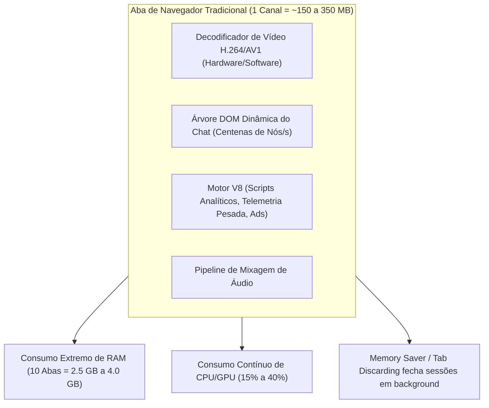
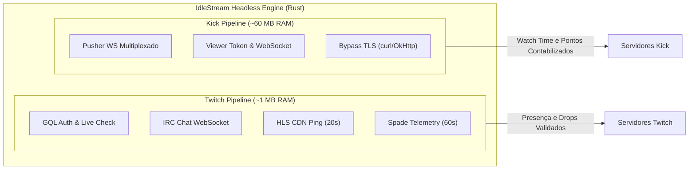
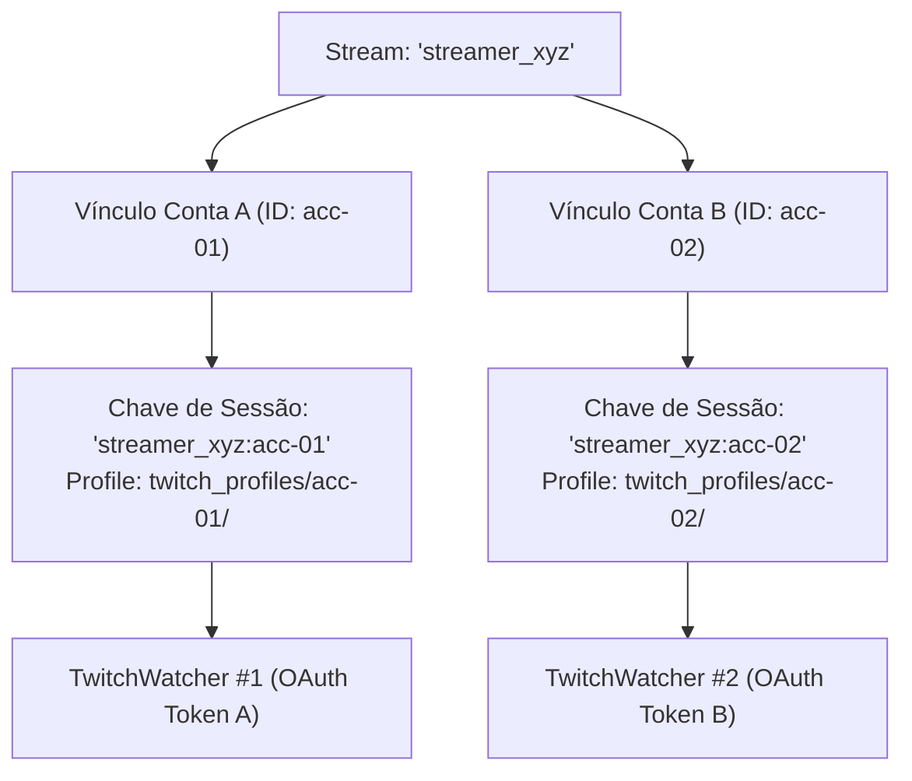
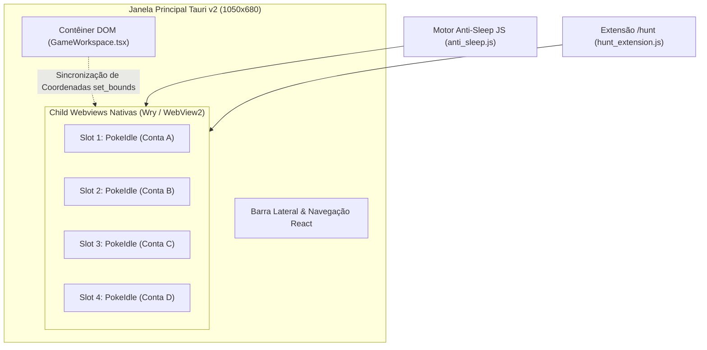
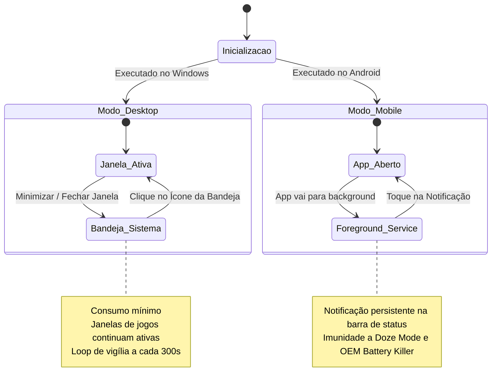

# Visão Geral, Conceito de Negócio e Casos de Uso

Este documento detalha os fundamentos de engenharia e as motivações operacionais que orientaram o desenvolvimento do **IdleStream** (também referenciado como **Chatter**). Aqui são expostos os gargalos críticos do ecossistema de streaming convencional, as decisões arquiteturais tomadas para superá-los e como o software resolve os desafios de farming 24/7 de recompensas e execução sustentada de *Idle Games*.

---

## 1. O Problema do Farming Tradicional de Streams

No cenário atual de transmissões ao vivo (Twitch, Kick e plataformas correlatas), criadores de conteúdo e desenvolvedores de jogos utilizam sistemas de recompensas temporais para engajamento da audiência:
- **Twitch Drops**: Recompensas em itens digitais obtidas acumulando tempo de visualização contínuo em categorias específicas.
- **Pontos de Canal (Twitch Channel Points)**: Moeda virtual acumulada a cada 5 a 15 minutos de live assistida, potencializada por bônus manuais periódicos (baús de +50 pontos).
- **Kick Channel Points & Watch Time**: Sistema análogo de telemetria e pontuação em canais parceiros e afiliados na plataforma Kick.

### O Custo Proibitivo dos Navegadores Tradicionais

Para manter presença simultânea em múltiplos streamers favoritos (ou gerenciar várias contas simultaneamente), a abordagem clássica consiste em abrir dezenas de abas em navegadores como Google Chrome, Brave ou Microsoft Edge.

Essa prática impõe custos computacionais severos decorrentes da pilha de renderização completa de um navegador moderno:

#### Fatores de Degradação:
1. **Decodificação Contínua de Vídeo**: Mesmo minimizada ou em qualidade 160p, o player HTML5 (`<video>`) consome ciclos de GPU e CPU para decodificar frames, alocar buffers de texturas e sincronizar frames de áudio.
2. **Sobrecarga de Renderização do Chat (DOM Bloat)**: Em canais com mais de 5.000 espectadores, o chat gera entre 50 e 200 mensagens por segundo. A constante mutação de nós na árvore DOM consome centenas de megabytes de memória heap.
3. **Mecanismo de Descarte Agressivo (*Tab Discarding*)**: A partir do Chrome 108+, as abas mantidas em segundo plano entram em estado de hibernação forçada pelo gerenciador de memória do sistema operacional, interrompendo a telemetria e pausando a contagem de pontos.
4. **Isolamento de Contas Deficiente**: O Chromium exige o chaveamento manual de perfis de usuário (*User Profiles*) ou janelas anônimas descartáveis para rodar mais de uma conta Twitch/Kick na mesma máquina.

---

## 2. A Solução IdleStream: Abordagem *Headless Native Watcher*

O **IdleStream** elimina integralmente a necessidade de um navegador web aberto para a manutenção de presença em transmissões ao vivo. O software substitui o renderizador visual por um conjunto de clientes de protocolo nativos implementados em Rust.

### 2.1 Subsistema Twitch: Consumo de ~1 MB por Canal
Na Twitch, o sistema não faz download do stream de vídeo HLS nem compila o CSS/HTML da página. A presença e os drops são mantidos através de uma coreografia de 4 canais de rede:
- **Twitch IRC (`wss://irc-ws.chat.twitch.tv:443`)**: Mantém a presença da conta na sala de bate-papo via protocolo IRC autenticado (`PASS oauth:...`).
- **GraphQL (`https://gql.twitch.tv/gql`)**: Consulta metadados, status de transmissão e verifica a disponibilidade de baús de bônus (`claim_community_points`).
- **Ping CDN HLS (Usher Playlist)**: Requisição leve a cada 20 segundos para a playlist de manifesto da live, atestando consumo ativo de pacotes para o balanceador da Twitch.
- **Spade Telemetry (`https://spade.twitch.tv/track`)**: Disparo a cada 60 segundos do evento autenticado `minute-watched` codificado em Base64, computando drops e presença ativa.

> [!TIP]
> **Consumo Operacional**: Um único processo de Twitch Watcher consome **menos de 1 megabyte de memória RAM** e praticamente **0.0% de CPU**. Manter 10 lives monitoradas consome cerca de 10 MB de memória global.

### 2.2 Subsistema Kick: Consumo de ~60 MB por Canal
Na plataforma Kick, a validação de tempo assistido requer conexão com o cluster de websockets de visualizadores:
- **Pusher WebSocket (`wss://ws-us2.pusher.com`)**: O IdleStream conecta-se a uma única sessão multiplexada por conta, subscrevendo dinamicamente até 16 chatrooms na mesma conexão TCP.
- **Viewer WebSocket (`wss://websockets.kick.com/viewer/v1/connect`)**: Realiza handshake periódico com token efêmero de sessão, emitindo a cada 10 segundos o evento `tracking.user.watch.livestream`.
- **Bypass de TLS / Cloudflare**: Emprega chamadas diretas ao utilitário `curl.exe` no Windows (ou via OkHttp nativo no Android), evitando o fingerprinting JA3/JA4 do Cloudflare que bloqueia clientes HTTP padrão em Rust.

---

## 3. Comparativo de Arquitetura & Benchmarks de Consumo

Com base nas baterias de testes executadas no script `scripts/benchmark-performance.ts`, a tabela a seguir contrasta o consumo de recursos entre navegadores convencionais e a arquitetura do IdleStream:

| Métrica / Ambiente | Google Chrome (Padrão) | Electron Convencional | IdleDeck (Chromium Multi) | IdleStream (Tauri v2 Otimizado) |
| :--- | :--- | :--- | :--- | :--- |
| **RAM por Stream Twitch** | ~180 MB | ~140 MB | ~100 MB | **~1 MB (Headless Nativo)** |
| **RAM por Stream Kick** | ~220 MB | ~160 MB | ~120 MB | **~60 MB (Viewer WS)** |
| **RAM para 4 Slots PokeIdle** | ~900 MB | ~720 MB | ~525 MB | **~230 MB (-74.4%)** |
| **Uso de GPU** | 80 a 140 MB (Processo Isolado) | 70 a 110 MB | 60 a 85 MB | **0 MB (Modo In-Process GPU)** |
| **Overhead de Host / Framework** | ~140 MB | ~90 MB | ~60 MB | **~40 MB (Rust Tokio Host)** |
| **Impacto de CPU Médio** | 12% a 30% | 10% a 25% | 8% a 18% | **< 1.5%** |
| **Resiliência a Tab Discarding** | Nenhuma (requer extensões) | Moderada | Moderada | **100% Imune (Anti-Sleep Nativo)** |

---

## 4. Segregação e Gestão de Múltiplas Contas Concorrentes

O IdleStream foi arquitetado com separação estrita de contextos multi-inquilino (*multi-tenant* local). Uma mesma transmissão pode ser vinculada simultaneamente a duas ou mais contas diferentes (por exemplo, `Conta Principal` e `Conta Smurf`).

### Princípios da Segregação:
1. **Chaves Compostas de Sessão (`"streamId:accountId"`)**: No mapa de estado do Rust (`AppState.twitch_watchers` e `AppState.kick_watchers`), as sessões operam com chaves compostas. Isso impede que o encerramento ou reconexão de uma conta interfira nas demais contas associadas à mesma live.
2. **Isolamento de Armazenamento e Cookies em Disco**:
   - Cada conta possui diretório próprio de armazenamento (`twitch_profiles/{account_id}` e `kick_profiles/{account_id}`).
   - Cookies de autenticação (`auth-token`, `unique_id`, `kick_session`, `session_token`) nunca são compartilhados entre sessões.
3. **Coordenador de Prioridade Twitch (Regra dos 2 Slots)**:
   - A Twitch impõe internamente uma restrição de telemetria: uma única conta assistindo a mais de 2 canais simultaneamente tem seus pontos e drops invalidados em canais adicionais.
   - O `AccountPriorityCoordinator` do IdleStream calcula automaticamente o ranking histórico dos canais cadastrados com base nas horas médias de VOD (`avg_duration_hours`).
   - Apenas os **2 canais online com maior probabilidade de tempo em live** entram em estado `ActiveMining`. Os demais permanecem em `StandbyVigil`, sendo promovidos instantaneamente se um dos canais principais encerrar a transmissão.

---

## 5. Hub Multi-Slot de Jogos Ociosos (*Idle Games*)

Além do gerenciamento de streams, o IdleStream incorpora um ambiente de execução multi-instância para jogos baseados na web (com suporte completo e especializado para **PokeIdle**).

### Desafios de Execução de Idle Games em Navegadores:
- **Queda de FPS em Background**: O Chromium desacelera chamadas de `requestAnimationFrame` de 60 FPS para 1 FPS (ou 0 FPS) quando a aba perde foco ou a janela é minimizada.
- **Congelamento de Timers de Jogo**: `setInterval` e `setTimeout` sofrem *throttling* forçado para intervalos de até 1000ms.
- **Descarte de Memória**: O garbage collector do navegador descarrega texturas WebGL e estruturas de dados do jogo para liberar RAM.

### A Solução do IdleStream:
1. **Child Webviews Independentes**: Cada slot opera em uma instância de Webview nativa (`wry`), possuindo seu próprio contexto de JavaScript e processo de renderização.
2. **Motor Anti-Sleep Proprietário (`anti_sleep.js`)**:
   - Sobrescreve `document.hidden` para retornar sempre `false` e `document.visibilityState` para `'visible'`.
   - Intercepta eventos `blur` e `focusout`, forçando o jogo a agir como se estivesse com foco ativo contínuo.
   - Substitui o `requestAnimationFrame` por um loop baseado em `setInterval(8ms)`, garantindo execução contínua em 60, 30 ou 10 FPS mesmo com a janela oculta na bandeja do sistema.
   - Emite áudio silencioso via oscilador Web Audio, acionando a flag `IsAudible` do Chromium que impede o sistema operacional de suspender o processo.
3. **Extensão `/hunt` Embutida**:
   - Injeta automaticamente a suíte de automação `/hunt` com tabelas de fraquezas elementais, movesets e otimização de batalha do PokeIdle.

---

## 6. Modos Operacionais & Casos de Uso

### Caso de Uso 1: Execução Contínua Desktop 24/7 (Modo Bandeja)
- O usuário adiciona de 5 a 15 streamers favoritos na Twitch e Kick, vinculando uma ou mais contas.
- Ao clicar no botão fechar `[X]` da janela, o IdleStream intercepta o evento (`WindowEvent::CloseRequested`) e oculta a janela na bandeja do sistema (*System Tray*).
- O loop de vigília analisa em segundo plano a cada 300 segundos quais canais estão online.
- As transmissões offline permanecem em consumo zero; canais ao vivo acumulam drops e pontos silenciosamente sem exibir vídeo ou emitir ruído.

### Caso de Uso 2: Execução Mobile Android 24/7 (Modo Notificação)
- O usuário executa o aplicativo em um smartphone Android.
- Ao alternar para outro aplicativo ou bloquear a tela, o `IdleStreamForegroundService` assume a execução com uma notificação persistente atualizada dinamicamente com o saldo de pontos e quantidade de lives ativas.
- O sistema solicita isenção das otimizações agressivas de bateria das fabricantes OEM (*Doze mode*), garantindo que a conexão WebSocket com Twitch e Kick permaneça aberta ininterruptamente.

### Caso de Uso 3: Votação Diária em 4 Contas no TopIdle (Desktop e Android)
- Na seção **Votos** (logo abaixo de **Idle Games**), o usuário visualiza o status de suas 4 contas (`GGB2006`, `GGB2006_2`, `GGB2006_3`, `GGB2006_4`) pré-vinculadas aos perfis Google do `Idle Games`.
- Somente ao clicar para votar, o IdleStream abre uma WebView restrita ao `topidle.com` (+ login Google e CAPTCHA interativo), destruindo-a completamente ao sair (0 MB em repouso).
- Exatamente após **24h 01m** (`86.460s`) do último voto, um alerta de sistema (Toast Windows / AlarmManager Android) notifica o jogador para votar novamente.

---

## 7. Próximos Passos & Documentos Relacionados

Para compreender como a infraestrutura técnica do Tauri v2, o barramento IPC e as chamadas assíncronas do Rust operam em nível de baixo nível:
👉 Prossiga para: **[[01-arquitetura]] — Arquitetura Geral do Sistema e Barramento IPC**.
