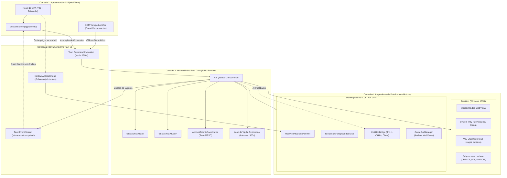
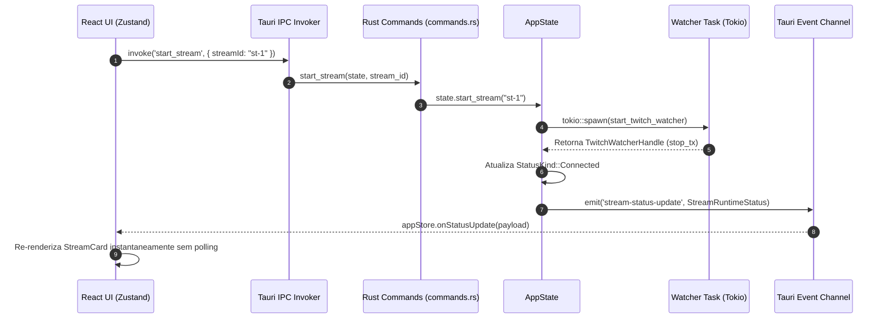

# Arquitetura de Sistemas, Modelo de Concorrência e Barramento IPC

Este documento expõe detalhadamente a topologia de engenharia de software do **IdleStream**, o ciclo de vida dos processos nativos e web, o modelo de memória compartilhada assíncrona em Rust e o protocolo de comunicação bidirecional entre o frontend React 19 e o backend nativo.

---

## 1. Topologia de Camadas (Visão C4 / Arquitetura em Blocos)

O IdleStream é estruturado em uma arquitetura desacoplada de 4 camadas:



### Divisão de Responsabilidades:
1. **Camada 1 (Frontend)**: Renderiza componentes reativos puros. Não calcula heurísticas de tempo de stream nem decodifica streams de rede; apenas reflete o estado empurrado pelo backend e despacha intenções do usuário.
2. **Camada 2 (Barramento IPC)**: Serializa e desserializa comandos via `serde` com tipagem forte. Em mobile, desvia rotas de sistema para a interface injetada `AndroidBridge`.
3. **Camada 3 (Rust Core)**: Centraliza a verdade absoluta da aplicação. Utiliza primitivas assíncronas do Tokio para orquestrar dezenas de tarefas de rede com alocação nula de threads bloqueantes.
4. **Camada 4 (Plataformas)**: Abstrai as diferenças de SO: chamadas Win32 e WebView2 no Windows vs ciclo de vida de Activities e JNI no Android.

---

## 2. Ciclo de Inicialização do Aplicativo (`main.rs` & `lib.rs`)

O ponto de entrada de baixo nível da aplicação executa uma série de configurações de baixo nível antes de instanciar a interface gráfica:

```mermaid
sequenceDiagram
    autonumber
    participant OS as Sistema Operacional
    participant Main as main.rs / lib.rs
    participant Env as Variáveis de Ambiente
    participant Panic as Panic Hook
    participant Builder as Tauri Builder
    participant AppState as AppState::new()
    participant Loop as Vigilance Loop

    OS->>Main: Executa binário idlestream.exe
    critical Configuração de Flags WebView2
        Main->>Env: Seta WEBVIEW2_ADDITIONAL_BROWSER_ARGUMENTS
    end
    critical Tratamento de Pânico
        Main->>Panic: Registra std::panic::set_hook (Log em stderr / panic.log)
    end
    Main->>Builder: tauri::Builder::default()
    Builder->>Builder: Registra Plugins (Opener, Updater)
    Builder->>Builder: Configura WindowEvent::CloseRequested (Minimizar na Tray)
    Builder->>AppState: Instancia Arc<AppState> e carrega config.json
    Builder->>Loop: Dispara app_state.start_vigilance_loop()
    Builder->>Main: Dispara auto_start de streams marcadas (Delay 1500ms)
    Main->>OS: Abre Janela Principal (1050x680 centralizada)
```

### 2.1 Flags Especiais do WebView2 (Windows Anti-Sleep & Resiliência)
Em `src-tauri/src/lib.rs`, antes da inicialização do WebView2 no Windows, a variável de ambiente `WEBVIEW2_ADDITIONAL_BROWSER_ARGUMENTS` é configurada com diretivas estritas de motor Chromium:

```rust
std::env::set_var(
    "WEBVIEW2_ADDITIONAL_BROWSER_ARGUMENTS",
    "--disable-background-timer-throttling \
     --disable-renderer-backgrounding \
     --disable-backgrounding-occluded-windows \
     --disable-gpu-watchdog \
     --disable-features=CalculateNativeWinOcclusion,SpareRendererForSitePerProcess,TranslateUI,MediaRouter,AutofillServerCommunication \
     --enable-features=SharedArrayBuffer \
     --renderer-process-limit=6 \
     --disable-extensions \
     --disable-default-apps \
     --no-default-browser-check \
     --js-flags=\"--max-old-space-size=512 --optimize-for-size --expose-gc\""
);
```

#### Finalidade das Flags:
- `--disable-background-timer-throttling`: Impede que o Chromium limite a execução de `setInterval` e `setTimeout` a 1 tick/segundo quando a janela perde o foco.
- `--disable-renderer-backgrounding` & `--disable-backgrounding-occluded-windows`: Garante que o processo de renderização não tenha prioridade rebaixada pelo escalonador do Windows quando a janela é coberta por outros programas.
- `--disable-gpu-watchdog`: Previne crashes da janela causados por *DirectX Device Removed* transitórios durante suspensão de monitores.
- `--renderer-process-limit=6`: Limita o teto de processos de renderização paralelos, reduzindo fragmentação de memória com 4 slots de jogos abertos.
- `--js-flags="--max-old-space-size=512 --optimize-for-size --expose-gc"`: Restringe o heap do motor V8 a 512 MB por contexto, força empacotamento agressivo de ponteiros e habilita a API nativa `window.gc()` chamada periodicamente pelo script anti-sleep.

### 2.2 Interceptação de Fechamento de Janela (*Close-to-Tray*)
Em plataformas Desktop, o evento `WindowEvent::CloseRequested` da janela principal `"main"` é interceptado:
- Se `settings.minimize_to_tray == true`: Cancela o fechamento (`api.prevent_close()`), oculta a janela (`window.hide()`) e chama `game_layout_manager.hide_all_game_views()` para que as Child Webviews não continuem renderizando pixels na tela fantasma (permanecendo vivas na memória).
- Se `settings.minimize_to_tray == false`: Executa `std::process::exit(0)`, finalizando o processo de forma limpa.

---

## 3. Gerenciamento de Estado Concorrente (`AppState`)

O núcleo de estado da aplicação reside em `src-tauri/src/state.rs`. Todo o runtime compartilha uma única instância de `AppState` empacotada em um ponteiro atômico `Arc<AppState>`:

```rust
pub struct AppState {
    pub config: Mutex<AppConfig>,
    pub config_store: ConfigStore,
    pub twitch_sessions: Mutex<HashMap<String, TwitchSession>>,
    pub twitch_watchers: Mutex<HashMap<String, TwitchWatcherHandle>>,
    pub twitch_coordinator: AccountPriorityCoordinator,
    pub kick_watchers: Mutex<HashMap<String, KickWatcherHandle>>,
    pub statuses: Mutex<HashMap<String, StreamRuntimeStatus>>,
    pub http_client: reqwest::Client,
    pub app_handle: AppHandle,
}
```

### Análise dos Componentes de Estado:
1. **`config: Mutex<AppConfig>`**: Guarda a árvore de configurações persistida em disco (`config.json`), incluindo contas registradas, streams cadastradas, preferências globais e slots de jogo. O acesso assíncrono é protegido por um `tokio::sync::Mutex` para evitar concorrência descontrolada durante gravações do frontend.
2. **`twitch_watchers` & `kick_watchers`**: Mapas indexados por chaves compostas de sessão:
   $$\text{Chave de Sessão} = \texttt{"<streamId>:<accountId>"}$$
   Isso permite que a mesma transmissão tenha watchers independentes rodando sob tokens e contas diferentes sem colisão no hash map.
3. **`statuses: Mutex<HashMap<String, StreamRuntimeStatus>>`**: Tabela em memória com o status em tempo real de cada stream cadastrada (tempo online, pontos atuais, estimativa de RAM, mensagem descritiva de erro ou fila).
4. **`twitch_coordinator: AccountPriorityCoordinator`**: Orquestrador thread-safe que mantém canais de comunicação `mpsc::UnboundedSender` com os watchers Twitch ativos para re-priorização de slots em tempo real.

---

## 4. Protocolo IPC e Eventos Reativos

A comunicação entre a interface do usuário e o Rust Core é 100% orientada a eventos assíncronos e comandos remotos serializados com `serde_json`.



### 4.1 Catálogo do Evento `stream-status-update`
- **Nome do Evento**: `stream-status-update`
- **Origem**: Rust (`AppState::emit_status`)
- **Destino**: Frontend (`window.__TAURI__.event.listen('stream-status-update', ...)`)
- **Frequência**: Disparado imediatamente após qualquer transição de estado:
  - Detecção de streamer entrando online ou ficando offline.
  - Incremento ou resgate de Pontos de Canal / Baús de bônus.
  - Repriorização de slots (`ActiveMining` $\leftrightarrow$ `StandbyVigil`).
  - Ocorrência de erros de rede ou expiração de token.

#### Formato do Payload JSON (`StreamRuntimeStatus`):
```json
{
  "stream_id": "stream-1731000000000",
  "status": "connected",
  "is_live": true,
  "message": "Minerando pontos (Prioridade #1 • Média: 8.5h)",
  "uptime_seconds": 1420,
  "estimated_ram_mb": 1,
  "connected_at": "2026-11-07T19:30:00Z",
  "channel_points": "145.250",
  "account_points": {
    "acc-twitch-principal": "145.250",
    "acc-twitch-smurf": "82.100"
  }
}
```

#### Tabela de Estados Possíveis (`StatusKind`):
| Enum Rust | String Serializada | Significado Técnico | Comportamento na UI |
| :--- | :--- | :--- | :--- |
| `StatusKind::Disconnected` | `"disconnected"` | Stream parada pelo usuário. Sem conexões ativas. | Badge cinza, botão "Iniciar" disponível. |
| `StatusKind::Connecting` | `"connecting"` | Estabelecendo handshake WebSocket ou validando GQL. | Badge azul pulsante. |
| `StatusKind::Connected` | `"connected"` | Presença confirmada, telemetria Spade ou Pusher ativa. | Badge verde, indicador "LIVE", uptime ativo. |
| `StatusKind::Standby` | `"standby"` | Canal offline ou aguardando vaga na fila de prioridade. | Badge âmbar "Vigília", consumo 0 MB. |
| `StatusKind::Error` | `"error"` | Falha de autenticação, rate limit (429) ou erro de rede. | Badge vermelho com tooltip descritivo do erro. |

---

## 5. Ponte de Comunicação Mobile (AndroidBridge & JNI)

No ambiente Android, a arquitetura adapta-se às particularidades do sistema operacional móvel através de duas pontes complementares:

```mermaid
flowchart LR
    subgraph Frontend_JS ["Frontend JavaScript (React)"]
        UI_Code["Código React / Zustand"]
        JS_Bridge["window.AndroidBridge"]
    end

    subgraph Android_Kotlin ["Android Runtime (Kotlin)"]
        MainAct["MainActivity.kt"]
        FgSvc["IdleStreamForegroundService.kt"]
        HttpBridge["KickHttpBridge.kt"]
    end

    subgraph Rust_Native ["Rust Core (cdylib aarch64)"]
        RustHttp["kick/http.rs"]
        RustState["AppState (emit_status)"]
    end

    UI_Code -->|Se window.AndroidBridge != null| JS_Bridge
    JS_Bridge -->|@JavascriptInterface| MainAct
    MainAct --> FgSvc
    RustState -->|update_android_notification| RustHttp
    RustHttp -->|JNI Call JavaVM| HttpBridge
    HttpBridge -->|OkHttp HTTP Request| KickServers[Servidores Kick / API]
```

### 5.1 Interface JavaScript Injetada (`window.AndroidBridge`)
Exposta pela classe `MainActivity.kt` através da anotação `@JavascriptInterface`, permitindo que o frontend invoque capacidades nativas do Android que não passam pelo barramento padrão do Tauri:
- `isBatteryOptimizationIgnored()`: Verifica se o app possui permissão especial para ignorar o *Doze Mode*.
- `requestIgnoreBatteryOptimization()`: Abre o diálogo do sistema Android para solicitar isenção de economia de bateria.
- `startForegroundService()` & `stopForegroundService()`: Controla o serviço de segundo plano com notificação persistente.
- `updateNotification(title, text)`: Atualiza em tempo real o texto da notificação com o total de pontos acumulados.
- `openTwitchLogin(accountId, label)` & `openKickLogin(accountId, label)`: Abre WebViews isoladas para autenticação OAuth sem expor credenciais na tela principal.

### 5.2 Interoperabilidade JNI Rust $\leftrightarrow$ Kotlin (`KickHttpBridge.kt` / `kick/http.rs`)
Para contornar o bloqueio de TLS Fingerprint (Cloudflare JA3/JA4) que rejeita clientes HTTP nativos compilados em Rust no Android, o Rust delega as requisições à pilha OkHttp nativa do Android:
1. Durante a inicialização do Android, `KickHttpBridge.kt` chama a função C exportada `Java_com_idlestream_app_KickHttpBridge_registerNativeBridge`.
2. O Rust salva referências globais da JavaVM (`static JVM: OnceLock<JavaVM>`) e da classe Java (`static BRIDGE_CLASS: OnceLock<GlobalRef>`).
3. Quando o watcher da Kick precisa fazer requisições na API, o código em `kick/http.rs` anexa a thread atual à JVM (`jvm.attach_current_thread()`) e executa o método estático `KickHttpBridge.request(...)`.
4. O OkHttp nativo do Android executa a chamada com as cifras TLS legítimas do sistema operacional e devolve o status code e corpo da resposta para o Rust.

---

## 6. Próximos Passos & Documentos Relacionados

Para compreender a engenharia detalhada dos protocolos de chat IRC, queries GraphQL e telemetria de pontos da Twitch:
👉 Prossiga para: **[[02-twitch-engine]] — Twitch Engine (IRC, GQL, Spade & Multi-Account Coordinator)**.
