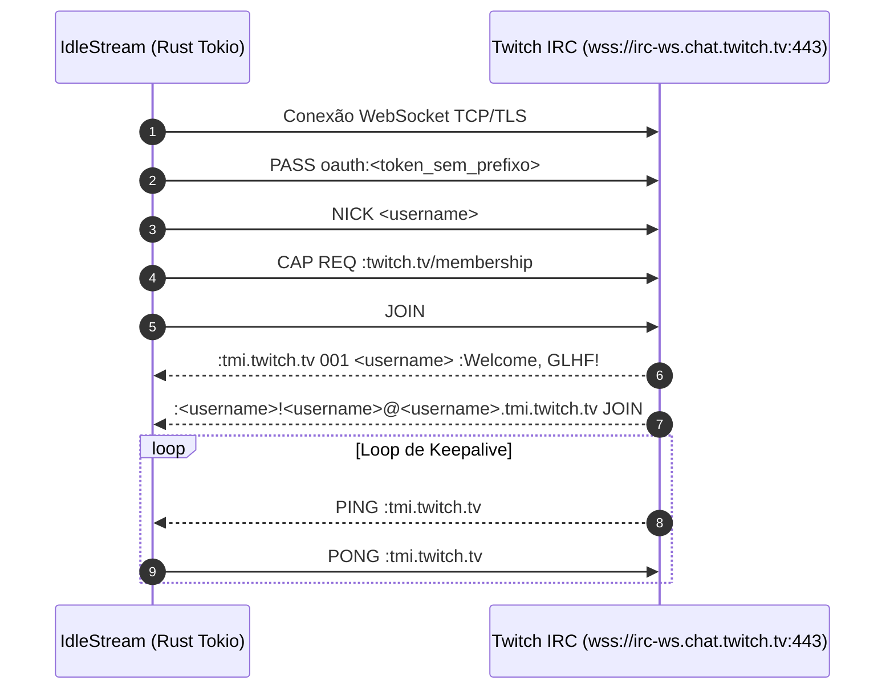
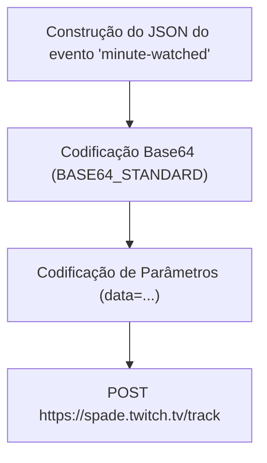
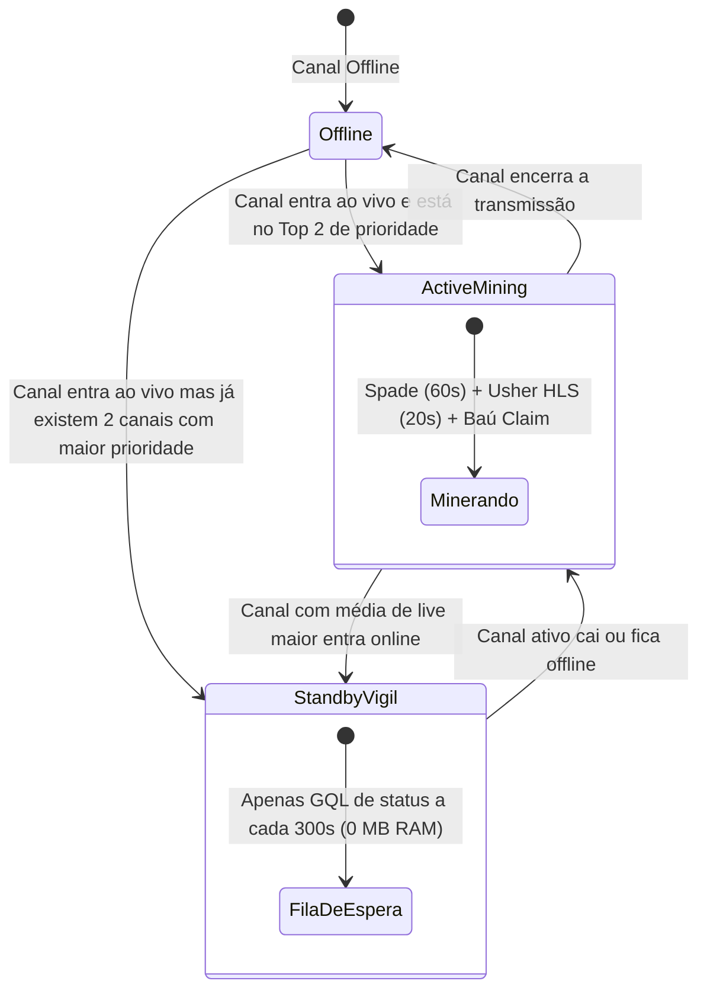
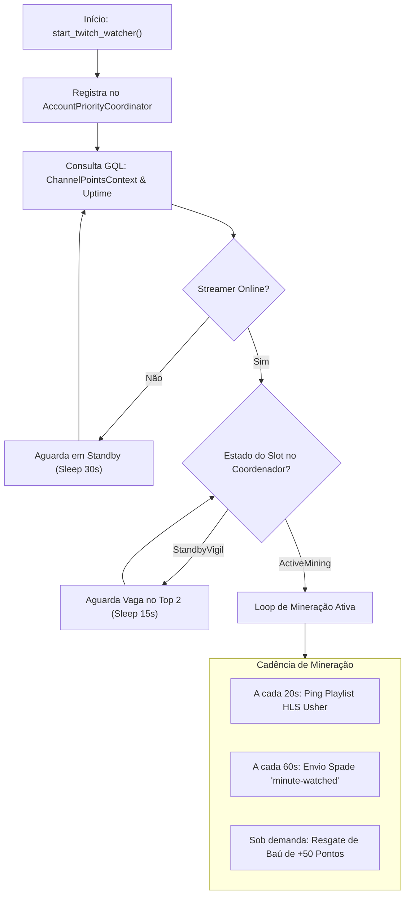

# Subsistema Twitch: IRC, GQL, Telemetria Spade e Coordenador Multi-Conta

Este documento descreve exaustivamente o subsistema Twitch do **IdleStream**, cobrindo os protocolos de rede, fluxos de autenticação, mecanismos anti-bot, automação de bônus e o algoritmo de balanceamento de contas concorrentes.

---

## 1. Protocolo IRC WebSocket Ultraleve (`twitch/irc.rs`)

O IdleStream conecta-se ao cluster de chat oficial da Twitch عبر WebSocket seguro (`wss://irc-ws.chat.twitch.tv:443`). O objetivo é estabelecer e manter presença legítima da conta no canal sem decodificar vídeo.



### 1.1 Otimização de Throughput: Isenção de Tags de Chat
Diferente de clientes de chat convencionais, o IdleStream envia exclusivamente a diretiva:
```text
CAP REQ :twitch.tv/membership
```
Ao omitir propositalmente `twitch.tv/tags` e `twitch.tv/commands`, os servidores da Twitch deixam de encaminhar o payload com metadados de cada mensagem enviada no chat (badges, cores, emotes, cheer bits). Em lives com centenas de milhares de mensagens diárias, isso reduz o tráfego de rede e o processamento de texto em mais de **99.8%**, prevenindo o acúmulo de heap e ciclos de CPU durante a execução noturna contínua.

### 1.2 Loop de Keepalive e Resiliência
- **Tratamento de PING**: O loop de leitura monitora mensagens que se iniciam com `PING`. Ao receber `PING :tmi.twitch.tv`, responde imediatamente com `PONG :tmi.twitch.tv\r\n`.
- **Detecção de Token Inválido**: Caso o servidor retorne `:Login authentication failed`, o estado é transicionado para `StatusKind::Error` e o watcher interrompe novas tentativas para não disparar banimento de IP.
- **Reconexão com Backoff**: Em quedas de socket TCP, o loop aguarda `config.reconnect_delay_secs` (padrão: 10 segundos) antes de reinstanciar a conexão.

---

## 2. Camada GraphQL (`twitch/gql.rs`) e Bypass Kasada

A comunicação de dados ricos (status de transmissão, saldo de pontos de canal e resgate de bônus) é realizada عبر chamadas POST para `https://gql.twitch.tv/gql`.

### 2.1 Matriz de Client IDs Oficiais Utilizados
Para contornar restrições da Twitch e contornar desafios de bot (*Kasada / Client-Integrity*), o IdleStream utiliza diferentes Client IDs conforme o propósito da chamada:

| Identificador | Client ID | Plataforma Emulada | Finalidade no IdleStream |
| :--- | :--- | :--- | :--- |
| `TWITCH_WEB_CLIENT_ID` | `kimne78kx3ncx6brgo4mv6wki5h1ko` | Twitch Web (Browser) | Consultas públicas de stream, headers Spade e VODs. |
| `TWITCH_ANDROID_CLIENT_ID` | `kd1unb4b3q4t58fwlpcbzcbnm76a8fp` | Aplicativo Android Oficial | **Bypass Kasada**: Resgate de baús e pontos de canal. |
| `TWITCH_SMARTTV_CLIENT_ID` | `ue6666qo983tsx6so1t0vnawi233wa` | Twitch SmartTV / LG | Fallback para consultas de uptime e metadados. |

### 2.2 Técnica de Bypass de Integridade Kasada
A Twitch exige tokens de integridade (`Client-Integrity`) para navegadores web ao chamar mutations críticas como `ClaimCommunityPoints`. No entanto, os aplicativos móveis oficiais da Twitch autenticam diretamente via TLS com Client ID Android sem gerar o desafio Kasada do browser.

O IdleStream explora essa interoperabilidade:
1. Executa a mutation GQL utilizando `TWITCH_ANDROID_CLIENT_ID`.
2. Define o cabeçalho `User-Agent: okhttp/4.12.0` e `X-Device-Id: <UUIDv4>`.
3. A mutation de resgate do baú (`ClaimCommunityPointsInput`) é aceita e processada sem bloqueios ou exigência de solve de captcha.

```json
{
  "operationName": "ClaimCommunityPoints",
  "variables": {
    "input": {
      "channelID": "12345678",
      "claimID": "01234567-89ab-cdef-0123-456789abcdef"
    }
  },
  "extensions": {
    "persistedQuery": {
      "version": 1,
      "sha256Hash": "d520919ad7100d01865573088e4ea11311752f60acb142987883fcba40b735a2"
    }
  }
}
```

### 2.3 Cálculo Preditivo de Uptime Médio (`fetch_streamer_uptime_avg`)
Para ordenar a prioridade dos streamers na fila de mineração, a função `fetch_streamer_uptime_avg` consulta a lista de gravações passadas (VODs) via GraphQL (`videos(first: 10, type: ARCHIVE)`):
$$\text{Média de Horas} = \frac{\sum_{i=1}^{N} \text{lengthSeconds}_i}{N \times 3600}$$
Essa métrica é arredondada para uma casa decimal e alimenta o algoritmo do coordenador.

---

## 3. Telemetria Spade (`twitch/spade.rs`)

O sistema **Spade** (`https://spade.twitch.tv/track`) é o serviço central de telemetria da Twitch que valida a audiência ativa. Sem o disparo correto desses beacons, a Twitch não pontua minutos assistidos para Drops nem para Pontos de Canal passivos.



### 3.1 Estrutura do Payload `minute-watched`
A cada 60 segundos de live ativa, o payload a seguir é montado e codificado em Base64:

```json
[
  {
    "event": "minute-watched",
    "properties": {
      "broadcast_id": "41234567890",
      "channel_id": "98765432",
      "channel": "streamer_slug",
      "client_time": 1731000000.123,
      "hidden": false,
      "is_live": true,
      "live": true,
      "logged_in": true,
      "minutes_logged": 1,
      "muted": false,
      "player": "site",
      "user_id": "11223344"
    }
  }
]
```

#### Requisitos Mandatórios do Cabeçalho HTTP:
- `Content-Type: application/x-www-form-urlencoded; charset=UTF-8`
- `Client-Id: kimne78kx3ncx6brgo4mv6wki5h1ko`
- `Authorization: OAuth <token>`
- `Cookie: auth-token=<token>`
- `Referer: https://www.twitch.tv/<channel_slug>`

O servidor Spade responde com HTTP `200 OK` ou `204 No Content`.

---

## 4. Coordenador Multi-Conta e Algoritmo de Prioridade (`twitch/coordinator.rs`)

### 4.1 A Regra de Negócio dos 2 Slots
A Twitch limita estritamente o cômputo simultâneo de watch-time:
> **Regra**: Cada conta Twitch só pode minerar pontos e progredir drops em no máximo **2 canais simultâneos** (`MAX_CONCURRENT_ACTIVE_SLOTS_PER_ACCOUNT = 2`). Abrir um 3º canal com a mesma conta resulta em telemetria rejeitada pelo Spade.

### 4.2 Máquina de Estados de Mineração
Cada streamer associado a uma conta transita entre três estados dinâmicos:



### 4.3 Reconciliação Reativa Instantânea
O coordenador mantém instâncias de canais `tokio::sync::mpsc::UnboundedSender<StreamerSlotNotification>`. Quando o loop de vigília ou um watcher detecta que um streamer ficou offline:
1. `reconcile_account_slots` reordena os streamers online pelo seu `priority_rank`.
2. Se um slot `ActiveMining` for liberado, o primeiro streamer da fila `StandbyVigil` recebe instantaneamente uma notificação عبر canal MPSC.
3. O watcher do canal promovido ativa imediatamente o loop de telemetria Spade e pings de CDN HLS sem exigir intervenção do usuário.

---

## 5. Loop do Watcher Nativo (`twitch/watcher.rs`)

O watcher opera em um loop assíncrono spawned pelo Tokio runtime:



### Ciclo Iterativo Detalhado:
1. **Passo 1 (Integridade)**: A cada 20 minutos, atualiza o token de integridade e valida se o OAuth token permanece autorizado.
2. **Passo 2 (CDN Usher Ping)**: A cada 20 segundos, requisita `https://usher.ttvnw.net/api/channel/hls/{channel}.m3u8`, mantendo ativa a sessão de tráfego de borda.
3. **Passo 3 (Spade Watch Time)**: A cada 60 segundos (3 iterações do ping Usher), envia o beacon `minute-watched` autenticado.
4. **Passo 4 (Auto-Claim de Baú)**: Se a query GQL retornar um `available_claim_id`, o watcher dispara a mutation de claim. Se o resgate via GQL for rejeitado por restrição de navegador, delega a tarefa para a automação WebView em background.

---

## 6. Automação WebView & Extração de Sessão (`twitch/webview.rs`)

Para facilitar o onboarding do usuário e fornecer redundância caso a API GraphQL sofra alterações:

### 6.1 Isolamento de Diretórios de Perfil
Cada conta possui seu próprio armazenamento persistente em disco:
```text
%LOCALAPPDATA%/com.idlestream.app/twitch_profiles/{account_id}/
```
Isso assegura que cookies de sessão, LocalStorage e caches do WebView2 fiquem completamente isolados.

### 6.2 Script Injetado de Auto-Claim (8 Seletores de Fallback)
Quando uma janela de resgate ou claim em background é instanciada, o seguinte script é injetado via inicialização do WebView:

```javascript
const selectors = [
    'button[aria-label="Claim Bonus"]',
    'button[aria-label="Resgatar bônus"]',
    'button[aria-label*="Claim Bonus" i]',
    'button[aria-label*="Resgatar bônus" i]',
    '[data-test-selector="community-points-claim-summary"] button',
    '[data-test-selector="community-points-claim-summary"]',
    '.claimable-bonus__icon'
];
```
O script combina um polling a cada 2000ms com um `MutationObserver` no nó `document.body` com debounce de 400ms, assegurando que qualquer baú seja clicado no exato milissegundo em que renderizar na tela.

### 6.3 Janelas Headless Descartáveis de 25 Segundos
Se o claim de baú falhar via GQL:
- O Rust instancia uma janela WebView invisível (`visible: false`), apontando diretamente para `https://www.twitch.tv/popout/{slug}/chat`.
- O cookie `auth-token` da conta é injetado programaticamente.
- A janela carrega o chat oficial e o script de MutationObserver clica no baú.
- Um temporizador do Tokio encerra e destrói o processo do WebView2 após 25 segundos, liberando 100% da memória RAM alocada temporariamente.

---

## 7. Próximos Passos & Documentos Relacionados

Para compreender o subsistema de mineração da Kick, multiplexação de chatrooms via Pusher e o bypass de TLS Cloudflare:
👉 Prossiga para: **[[03-kick-engine]] — Subsistema Kick (Pusher WS, Viewer WS, TLS Bridge & WebViews)**.
