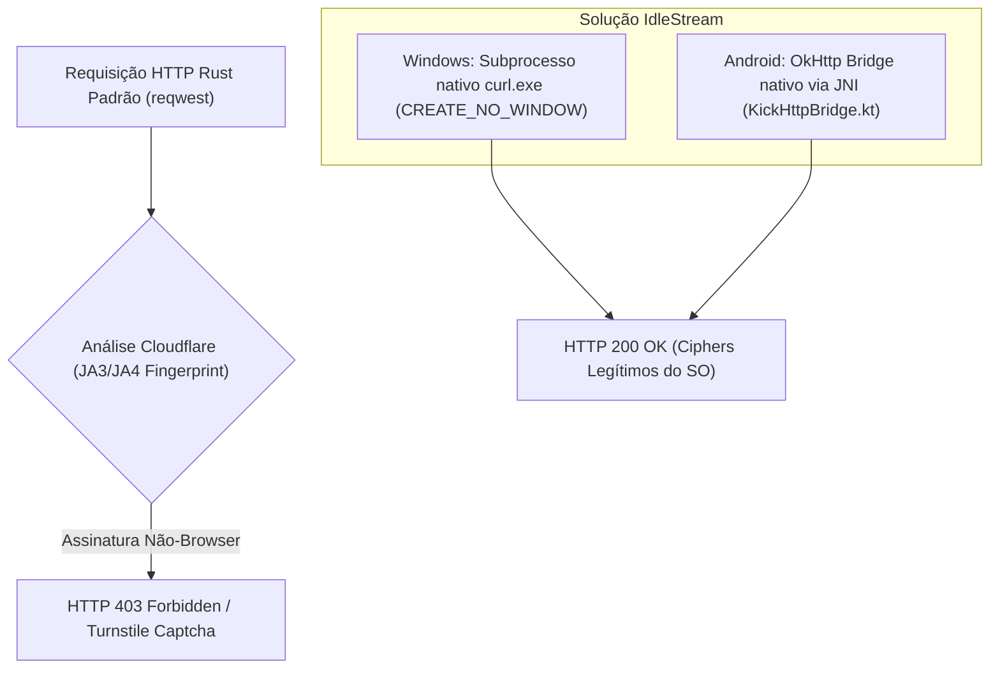
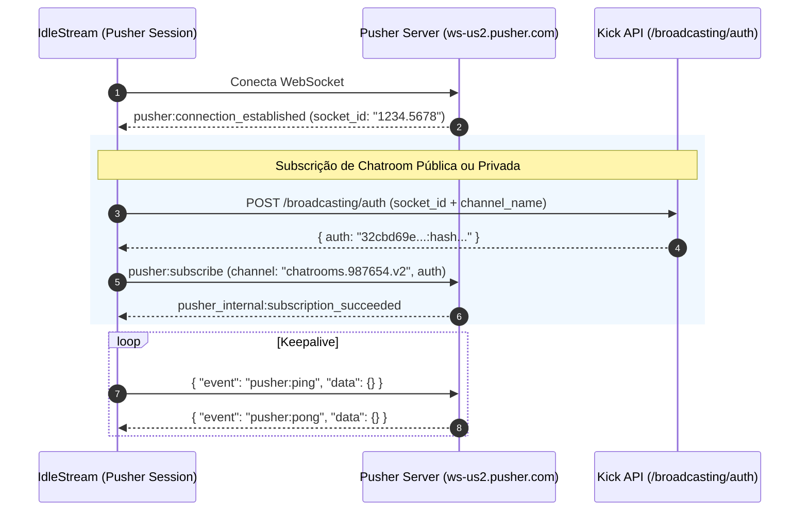
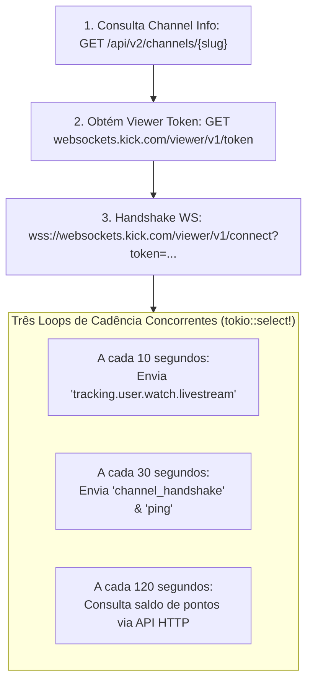

# Subsistema Kick: Pusher WS, Viewer WS, TLS Bridge e Autenticação

Este documento especifica detalhadamente a integração de engenharia reversa com a plataforma **Kick**, cobrindo o bypass de proteção Cloudflare em nível de TLS, a multiplexação de conexões WebSocket de chat e o protocolo de watch-time do cluster de visualizadores da Kick.

---

## 1. O Problema do Cloudflare JA3/JA4 TLS Fingerprint e a Solução Multiplataforma (`kick/http.rs`)

### 1.1 O Desafio de Segurança da Kick
Diferente da Twitch, que utiliza APIs abertas em GraphQL, toda a infraestrutura HTTP da Kick (`kick.com/api/v2/*`) é protegida por **Cloudflare Bot Management**.
- **O Bloqueio de Clientes Rust**: Bibliotecas HTTP padrão em Rust (como `reqwest` baseadas em `rustls` ou `native-tls`) possuem assinaturas de handshake TLS (ordem de ciphers, extensões TLS e parâmetros de curva elíptica) identificáveis como clientes não-navegador via hashes **JA3 / JA4**. Requisições feitas por essas bibliotecas resultam invariavelmente em **HTTP 403 Forbidden** ou redirecionamentos para captchas Cloudflare Turnstile.



### 1.2 Solução Desktop (Windows): Subprocesso `curl.exe`
No Windows 10 e 11, o binário nativo do sistema `curl.exe` utiliza a biblioteca OpenSSL/Schannel padrão do sistema operacional, sendo aceito sem restrições pelo Cloudflare.
Em `src-tauri/src/kick/http.rs`:
- Executa `curl.exe` em thread isolada via `tokio::task::spawn_blocking`.
- Utiliza a flag Win32 `cmd.creation_flags(0x08000000)` (`CREATE_NO_WINDOW`), garantindo que nenhuma janela de console DOS pisque na tela do usuário.
- Injeta o formatador `-w "\n<HTTP_STATUS>%{http_code}</HTTP_STATUS>"` para extrair com precisão cirúrgica o status code HTTP sem quebrar o parsing do corpo JSON da resposta.

### 1.3 Solução Mobile (Android): Ponte JNI para OkHttp Nativo
No Android, invocar subprocessos de shell é ineficiente e propenso a restrições de permissão SELinux.
- O Rust utiliza o módulo JNI (`jni::JNIEnv` e `static JVM: OnceLock<JavaVM>`).
- A chamada é redirecionada para a classe `com.idlestream.app.KickHttpBridge.request(...)`.
- O cliente **OkHttp 4.12** do runtime Android despacha a requisição HTTP com as cifras TLS oficiais do dispositivo móvel e retorna um envelope JSON estruturado:
```json
{
  "status": 200,
  "body": "{ ... payload kick ... }",
  "error": ""
}
```

---

## 2. Pusher WebSocket Multiplexado (`kick/pusher.rs`)

O chat e eventos públicos da Kick são distribuídos via **Pusher Channels**. O endpoint oficial utilizado é:
```text
wss://ws-us2.pusher.com/app/32cbd69e4b950bf97679?protocol=7&client=js&version=7.6.0&flash=false
```



### 2.1 Multiplexação de Múltiplos Canais em 1 Conexão TCP
Clientes amadores abrem uma nova conexão WebSocket para cada streamer monitorado. O IdleStream implementa a struct `KickAccountSession`:
- Uma **única conexão TCP/WebSocket** por conta Kick.
- Suporta gerenciar até **16 canais simultâneos** através de comandos assíncronos:
  - `SessionCommand::Subscribe(KickSub)`: Envia dinamicamente `pusher:subscribe` para a sala de chat do streamer adicionado.
  - `SessionCommand::Unsubscribe { stream_id, chatroom_id }`: Desinscreve o canal sem derrubar a conexão das demais lives.
- Reduz o consumo de sockets abertos no sistema operacional de 16 conexões para apenas 1.

### 2.2 Resolução de `chatroom_id`
A API da Kick organiza as mensagens de chat pelo ID interno do chatroom, e não pelo slug do streamer. A função `resolve_chatroom_id` realiza uma chamada autenticada para:
```text
GET https://kick.com/api/v2/channels/{slug}
```
Extraindo o campo numérico `json["chatroom"]["id"]` (ex: `987654`) para compor o nome do canal Pusher: `chatrooms.987654.v2`.

---

## 3. Viewer WebSocket & Contabilização de Pontos (`kick/watcher.rs`)

O chat do Pusher apenas confirma presença textual. Para acumular tempo de visualização (*Watch Time*) e gerar **Kick Channel Points**, a Kick exige uma conexão dedicada com o cluster de websockets de visualizadores:



### 3.1 Obtenção do Viewer Token
Para abrir o websocket de visualizador, o IdleStream envia uma requisição autenticada:
- **Endpoint**: `https://websockets.kick.com/viewer/v1/token`
- **Headers Mandatórios**:
  - `Authorization: Bearer <session_token>`
  - `X-Chatroom: <channel_id>`
  - `X-User-Id: <user_id>`
  - `X-Client-Token: e1393935a959b4020a4491574f6490129f678acdaa92760471263db43487f823`
  - `User-Agent: Mozilla/5.0... Chrome/120.0.0.0`
- O endpoint retorna uma string com o token efêmero de conexão.

### 3.2 O Handshake e o Triplo Loop Concorrente
Após conectar em `wss://websockets.kick.com/viewer/v1/connect?token={ws_token}`:

1. **Loop de 10 Segundos (Watch Telemetry)**:
   Dispara o beacon de visualização contínua:
   ```json
   {
     "type": "user_event",
     "data": {
       "message": {
         "event": "tracking.user.watch.livestream",
         "channel_id": 123456,
         "livestream_id": 987654
       }
     }
   }
   ```
2. **Loop de 30 Segundos (Keepalive & Handshake)**:
   Envia pacote `channel_handshake` e mensagem `{"type": "ping"}` para prevenir desconexão por inatividade pelo gateway de rede.
3. **Loop de 120 Segundos (Sync de Pontos do Canal)**:
   Requisita `GET /api/v2/channels/{slug}/points`, extrai o saldo numérico atualizado e atualiza a store reativa do IdleStream via `update_points`.

### 3.3 Coordenador de Prioridade Multi-Stream e Fila de Vigília Kick (`kick/coordinator.rs`)

Assim como a Twitch possui um coordenador para 2 vagas, a Kick agora conta com o `KickPriorityCoordinator`, respeitando o limite arquitetural da plataforma:

1. **Limite Estrito de 1 Vaga Ativa por Conta (`MAX_CONCURRENT_KICK_SLOTS_PER_ACCOUNT = 1`)**:
   Diferente da Twitch (que aceita 2 visualizações simultâneas contabilizando watch-time), a Kick rastreia estritamente **1 stream ativa por conta**. A tentativa de abrir múltiplos WebSockets de visualizadores em paralelo com a mesma conta acarreta:
   - Bloqueio imediato por **Rate-Limit HTTP 429** no endpoint de token (`/viewer/v1/token`).
   - Descarte silencioso (*silent drop*) do acúmulo de pontos no servidor.

2. **Cálculo de Prioridade pelo Tempo Médio Online**:
   - A função `fetch_kick_streamer_uptime_avg` consulta `GET /api/v2/channels/{slug}/videos` e converte o campo `"duration"` (em milissegundos) dos VODs recentes em horas médias de live.
   - O algoritmo `compute_kick_priority_ranks` ordena os streamers de forma decrescente: o streamer com maior histórico de horas online recebe o **Rank #1**.

3. **Fila Reativa Tokio MPSC (`MiningSlotState`)**:
   - **`ActiveMining`**: Apenas o streamer online de maior prioridade (Rank 1) recebe a vaga ativa de mineração, conectando o Viewer WebSocket e disparando o tracking a cada 10s.
   - **`StandbyVigil`**: Os demais canais online (ou offline) entram em modo vigília reativa com **0 MB de RAM e 0% de CPU**. Ao detectar democao, o WebSocket anterior é encerrado de forma graciosa.
   - **Promoção Dinâmica Instantânea**: Se o streamer Rank 1 encerrar a transmissão, o Coordenador envia instantaneamente uma notificação via MPSC promovendo o Rank 2 para `ActiveMining`, sem interrupção para o usuário.

---

## 4. WebView & Extração de Sessão (`kick/webview.rs`, `kick/auth.rs`)

Para efetuar login e capturar cookies da Kick sem exigir que o usuário copie e cole tokens complexos manualmente:

### 4.1 Janela de Login Dedicada
- O IdleStream abre uma janela WebView isolada apontando para `https://kick.com/login`.
- Os cookies e local storage são salvos no diretório exclusivo da conta:
  ```text
  %LOCALAPPDATA%/com.idlestream.app/kick_profiles/{account_id}/
  ```

### 4.2 Triagem e Captura de Cookies Críticos
A struct `KickCredentials` requer três valores essenciais:
1. `kick_session`: Cookie de sessão criptografado do framework Laravel.
2. `XSRF-TOKEN`: Token anti-CSRF para autorização de endpoints POST (`/broadcasting/auth`).
3. `session_token`: Bearer token JWT extraído do LocalStorage ou retornado após autenticação bem-sucedida, utilizado nas APIs de visualizador e pontos.

---

## 5. Tratamento de Rate Limits (HTTP 429) e Backoff

A Kick implementa políticas rígidas de limitação de taxa em seu cluster de API:
- Se uma requisição retornar **HTTP 429 Too Many Requests**, o watcher não repete a chamada imediatamente.
- O algoritmo de backoff exponencial eleva o intervalo de espera para $30\text{s} \to 60\text{s} \to 120\text{s} \to 180\text{s}$ (teto máximo).
- O status do canal na interface é atualizado para `StatusKind::Error` com a mensagem informativa:
  `"Rate limit Kick (429): aguardando 60s para reobter token..."`.
- Ao obter sucesso em uma conexão subsequente, o delay de retry é imediatamente resetado para o padrão de 5 segundos.

---

## 6. Próximos Passos & Documentos Relacionados

Para compreender o motor anti-suspensão do Chromium, a sincronização de layout das Child Webviews e o hub multi-instância de PokeIdle:
👉 Prossiga para: **[[04-games-engine]] — Game Workspace & Motor Anti-Sleep (Layouts, Injeção e Extensão /hunt)**.
