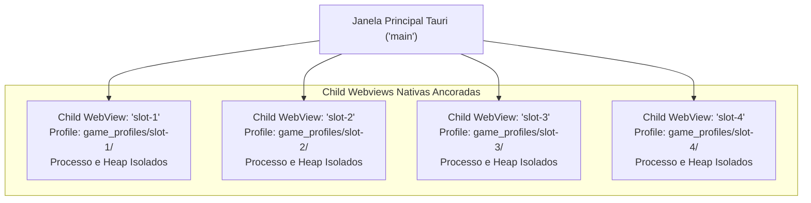
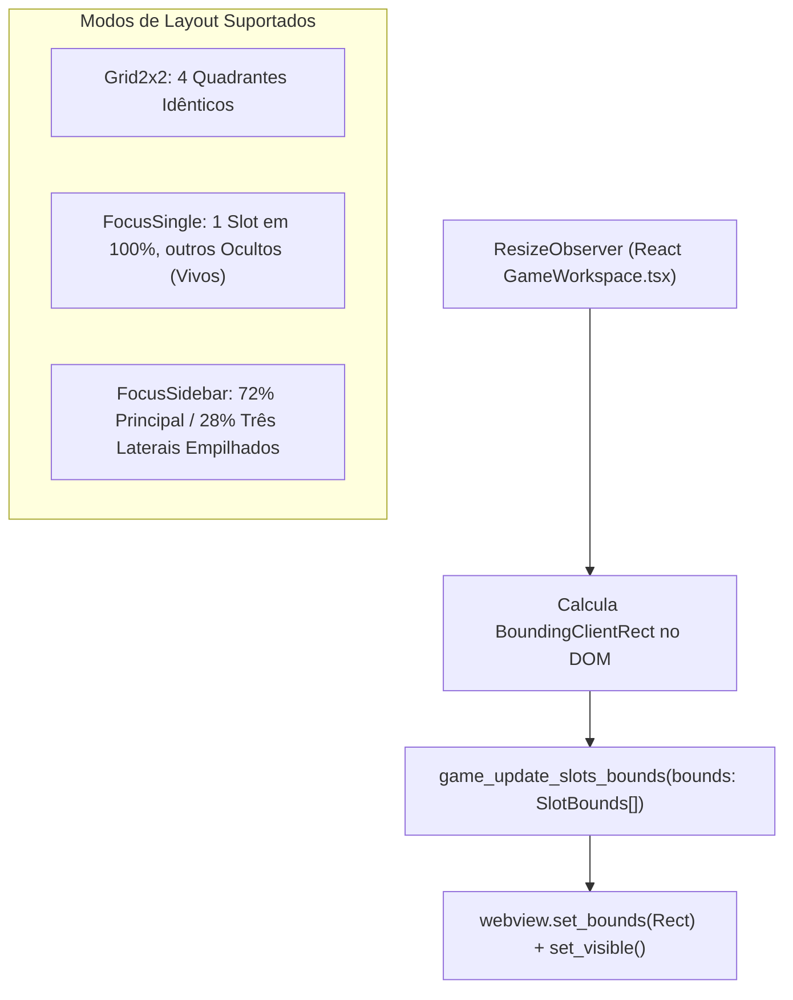
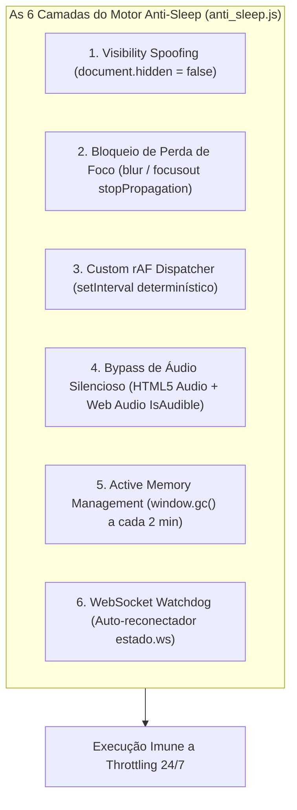
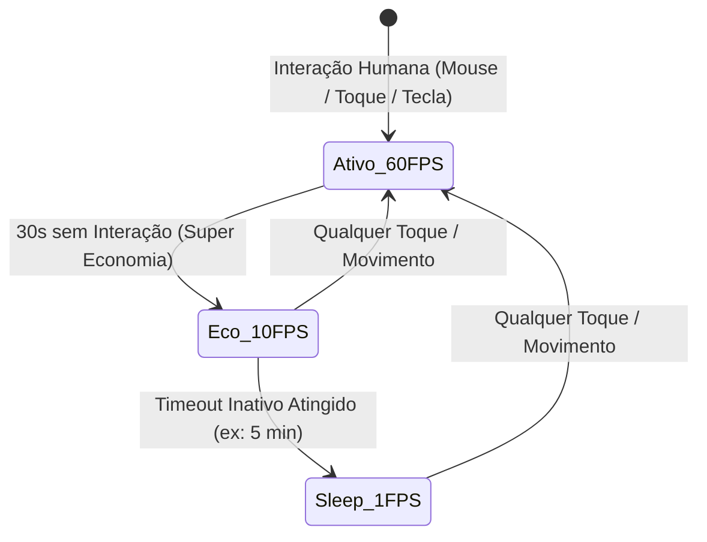

# Game Workspace e Motor Anti-Sleep (Child Webviews, Anti-Suspension & /hunt)

Este documento detalha a engenharia do **Game Workspace** do **IdleStream**, a gestão de instâncias concorrentes de jogos baseados na web (com foco primário no **PokeIdle**), a sincronização geométrica de layouts e o motor proprietário **Anti-Sleep** projetado para derrotar os mecanismos de suspensão e congelamento do Chromium / WebView2.

---

## 1. Arquitetura de Child Webviews Nativas (`games/manager.rs`)

Diferente de implementações baseadas em `<iframe>` — que compartilham a mesma thread de execução de JavaScript, memória heap e cookies do frontend —, o IdleStream utiliza **Child Webviews Nativas** via biblioteca `wry` do ecossistema Tauri v2.



### Vantagens Estruturais:
1. **Isolamento de Contas e LocalStorage**: Cada slot aponta para uma pasta independente em disco (`game_profiles/{slot_id}`). Um jogador pode rodar 4 contas de PokeIdle com sessões distintas sem risco de contaminação cruzada de save game ou credenciais.
2. **Estabilidade contra Falhas (Fault Isolation)**: Se uma instância travar ou sofrer *WebGL Context Lost*, as demais instâncias e a interface principal permanecem intactas.
3. **Imunidade a Cross-Origin Restrictions**: Não há bloqueios de CORS ou políticas de iframe (`X-Frame-Options: SAMEORIGIN`) impostas por servidores de jogos web.

---

## 2. Modos de Layout Geométrico e Sincronização DOM

O módulo `GameLayoutManager` gerencia as dimensões e o posicionamento de cada Child Webview sobre a viewport do aplicativo React:



### 2.1 Especificação dos Modos de Layout
- **`ViewLayoutMode::Grid2x2`**: Divide a área útil em 4 quadrantes regulares ($W/2 \times H/2$). Ideal para monitoramento equilibrado de 4 contas.
- **`ViewLayoutMode::FocusSingle(slot_id)`**: Maximiza o slot selecionado para 100% da área útil ($W \times H$). As outras 3 Webviews têm sua visibilidade alterada para `set_visible(false)`, mas **permanecem em execução contínua no background**, acumulando itens e XP.
- **`ViewLayoutMode::FocusSidebar(slot_id)`**:
  - Slot Principal: Alocado com $72\%$ da largura total ($0.72 \times W$) e $100\%$ da altura ($H$).
  - Slots Secundários (3): Empilhados verticalmente no quadrante lateral de $28\%$ da largura ($0.28 \times W$), cada um ocupando $1/3$ da altura ($H / 3$).

### 2.2 Sincronização de Coordenadas Nativo $\leftrightarrow$ DOM
Para evitar lacunas de pixel durante redimensionamento da janela:
1. O frontend React utiliza um `ResizeObserver` acoplado ao elemento DOM `#game-viewport-container`.
2. Ao detectar mutação de tamanho ou troca de aba, despacha via IPC o comando `game_update_slots_bounds` com um array de `SlotBounds`:
   ```json
   {
     "slot_id": "slot-1",
     "x": 260.0,
     "y": 48.0,
     "width": 790.0,
     "height": 632.0,
     "visible": true
   }
   ```
3. O Rust aplica instantaneamente `webview.set_bounds(Rect { position, size })` e ajusta a visibilidade via `webview.set_visible(bounds.visible)`. O benchmark de reposicionamento demonstra latência inferior a $0.001\text{ ms}$ (overhead nulo).

---

## 3. O Motor Anti-Sleep (`anti_sleep.js`)

Navegadores baseados em Chromium e o WebView2 implementam políticas agressivas para economizar recursos em janelas minimizadas ou sem foco:
- Desaceleração de timers (`setInterval`/`setTimeout`) para 1 execução por segundo.
- Congelamento completo do `requestAnimationFrame` (0 FPS).
- Descarte de abas e purga de texturas WebGL.

O IdleStream neutraliza essas restrições através do script injetado `anti_sleep.js`, composto por **6 camadas de defesa**:



### Detalhamento das Camadas:

#### Camada 1: Spoofing de Visibilidade
Sobrescreve os getters nativos do protótipo do documento para que qualquer engine de jogo web acredite estar em primeiro plano contínuo:
```javascript
Object.defineProperty(document, 'hidden', { get: () => false, configurable: true });
Object.defineProperty(document, 'visibilityState', { get: () => 'visible', configurable: true });
```

#### Camada 2: Interceptação de Perda de Foco
Impede a propagação de eventos `blur` e `focusout` na fase de captura:
```javascript
const stopPropagation = (e) => e.stopImmediatePropagation();
window.addEventListener('blur', stopPropagation, true);
window.addEventListener('focusout', stopPropagation, true);
```

#### Camada 3: Despachante Customizado de `requestAnimationFrame`
Como o Chromium suspende o rAF nativo quando a janela é coberta ou minimizada, o script intercepta a função global:
- Mantém um mapa interno `pendingCallbacks`.
- Dispara uma rotina de flush acionada por `setInterval` determinístico.
- Suporta 3 patamares de taxa de quadros:
  - **60 FPS** (delay de ~16.6 ms): Fluidez total.
  - **30 FPS** (delay de ~33.3 ms): Modo Eco equilibrado.
  - **10 FPS** (delay de 100 ms): Modo Super Economia.
- Se o slot estiver oculto ou o app minimizado na bandeja, desacelera automaticamente para **1 FPS**, permitindo que a CPU entre em C-states profundos e os ventiladores da máquina permaneçam em silêncio.

#### Camada 4: Bypass de Áudio Silencioso (Flag `IsAudible`)
O Chromium possui uma regra interna no gerenciador de recursos: *processos de renderização com áudio ativo não podem ter seus timers estrangulados nem ser descartados da memória*.
O IdleStream instancia:
1. Uma tag `<audio>` invisível reproduzindo em loop um buffer WAV silencioso codificado em Base64:
   `data:audio/wav;base64,UklGRigAAABXQVZFZm10IBAAAAABAAEARKwAAIhYAQACABAAZGF0YQQAAAAAAA==`
2. Um oscilador `AudioContext` da Web Audio API com ganho zero (`gain.value = 0.00001`).
Isso força a flag `IsAudible = true` no processo de renderização do WebView2 sem emitir qualquer ruído nos alto-falantes.

#### Camada 5: Gerenciamento Ativo de Memória (`window.gc()`)
Jogos como PokeIdle alocam milhares de texturas de sprites que, se não recicladas, acumulam gigabytes de memória.
- Graças à flag `--js-flags="--expose-gc"` injetada pelo Rust no WebView2, a API nativa de Garbage Collection da V8 é disponibilizada no escopo global.
- O motor anti-sleep invoca `window.gc()` a cada 120 segundos, mantendo o consumo de cada slot estável em ~45 MB a ~85 MB.

#### Camada 6: Watchdog de Conexão WebSocket
Monitora a conexão do servidor de save do jogo (`window.estado?.ws`). Se detectar que o socket foi fechado ou ficou inativo por mais de 60 segundos, reconecta e re-autentica o jogador de forma autônoma.

---

## 4. Otimizações de Renderização: Modo Eco e Modo Ultra PokeIdle

O sistema oferece controles granulares para maximizar a economia de hardware:

### 4.1 Modo Eco (CSS Injection)
Quando ativado via `game_set_eco_mode(true)`, injeta uma folha de estilos agressiva que remove os maiores ofensores de carga de GPU:
```css
* {
  text-shadow: none !important;
  box-shadow: none !important;
  filter: none !important;
  animation-duration: 0.001ms !important;
}
canvas {
  image-rendering: pixelated !important;
}
```
Reduz em mais de 70% a carga de rasterização de GPU e os ciclos de *repaint*.

### 4.2 Modo Ultra PokeIdle
Interage diretamente com o estado interno do PokeIdle (`window.appSettings` ou checkboxes do jogo):
- Desativa efeitos visuais climáticos (chuva, neve, tempestade de areia).
- Desativa animações de batalha e transições de tela.
- Reduz a resolução interna de renderização do mapa.

### 4.3 Performance Dinâmica Automatizada & Fim dos Botões Manuais (v4.2.0)
Na versão **4.2.0**, os seletores manuais estáticos de 60/30/10 FPS foram completamente removidos da barra de ferramentas, dando lugar a uma **máquina de estados de performance dinâmica 100% autônoma**:



- **60 FPS (Máxima Fluidez)**: Engajado no primeiro milissegundo de qualquer interação detectada no aplicativo ou dentro das child WebViews dos jogos.
- **10 FPS (Modo Super Economia)**: Se passarem **30 segundos contínuos** sem nenhuma interação humana, a taxa é automaticamente reduzida para 10 FPS, poupando até 85% de CPU/GPU enquanto a caça e batalhas continuam ocorrendo.
- **1 FPS (Modo Sleep)**: Ao atingir o tempo configurado pelo usuário (ex: 5 minutos), a tela é escurecida com overlay protetor e os frames caem para 1 FPS para máxima conservação de energia e resfriamento térmico.
- **Auto-Fit Adaptativo de Zoom (Grid 4 Telas vs Focus 1 Tela)**:
  - **Modo Grid (2x2)**: Aplica zoom adaptativo automático de **75% (`0.75`)** em cada slot. Isso garante que a interface inteira do PokeIdle (mapa, barra lateral, botões de ação e status) caiba perfeitamente no quadrante sem cortes ou barras de rolagem excessivas.
  - **Modo Focus / Imersivo**: Ao expandir um slot individual, a escala retorna instantaneamente para **100% (`1.0`)** nativo, proporcionando fidelidade visual e nitidez idêntica à de um navegador desktop full-window.

---

## 5. Extensão de Caça Embutida (`hunt_extension.js`) e Correção Definitiva (v4.2.0)

Para URLs contendo `pokeidle.io`, o gerenciador injeta automaticamente a extensão proprietária `/hunt`. A versão **4.2.0** resolveu em definitivo os problemas visuais de botões duplicados e caixas pretas/brancas sem estilo:

### 5.1 Causa Raiz e Solução da Renderização:
1. **Encapsulamento IIFE e Idempotência Global Estrita**:
   - Todo o script de 18.000 linhas foi encapsulado em uma IIFE com proteções de topo:
     ```javascript
     if (window.top !== window.self) return; // NUNCA injeta em iframes internos
     if (window.__pokeidleHuntGlobalLoaded) return; // Trava contra injeções duplicadas
     window.__pokeidleHuntGlobalLoaded = true;
     ```
2. **Injeção de CSS Resiliente (`ensureHuntStyles`)**:
   - Em `document_start`, o elemento `<head>` do DOM pode ser nulo. A função `ensureHuntStyles()` valida a disponibilidade do `<head>` e, caso nulo, agenda a injeção automaticamente no evento `DOMContentLoaded`.
   - Limpeza preventiva de nós DOM: antes de montar qualquer painel ou barra (`.pih-barra`, `.pih-painel`), remove instâncias preexistentes para impedir botões duplicados.
3. **Eliminação de Injeções Redundantes no Android (`GameSlotManager.kt`)**:
   - Removidas as chamadas redundantes em `onPageStarted` e guardada a injeção em `onPageFinished` para evitar execuções concorrentes.

---

## 6. Interface do Usuário (`GameWorkspace.tsx`)

O componente React [`src/components/games/GameWorkspace.tsx`](file:///C:/Projetos/Chatter/src/components/games/GameWorkspace.tsx) provê o painel de comando do hub:
- **Seletor de Layout**: Botões rápidos para alternar entre Grid 2x2, Focus Single e Focus Sidebar.
- **Automação Inteligente de FPS**: Badge informativo dinâmico indicando o patamar atual (60 FPS Ativo / 10 FPS Eco / 1 FPS Sleep) sem botões manuais desnecessários.
- **Escala de Zoom Adaptativa**: Auto-fit inteligente com override manual proporcional (50% a 200%) com atalho para reset.
- **Modo Imersivo (Fullscreen)**: Oculta o cabeçalho do IdleStream, permitindo foco total nos 4 quadrantes de jogo (saída via tecla `ESC`).

---

## 7. Responsividade Mobile e Resolução de Cortes na Tela (v4.2.1)

A versão **v4.2.1** aperfeiçoou a experiência de jogos em telas verticais de smartphones:
1. **Eliminação de Zoom Duplo no Android (`GameSlotManager.kt`)**:
   - Anteriormente, o Android executava simultaneamente `wv.setInitialScale(pct)` e `document.body.style.zoom = '${zoom}';`.
   - Essa combinação resultava em um zoom residual de 25% (0.5 * 0.5), distorcendo elementos com `position: fixed` e `z-index` elevado no PokeIdle (como o modal de sessão *"CONTA ABERTA EM OUTRO LUGAR"*).
   - O ajuste delegou o controle de escala 100% à viewport nativa da WebView via `setInitialScale`, eliminando quebras de layout.
2. **Modo Foco como Padrão no Celular**:
   - Em smartphones portrait (`< 768px` ou Android), o layout padrão inicial é o **Modo Foco (`1x`)**, entregando 100% de largura da tela para a conta em jogo com alternância rápida por abas superiores (`#1`, `#2`, `#3`, `#4`).
3. **Grade 2x2 com Rolagem Vertical e Espaçamento Seguro (`pb-28`)**:
   - Ao optar pelo modo Grade (`4x`) no celular, o container substitui o bloqueio rígido `overflow-hidden` por rolagem vertical suave (`overflow-y-auto pb-28`).
   - Cada card possui altura mínima garantida de `300px` (viewport `260px`), mantendo todos os botões e avisos visíveis sem cortes atrás da barra de navegação inferior.
   - O evento `onScroll={syncBounds}` sincroniza em tempo real as coordenadas das WebViews filhas durante o scroll.

---

## 8. Próximos Passos & Documentos Relacionados

Para compreender a estrutura interna do estado global em Rust (`AppState`), a persistência em `config.json` e consultar o dicionário exaustivo de comandos IPC:
👉 Prossiga para: **[[05-backend-core]] — Backend Rust Core, Estado Global e Dicionário IPC**.
