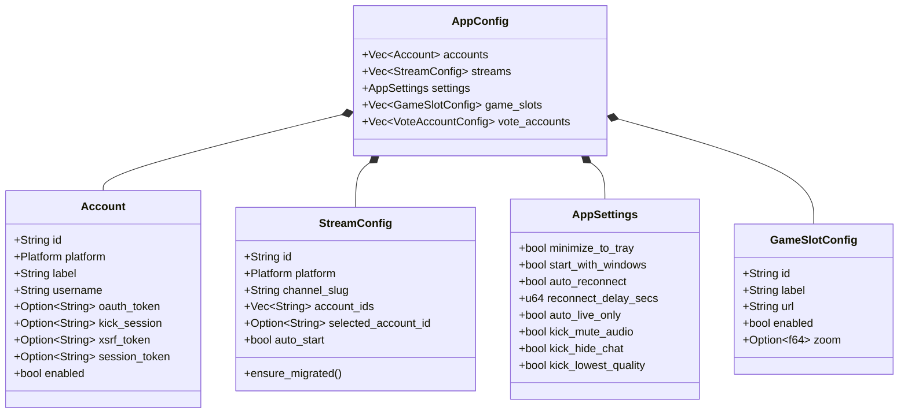
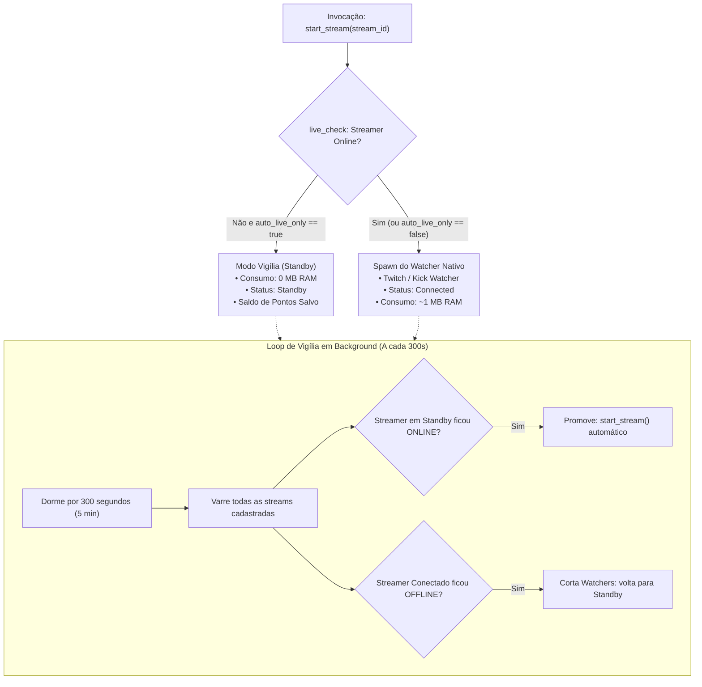

# Backend Rust Core, Estado Global e Dicionário de Comandos IPC

Este documento constitui o manual de referência do núcleo nativo em Rust do **IdleStream**, cobrindo o modelo de persistência, as regras de migração automática de esquemas legados, o ciclo de vida do Modo Vigília e o catálogo exaustivo de comandos do barramento IPC Tauri v2.

---

## 1. Modelos de Dados e Persistência Resiliente (`config/models.rs` & `config/store.rs`)

O estado persistido do usuário fica localizado em:
- **Windows**: `%APPDATA%/com.idlestream.app/config.json`
- **Android**: `/data/user/0/com.idlestream.app/files/config.json`



### 1.1 Tolerância Extrema a Falhas na Desserialização (`store.rs`)
O arquivo `config.json` pode sofrer corrupções parciais se o sistema for desligado abruptamente. A função `ConfigStore::load()` implementa uma estratégia de desserialização em cascata:
1. **Limpeza de BOM**: Remove automaticamente marcas de ordem de byte UTF-8 (`\u{feff}`).
2. **Desserialização Direta**: Tenta carregar a struct `AppConfig` completa via `serde_json::from_str`.
3. **Fallback Leniente por Seção**: Se a desserialização direta falhar (por exemplo, por um campo desconhecido adicionado em versão anterior), o parser chaveia para leitura de árvore genérica `serde_json::Value` e recupera individualmente cada seção válida (`accounts`, `streams`, `settings`, `game_slots`), descartando apenas os campos incompatíveis e evitando a perda de dados do usuário.

### 1.2 Migrações Automáticas em Tempo de Execução
Ao carregar o arquivo, o sistema executa mutações retrocompatíveis:
- **Migração Multi-Conta**: Streams legadas que continham apenas `account_id: String` são convertidas automaticamente para o vetor `account_ids: Vec<String>` عبر `stream.ensure_migrated()`. O campo legado é ignorado na serialização subsequente (`#[serde(skip_serializing)]`).
- **Migração de Domínio PokeIdle**: Slots configurados com URLs legadas `pokeidle.net` são sanitizados e redirecionados para a URL canônica atualizada: `https://pokeidle.io/app`.

---

## 2. Ciclo de Vida de Streams e Modo Vigília (`state.rs`)

O IdleStream minimiza o uso de recursos computacionais através do algoritmo **Auto-Live / Modo Vigília**:



### 2.1 Economia de Standby (Zero MB)
Quando um canal monitorado está offline e `settings.auto_live_only == true`:
- Nenhum socket WebSocket de chat ou conexão de vídeo é instanciado.
- O canal é inserido na tabela de status com `StatusKind::Standby`.
- O saldo de pontos acumulado anteriormente é preservado no cache.
- O uso de RAM e CPU atribuído a este canal é **rigorosamente zero**.

### 2.2 O Loop de Vigília (300 Segundos)
Executado em segundo plano por uma tarefa dedicada do Tokio:
- A cada **5 minutos (300s)**, realiza uma varredura leve de status online.
- Se um streamer em Standby iniciar a transmissão, o sistema detecta e promove o canal para execução ativa instantaneamente.
- Se uma live ativa for encerrada pelo streamer, o watcher cancela suas tarefas e rebaixa o canal para Standby, eliminando conexões ociosas.

---

## 3. Verificação de Status Online (`live_check.rs`)

O módulo `live_check.rs` implementa verificações de alta velocidade com baixa latência e tolerância a falhas:

### 3.1 Twitch Live Check
1. **Consulta Primária (GraphQL Oficial)**:
   Envia query leve para `https://gql.twitch.tv/gql` com timeout de 4 segundos:
   ```graphql
   query($login: String!) {
     user(login: $login) {
       id
       stream { id type }
     }
   }
   ```
   Considerado online se `stream.type == "live"` ou `stream.id` estiver presente. Latência média: ~25 ms.
2. **Fallback Secundário (`decapi.me`)**:
   Se a Twitch estiver instável ou bloqueando a requisição, consulta `https://decapi.me/twitch/uptime/{channel}`. Retorna online se a resposta não contiver `"is offline"` nem `"not found"`.

### 3.2 Kick Live Check
Consulta a API pública da Kick via `kick_http_request`:
```text
GET https://kick.com/api/v2/channels/{slug}
```
Inspeciona o nó JSON `livestream`. Se o objeto não for nulo e contiver um ID válido, atesta que o canal está transmitindo.

---

## 4. Dicionário Completo de Comandos IPC Tauri v2

Abaixo está o catálogo exaustivo de todos os comandos registrados em `lib.rs` e expostos ao frontend React via `invoke(comando, payload)`:

### 4.1 Comandos de Configuração e Contas (`commands.rs`)

| Comando IPC | Parâmetros e Tipos | Retorno | Descrição & Efeitos Colaterais |
| :--- | :--- | :--- | :--- |
| `get_config` | Nenhum | `Result<AppConfig, String>` | Retorna a árvore completa de configurações do `AppState`. |
| `save_config` | `config: AppConfig` | `Result<(), String>` | Sobrescreve e salva atomicamente a configuração em `config.json`. |
| `add_account` | `account: Account` | `Result<AppConfig, String>` | Insere ou atualiza uma conta e persiste em disco. |
| `remove_account` | `account_id: String` | `Result<AppConfig, String>` | Remove a conta, encerra watchers vinculados e limpa streams órfãs. |
| `add_stream` | `stream: StreamConfig` | `Result<AppConfig, String>` | Cadastra nova stream, executa `ensure_migrated()` e persiste. |
| `update_stream` | `stream: StreamConfig` | `Result<AppConfig, String>` | Atualiza metadados da stream e sincroniza contas ativas. |
| `set_selected_account` | `stream_id: String`, `account_id: String` | `Result<AppConfig, String>` | Define a conta prioritária para resgates manuais e exibição de saldo. |
| `remove_stream` | `stream_id: String` | `Result<AppConfig, String>` | Interrompe o watcher associado e remove a stream da configuração. |
| `get_app_version` | Nenhum | `String` | Retorna a string SemVer da versão corrente do binário (ex: `"3.2.7"`). |

### 4.2 Comandos de Execução e Status de Streams (`commands.rs`)

| Comando IPC | Parâmetros e Tipos | Retorno | Descrição & Efeitos Colaterais |
| :--- | :--- | :--- | :--- |
| `start_stream` | `stream_id: String` | `Result<(), String>` | Executa live check, instancia o watcher nativo e emite status. |
| `stop_stream` | `stream_id: String` | `Result<(), String>` | Envia sinal de shutdown para os canais e reseta o status para Desconectado. |
| `start_all_streams` | Nenhum | `Result<(), String>` | Inicia sequencialmente todas as streams cadastradas com delay de 250ms. |
| `stop_all_streams` | Nenhum | `Result<(), String>` | Interrompe todas as conexões ativas de Twitch e Kick. |
| `get_all_stream_statuses` | Nenhum | `Result<Vec<StreamRuntimeStatus>, String>` | Retorna o snapshot atualizado de tempo de live e saldo de pontos. |

### 4.3 Comandos de Autenticação e Resgate (`commands.rs`)

| Comando IPC | Parâmetros e Tipos | Retorno | Descrição & Efeitos Colaterais |
| :--- | :--- | :--- | :--- |
| `start_twitch_oauth` | `account_id: String` | `Result<String, String>` | Inicia servidor HTTP temporário (`tiny_http`) na porta 3000 para OAuth. |
| `open_twitch_login` | `account_id: String`, `account_label: String` | `Result<(), String>` | Abre janela WebView isolada para login manual na Twitch. |
| `save_twitch_session` | `account_id: String` | `Result<AppConfig, String>` | Extrai cookies da janela de login e salva o `auth-token`. |
| `save_twitch_token` | `account_id: String`, `token: String` | `Result<AppConfig, String>` | Salva manualmente um token OAuth da Twitch na conta especificada. |
| `get_twitch_account_streamers_ranking` | `account_id: String` | `Result<Vec<TwitchStreamerStats>, String>` | Retorna a lista de streamers ordenada pelo ranking de prioridade. |
| `open_kick_login` | `account_id: String`, `account_label: String` | `Result<(), String>` | Abre janela WebView apontando para `kick.com/login`. |
| `save_kick_session` | `account_id: String` | `Result<AppConfig, String>` | Captura cookies de sessão da Kick e token JWT do LocalStorage. |
| `save_kick_credentials_direct` | `account_id: String`, `kick_session: String`, `xsrf_token: String`, `session_token: String` | `Result<AppConfig, String>` | Permite injeção direta de credenciais Kick via formulário. |
| `open_stream_redeem` | `account_id: String`, `stream_id: String` | `Result<(), String>` | Abre janela popout dedicada para resgate manual de recompensas. |

### 4.4 Comandos do Motor de Jogos (`games/commands.rs`)

| Comando IPC | Parâmetros e Tipos | Retorno | Descrição & Efeitos Colaterais |
| :--- | :--- | :--- | :--- |
| `game_start_slot` | `slot_id: String`, `url: String`, `zoom: Option<f64>` | `Result<(), String>` | Instancia uma Child Webview com injeção do motor anti-sleep. |
| `game_stop_slot` | `slot_id: String` | `Result<(), String>` | Destrói a Child Webview e libera os recursos alocados pelo V8. |
| `game_apply_layout` | `mode: ViewLayoutMode` | `Result<(), String>` | Aplica o arranjo geométrico (`Grid2x2`, `FocusSingle`, `FocusSidebar`). |
| `game_update_slots_bounds` | `bounds: Vec<SlotBounds>` | `Result<(), String>` | Sincroniza as coordenadas físicas da janela com os elementos DOM. |
| `game_reload_slot` | `slot_id: String` | `Result<(), String>` | Força recarregamento limpo da página do jogo. |
| `game_set_slot_zoom` | `slot_id: String`, `zoom: f64` | `Result<(), String>` | Aplica fator de zoom proporcional (0.5 a 2.0) na Webview. |
| `game_set_eco_mode` | `enabled: bool` | `Result<(), String>` | Ativa ou desativa a injeção de CSS otimizado para economia de GPU. |
| `game_get_eco_mode` | Nenhum | `Result<bool, String>` | Retorna o estado atual do Modo Eco. |
| `game_set_fps` | `fps: u32` | `Result<(), String>` | Altera o tick do dispatcher de rAF (10, 30 ou 60 FPS). |
| `game_toggle_pokeidle_ultra` | `slot_id: String` | `Result<(), String>` | Alterna o Modo Ultra nativo nos controles do PokeIdle. |
| `game_hide_all` | Nenhum | `Result<(), String>` | Oculta visualmente todas as Child Webviews (durante minimizar na bandeja). |
| `game_get_active_slots` | Nenhum | `Result<Vec<GameSlotInfo>, String>` | Retorna a lista de slots em execução com métricas de memória e uptime. |
| `game_get_system_idle_seconds` | Nenhum | `u64` | Retorna os segundos de inatividade do usuário no sistema operacional. |

### 4.5 Comandos do Sistema de Votos Diários (`votes/commands.rs`)

| Comando IPC | Parâmetros e Tipos | Retorno | Descrição & Efeitos Colaterais |
| :--- | :--- | :--- | :--- |
| `vote_update_account` | `account: VoteAccountConfig` | `Result<AppConfig, String>` | Atualiza metadados, `player_identifier`, vínculo `linked_game_slot_id` e persistência. |
| `vote_open_webview` | `account_id: String`, `bounds: Option<VoteBounds>` | `Result<String, String>` | Cria WebView única `vote-active` restrita a `topidle.com` (+ OAuth Google / CAPTCHA). |
| `vote_close_webview` | Nenhum | `Result<(), String>` | Destrói a WebView `vote-active` e popups OAuth liberando 100% da memória. |
| `vote_update_bounds` | `bounds: VoteBounds` | `Result<(), String>` | Sincroniza geometria física (ou move offscreen `-99999` atrás de modais). |
| `vote_hide_webview` | Nenhum | `Result<(), String>` | Move temporariamente `vote-active` para offscreen sem destruir sessão DWM. |
| `vote_reload_webview` | Nenhum | `Result<(), String>` | Recarrega a página atual da WebView de votação. |
| `vote_clear_topidle_session` | `account_id: String` | `Result<(), String>` | Limpa cookies e storage exclusivamente de `topidle.com`, preservando Google/PokeIdle. |
| `vote_get_active` | Nenhum | `Result<Option<String>, String>` | Retorna o ID da conta atualmente aberta na WebView de voto (ou `null`). |
| `vote_mark_completed` | `account_id: String`, `voted_at: Option<i64>` | `Result<AppConfig, String>` | Registra o timestamp do voto e agenda o próximo ciclo de alerta para +24h 01m. |
| `vote_reset_timer` | `account_id: String` | `Result<AppConfig, String>` | Zera o timer da conta marcando-a novamente como pronta para votar. |
| `vote_test_notification` | `account_id: Option<String>` | `Result<VoteReadyNotificationPayload, String>` | Dispara alerta imediato na UI e no sistema operacional (Windows Toast / Android). |

---

## 5. Próximos Passos & Documentos Relacionados

Para compreender como a camada frontend consome esses comandos, gerencia o estado reativo com Zustand e renderiza os componentes de interface:
👉 Prossiga para: **[[06-frontend]] — Frontend React 19, Zustand Store e Interface UI**.
