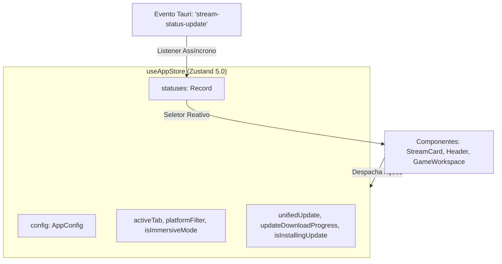
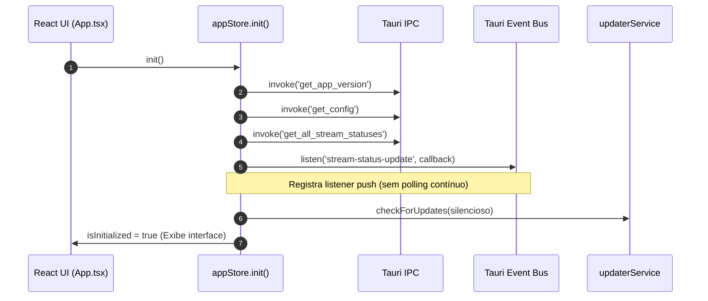
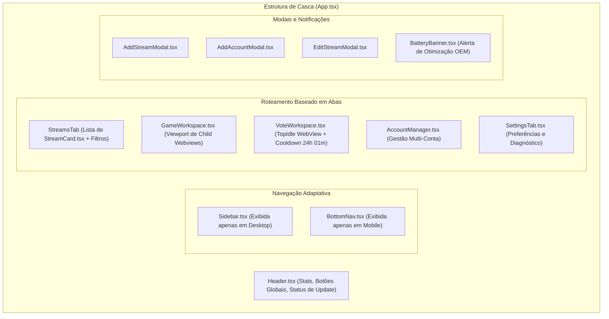

# Camada Frontend: React 19, Zustand Store e Catálogo de Componentes UI

Este documento especifica a engenharia do frontend do **IdleStream**, construído com **React 19.1**, **TypeScript 6.0**, **Tailwind CSS v4** e **Zustand 5.0**. Abrange o gerenciamento reativo de estado sem Context API, o listener de eventos IPC, o design system responsivo e a camada de serviços agnóstica de plataforma.

---

## 1. Gerenciamento de Estado Global Reativo (`src/stores/appStore.ts`)

O estado da aplicação é unificado em uma única store centralizada com Zustand (`useAppStore`), eliminando problemas de *re-renders* em cascata comuns a árvores de provedores React tradicionais.



### 1.1 O Ciclo de Inicialização `init()`
Ao carregar o aplicativo, o método `init()` executa a seguinte sequência de preparação:



1. **Leitura de Versão, Configuração e Estado de Sessão**: Lê `appVersion`, popula `config` e `statuses`, e consulta `get_runtime_state` para restaurar a última aba (`activeTab`), `game_fps_tier`, layout, `pokeidle_ultra` e retomar `auto_start ∪ desired_active_game_slots` (pulando slots já vivos nativamente no `GameSlotManager`).
2. **Registro do Listener Reativo**: Registra o listener no canal `stream-status-update`. Qualquer atualização de pontos ou mudança de estado de live é injetada diretamente no dicionário `statuses[stream_id]`, renderizando os cartões de live sem necessidade de polling HTTP.
3. **Verificação Silenciosa de Atualização**: Dispara em background uma checagem de novas releases via `checkForAppUpdates()`.

---

## 2. Catálogo de Componentes e Estrutura da Interface

A interface adota um layout fluido adaptável para telas grandes (Desktop) e telas verticais de toque (Smartphones Android):



### 2.1 Análise dos Componentes Principais

#### `App.tsx`
Orquestrador central de layout. Gerencia a visibilidade de modais, escuta atalhos de teclado globais (como `ESC` para sair do modo imersivo de tela cheia em jogos) e alterna entre a visão de abas.

#### `Header.tsx`
Barra de status superior agregada e adaptativa (v4.2.0):
- **Visibilidade Inteligente de Recursos**: O card central com métricas de transmissões (`Ao Vivo`, `Modo Vigília` e `RAM Estimada ~X MB`) é renderizado **estritamente na aba Streams** (`activeTab === 'streams'`).
- **Navegação Despoluída**: Nas abas Jogos, Votos, Contas e Configurações, o card de streams é omitido, mantendo apenas as ações globais essenciais (**"Ativar Todas"**, **"Parar Todas"**), indicador de saúde e o atalho de **Tela Cheia (Fullscreen)**.
- **Badge de Atualização**: Exibe a versão detectada e permite início do download do update em um clique.

#### `Sidebar.tsx` & `BottomNav.tsx`
- **`Sidebar.tsx` (Desktop)**: Barra lateral fixa à esquerda com ícones Lucide para Streams, Idle Games, **Votos** (com contador pulsante de contas prontas), Contas e Configurações.
- **`BottomNav.tsx` (Mobile Android)**: Barra de navegação inferior ergonomicamente posicionada para alcance do polegar em dispositivos móveis, incluindo atalho e badge de contas prontas em **Votos**.

#### `StreamCard.tsx`
O componente atômico de visualização de streams:
- **Diferenciação Visual "Farmando" vs "Ao Vivo" (v4.2.0)**:
  - **Selo "Farmando"**: Pílula esmeralda pulsante exibida quando a live está ativa **E** alocada no slot prioritário de pontuação do minerador (`ActiveMining`), pontuando efetivamente em segundo plano.
  - **Selo "Ao Vivo"**: Pílula indicando que o streamer está transmitindo, mas o canal está em lista de espera/vigília aguardando liberação de vaga concorrente.
  - **Selo "Vigília"**: Exibido para canais offline com consumo de 0 MB de RAM.
- **Ordenação Flexível por Saldo de Pontos**:
  - Seletor de ordenação no topo da aba: *Mais Pontos*, *Menos Pontos*, *Ordem Padrão*, *A-Z*.
  - Utilitário numérico `parsePointsNumber` que converte formatações de string (`"1.600"`, `"1,6 mil"`, `"250 pts"`) em números inteiros para ordenação correta.
- **Seletor Multi-Conta de Pontos & Resgate Rápido**: Abas para alternar a conta exibida no card e botão `openStreamRedeem` para abrir o chat popout autenticado.

#### `AccountManager.tsx` & `EditAccountModal.tsx` (v4.2.0)
- **Ordenação Estruturada por Plataforma e Nome**: Agrupa primeiro todas as contas da Twitch e em seguida todas as contas da Kick, ordenadas alfabeticamente por nome.
- **Edição de Identificação sem Perda de Sessão**: Modal dedicado para alterar rótulo e username da conta via comando `update_account_info`, preservando rigorosamente tokens OAuth, cookies nativos e sessões ativas.

#### `VoteWorkspace.tsx` & `VoteSyncModal.tsx` (v4.2.0)
- **Sincronização Bidirecional PC $\leftrightarrow$ Celular via QR Code**:
  - Botão de pareamento no topo que abre o `VoteSyncModal` com QR Code gerado em alta definição (`qrcode`).
  - **Totalmente Automatizado & Sem Botões Manuais de Atualização**:
    - Ao abrir no Celular, busca automaticamente votos recentes efetuados no Computador.
    - Ao abrir no Computador, busca automaticamente votos recentes efetuados no Celular.
    - Ao registrar um voto em qualquer aparelho, despacha o payload de forma assíncrona e não-bloqueante.
  - Zero impacto em memória RAM e zero tráfego de rede quando não pareado.

#### `AuditLogViewer.tsx` (Aba Configurações — v4.2.0)
- Componente de terminal monospace integrado para leitura dos logs rotativos de 6 horas em disco:
  - Filtros por categoria (`TODAS`, `ACCOUNTS`, `LIVES`, `GAMES`, `VOTES`, `SYSTEM`).
  - Filtros por nível (`TODOS`, `INFO`, `WARN`, `ERROR`).
  - Campo de busca instantânea nos registros em disco.
  - Ações para **"Copiar Relatório Completo"** e **"Limpar Histórico do Disco"** com confirmação de segurança.

#### `BatteryBanner.tsx`
Componente exclusivo do ambiente mobile Android:
- Consulta `isBatteryOptimizationIgnored()`, `hasNotificationPermission()`, `canDrawOverlays()` e `getOemGuidanceJson()`.
- Alerta caso as notificações (`POST_NOTIFICATIONS`) estejam bloqueadas, oferece atalhos diretos para isenção de bateria (`requestIgnoreBatteryOptimization()`), **Config. App** (`openAppSettings()`) e botão opcional **Permitir Auto-Recuperação** (`SYSTEM_ALERT_WINDOW`), além de exibir um checklist expansível específico por fabricante (Xiaomi/HyperOS, Samsung/OneUI, Motorola, Realme/Oppo).

---

## 3. Camada de Serviços Híbridos (`src/services/`)

O frontend é 100% agnóstico do ambiente em que está executando, delegando ações específicas de plataforma para serviços desacoplados:

### 3.1 `gamePlatformService.ts`
Implementa o padrão *Bridge / Adapter*:
```typescript
export const gamePlatformService = {
  isAndroid: isAndroidPlatform,

  async startSlot(slotId: string, url: string, zoom = 1.0): Promise<void> {
    const bridge = getAndroidBridge();
    if (bridge) {
      bridge.startGameSlot(slotId, url, zoom);
      return;
    }
    await invoke('game_start_slot', { slotId, url, zoom });
  },
  // Métodos correspondentes para stopSlot, reloadSlot, updateSlotsBounds, setSlotZoom...
};
```
Se executado no Android, direciona as chamadas para a interface injetada `window.AndroidBridge`. Se executado no Windows, direciona as chamadas para os comandos IPC nativos do Tauri.

### 3.2 `updaterService.ts`
Gerencia a lógica de atualização híbrida:
- **Ambiente Desktop**: Utiliza a API oficial `@tauri-apps/plugin-updater`. Baixa o delta assinado via Minisign e aplica o instalador NSIS.
- **Ambiente Android**: Consulta a API REST de releases do repositório GitHub (`repos/GabrielGamaBaptista/IdleStream/releases/latest`). Extrai o link de download direto do asset APK ARM64 (`IdleStream_x.x.x_arm64.apk`), dispara o download no Android e invoca o instalador de pacotes nativo do sistema operacional.

---

## 4. Tipagem TypeScript e Formatadores (`src/types/` & `src/utils/`)

### 4.1 Principais Definições de Tipos (`types/index.ts`)
```typescript
export type Platform = 'twitch' | 'kick';

export interface Account {
  id: string;
  platform: Platform;
  label: string;
  username: string;
  oauth_token?: string;
  kick_session?: string;
  xsrf_token?: string;
  session_token?: string;
  enabled: boolean;
}

export interface StreamConfig {
  id: string;
  platform: Platform;
  channel_slug: string;
  account_ids: string[];
  selected_account_id?: string;
  auto_start: boolean;
}

export interface StreamRuntimeStatus {
  stream_id: string;
  status: 'disconnected' | 'connecting' | 'connected' | 'standby' | 'error';
  is_live: boolean;
  message?: string;
  uptime_seconds: number;
  estimated_ram_mb: number;
  connected_at?: string;
  channel_points?: string;
  account_points: Record<string, string>;
}
```

### 4.2 Formatadores de Localidade (`utils/format.ts`)
- `formatPoints(val)`: Converte números brutos em notação brasileira legível (ex: `154200` $\to$ `"154.200"` ou `"154,2k"`).
- `formatUptime(seconds)`: Converte segundos acumulados em strings temporais estruturadas (ex: `7320` $\to$ `"2h 02m"`).

---

## 5. Próximos Passos & Documentos Relacionados

Para compreender como a infraestrutura nativa do Android opera, incluindo serviços em primeiro plano, compilação cruzada em Rust e o pipeline de empacotamento:
👉 Prossiga para: **[[07-multiplataforma-android]] — Multiplataforma, Android Bridge e Build System**.
