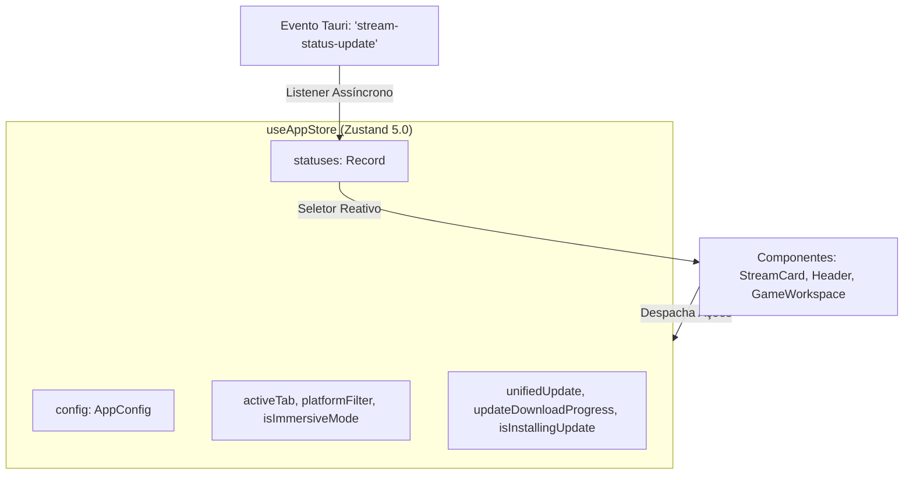
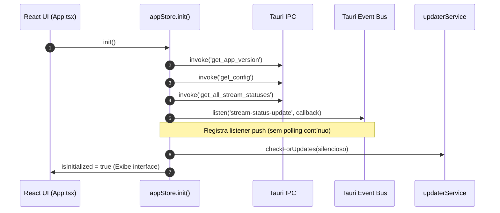
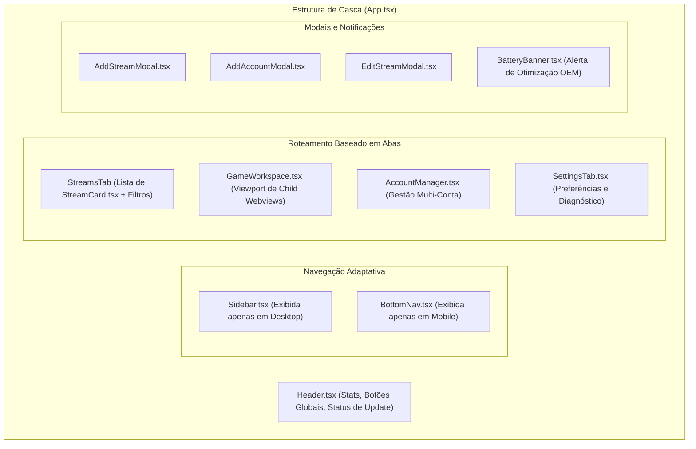

# Camada Frontend: React 19, Zustand Store e Catálogo de Componentes UI

Este documento especifica a engenharia do frontend do **IdleStream**, construído com **React 19.1**, **TypeScript 6.0**, **Tailwind CSS v4** e **Zustand 5.0**. Abrange o gerenciamento reativo de estado sem Context API, o listener de eventos IPC, o design system responsivo e a camada de serviços agnóstica de plataforma.

---

## 1. Gerenciamento de Estado Global Reativo (`src/stores/appStore.ts`)

O estado da aplicação é unificado em uma única store centralizada com Zustand (`useAppStore`), eliminando problemas de *re-renders* em cascata comuns a árvores de provedores React tradicionais.



### 1.1 O Ciclo de Inicialização `init()`
Ao carregar o aplicativo, o método `init()` executa a seguinte sequência de preparação:



1. **Leitura de Versão e Configuração**: Lê `appVersion` e popula a árvore `config` e `statuses`.
2. **Registro do Listener Reativo**: Registra o listener no canal `stream-status-update`. Qualquer atualização de pontos ou mudança de estado de live é injetada diretamente no dicionário `statuses[stream_id]`, renderizando os cartões de live sem necessidade de polling HTTP.
3. **Verificação Silenciosa de Atualização**: Dispara em background uma checagem de novas releases via `checkForAppUpdates()`.

---

## 2. Catálogo de Componentes e Estrutura da Interface

A interface adota um layout fluido adaptável para telas grandes (Desktop) e telas verticais de toque (Smartphones Android):



### 2.1 Análise dos Componentes Principais

#### `App.tsx`
Orquestrador central de layout. Gerencia a visibilidade de modais, escuta atalhos de teclado globais (como `ESC` para sair do modo imersivo de tela cheia em jogos) e alterna entre a visão de abas.

#### `Header.tsx`
Barra de status superior agregada:
- **Estatísticas em Tempo Real**: Contadores visuais com a quantidade de transmissões ativas (`Connected`), em espera (`Standby`) e estimativa combinada de memória RAM consumida (~1 MB por live).
- **Ações Globais**: Botões de um clique `"Ativar Todas"` (`startAll`) e `"Parar Todas"` (`stopAll`).
- **Badge de Atualização de Versão**: Exibe uma pílula destacada quando uma nova versão (`v3.2.x`) for detectada no GitHub ou servidor de update.

#### `Sidebar.tsx` & `BottomNav.tsx`
- **`Sidebar.tsx` (Desktop)**: Barra lateral fixa à esquerda com ícones Lucide para Streams, Jogos, Contas e Configurações, além de alternador de tema e modo compacto.
- **`BottomNav.tsx` (Mobile Android)**: Barra de navegação inferior ergonomicamente posicionada para alcance do polegar em dispositivos móveis.

#### `StreamCard.tsx`
O componente atômico mais complexo do sistema:
- **Badge de Plataforma**: Identificador colorido para Twitch (roxo) ou Kick (verde).
- **Indicador Dinâmico de Live**: Animação de pulso verde quando online, exibindo contador incremental de horas/minutos de live assistida.
- **Seletor Multi-Conta de Pontos**: Menu suspenso com abas individuais para cada conta vinculada à transmissão, exibindo o saldo de pontos formatado de cada perfil.
- **Botão de Resgate Rápido (`openStreamRedeem`)**: Abre diretamente a janela do chat web da Twitch ou Kick já autenticada com os cookies da conta selecionada para resgate manual imediato de recompensas do streamer.

#### `BatteryBanner.tsx`
Componente exclusivo do ambiente mobile Android:
- Consulta `window.AndroidBridge.isBatteryOptimizationIgnored()`.
- Se o dispositivo mantiver o app sob restrição de bateria do fabricante (Samsung, Xiaomi, etc.), exibe um banner orientando o usuário a conceder isenção em um clique (`requestIgnoreBatteryOptimization()`) para evitar interrupções de conexão em segundo plano.

---

## 3. Camada de Serviços Híbridos (`src/services/`)

O frontend é 100% agnóstico do ambiente em que está executando, delegando ações específicas de plataforma para serviços desacoplados:

### 3.1 `gamePlatformService.ts`
Implementa o padrão *Bridge / Adapter*:
```typescript
export const gamePlatformService = {
  isAndroid: isAndroidPlatform,

  async startSlot(slotId: string, url: string, zoom = 1.0): Promise<void> {
    const bridge = getAndroidBridge();
    if (bridge) {
      bridge.startGameSlot(slotId, url, zoom);
      return;
    }
    await invoke('game_start_slot', { slotId, url, zoom });
  },
  // Métodos correspondentes para stopSlot, reloadSlot, updateSlotsBounds, setSlotZoom...
};
```
Se executado no Android, direciona as chamadas para a interface injetada `window.AndroidBridge`. Se executado no Windows, direciona as chamadas para os comandos IPC nativos do Tauri.

### 3.2 `updaterService.ts`
Gerencia a lógica de atualização híbrida:
- **Ambiente Desktop**: Utiliza a API oficial `@tauri-apps/plugin-updater`. Baixa o delta assinado via Minisign e aplica o instalador NSIS.
- **Ambiente Android**: Consulta a API REST de releases do repositório GitHub (`repos/GabrielGamaBaptista/IdleStream/releases/latest`). Extrai o link de download direto do asset APK ARM64 (`IdleStream_x.x.x_arm64.apk`), dispara o download no Android e invoca o instalador de pacotes nativo do sistema operacional.

---

## 4. Tipagem TypeScript e Formatadores (`src/types/` & `src/utils/`)

### 4.1 Principais Definições de Tipos (`types/index.ts`)
```typescript
export type Platform = 'twitch' | 'kick';

export interface Account {
  id: string;
  platform: Platform;
  label: string;
  username: string;
  oauth_token?: string;
  kick_session?: string;
  xsrf_token?: string;
  session_token?: string;
  enabled: boolean;
}

export interface StreamConfig {
  id: string;
  platform: Platform;
  channel_slug: string;
  account_ids: string[];
  selected_account_id?: string;
  auto_start: boolean;
}

export interface StreamRuntimeStatus {
  stream_id: string;
  status: 'disconnected' | 'connecting' | 'connected' | 'standby' | 'error';
  is_live: boolean;
  message?: string;
  uptime_seconds: number;
  estimated_ram_mb: number;
  connected_at?: string;
  channel_points?: string;
  account_points: Record<string, string>;
}
```

### 4.2 Formatadores de Localidade (`utils/format.ts`)
- `formatPoints(val)`: Converte números brutos em notação brasileira legível (ex: `154200` $\to$ `"154.200"` ou `"154,2k"`).
- `formatUptime(seconds)`: Converte segundos acumulados em strings temporais estruturadas (ex: `7320` $\to$ `"2h 02m"`).

---

## 5. Próximos Passos & Documentos Relacionados

Para compreender como a infraestrutura nativa do Android opera, incluindo serviços em primeiro plano, compilação cruzada em Rust e o pipeline de empacotamento:
👉 Prossiga para: **[[07-multiplataforma-android]] — Multiplataforma, Android Bridge e Build System**.
