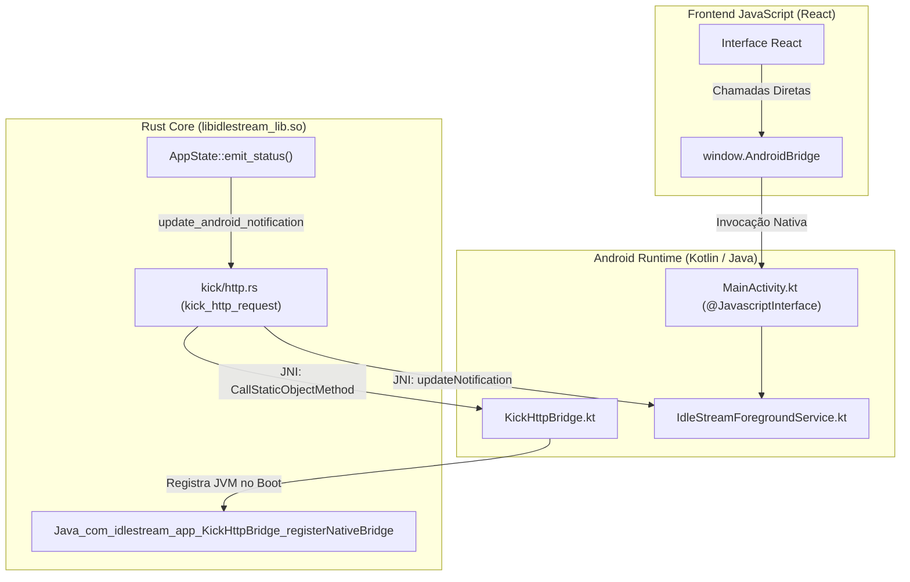
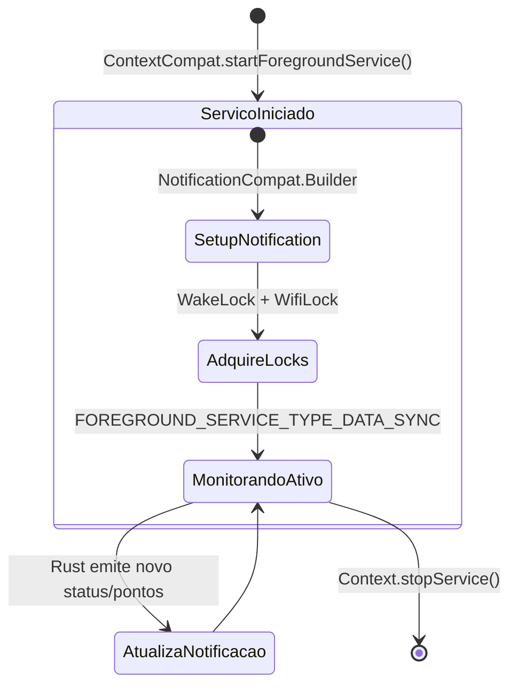
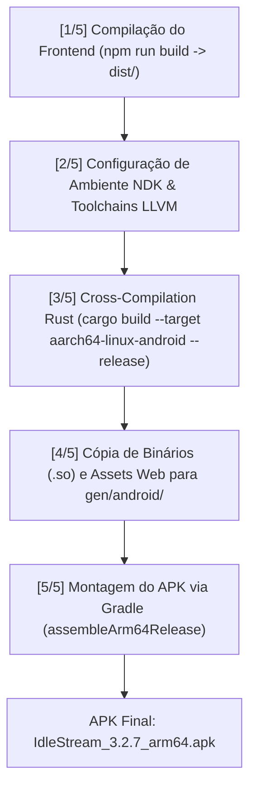

# Multiplataforma, Interoperabilidade JNI, Android Foreground Service e Pipeline de Build

Este documento especifica a engenharia do **IdleStream** no ecossistema **Android** (API 24+ / Android 7.0 a 15+), detalhando a integração entre o runtime Rust compilado como biblioteca dinâmica (`.so`), as activities Kotlin, a proteção contra suspensão de processos (*Doze Mode*) e a esteira de build automatizada.

---

## 1. Divergências Arquiteturais: Desktop (Windows) vs Mobile (Android)

Para operar de forma transparente em ambas as plataformas, o código-fonte adapta seus mecanismos em tempo de compilação (`#[cfg(target_os = "android")]` vs `#[cfg(desktop)]`):

| Funcionalidade | Implementação Desktop (Windows) | Implementação Mobile (Android) |
| :--- | :--- | :--- |
| **Janelas e WebViews** | Processo Win32 + WebView2 com Child Webviews Wry | `MainActivity` (`TauriActivity`) + `GameSlotManager` em WebViews nativas |
| **Ciclo de Segundo Plano** | Minimização na Bandeja do Sistema (`System Tray`) | `IdleStreamForegroundService` com notificação persistente |
| **Bypass TLS Cloudflare** | Subprocesso assíncrono `curl.exe` (`CREATE_NO_WINDOW`) | Chamada JNI delegando ao cliente **OkHttp 4.12** nativo |
| **Execução Anti-Sleep** | Flags de inicialização Chromium (`--disable-background-*`) | `PowerManager.WakeLock` parcial + `WifiLock` de alta performance |
| **Mecanismo de Update** | Plugin oficial Tauri Updater com delta assinado Minisign | Download de APK via GitHub Releases + `AppUpdateHelper` nativo |
| **Autenticação OAuth** | Servidor HTTP temporário `tiny_http` em `localhost:3000` | Interceptação de redirecionamento via `TwitchLoginActivity` |

---

## 2. Camada JNI & Pontes de Comunicação

A comunicação multiplataforma opera em duas vias distintas:



### 2.1 Interface JavaScript Injetada (`window.AndroidBridge`)
Disponibilizada no WebView via `@JavascriptInterface` na classe `MainActivity.kt`:
- **Isenção de Bateria**: `isBatteryOptimizationIgnored()` e `requestIgnoreBatteryOptimization()`.
- **Serviço de Segundo Plano**: `startForegroundService()`, `stopForegroundService()`, `updateNotification(title, text)`.
- **Slots de Jogos**: `startGameSlot()`, `stopGameSlot()`, `updateGameSlotBounds()`, `setGameSlotFps()`.
- **Login OAuth Seguro**: `openTwitchLogin(accountId, label)` e `openKickLogin(accountId, label)` abrem activities separadas, evitando poluição de cookies no WebView principal.

### 2.2 Callback JNI Rust $\leftrightarrow$ OkHttp (`KickHttpBridge.kt` & `kick/http.rs`)
1. **Registro Inicial**: Ao carregar a aplicação, `KickHttpBridge.kt` invoca o método C nativo:
   ```rust
   #[no_mangle]
   pub extern "system" fn Java_com_idlestream_app_KickHttpBridge_registerNativeBridge(
       mut env: JNIEnv,
       class: JClass,
   ) {
       let _ = JVM.set(env.get_java_vm().unwrap());
       let _ = BRIDGE_CLASS.set(env.new_global_ref(class).unwrap());
   }
   ```
2. **Execução de Chamada**: Quando o Rust precisa fazer requisições na API Kick:
   - Obtém o ponteiro da JVM (`JVM.get()`).
   - Anexa a thread atual à JVM (`jvm.attach_current_thread()`).
   - Invoca o método Kotlin `KickHttpBridge.request(method, url, headersJson, body, timeoutSecs)`.
   - O OkHttp processa a conexão e retorna o envelope JSON com status code e corpo.

### 2.3 Persistência de Sessão PokeIdle & Rastreamento de Toques (`GameSlotBridge`)
No Android, o fechamento completo do aplicativo pelo usuário ou o encerramento da Activity pelo sistema descartava o cache LevelDB e cookies não sincronizados das WebViews secundárias. A versão 3.2.8 introduziu uma camada de blindagem:
- **`GameSlotBridge` (`IdleStreamSlotBridge`)**: Injetada em cada WebView via `addJavascriptInterface`. Permite comunicação direta entre o JavaScript do jogo e o runtime Android.
- **Persistência Atômica em `SharedPreferences`**: Sempre que o PokeIdle grava sua chave de autenticação (`localStorage.setItem('sessao', ...)`), o script de isolamento espelha o JSON completo no arquivo nativo `idlestream_game_sessions` sob a chave `slot_{slotId}_sessao` e aciona `CookieManager.getInstance().flush()`.
- **Restauração Transparente no Boot**: No carregamento inicial do slot (`onPageStarted` e `DOCUMENT_START_SCRIPT`), se o localStorage estiver limpo, a sessão salva é resgatada de `IdleStreamSlotBridge.getSavedSession()` e re-injetada antes de `app.js` rodar, abrindo o jogo já autenticado sem exigir login do Google ou e-mail/senha.
- **Rastreamento de Toques (`MainActivity.dispatchTouchEvent`)**: Intercepta eventos físicos de toque na tela, atualizando `lastUserInteractionTime` e disparando `window.__onUserActivity()` para impedir suspensão indevida por inatividade.

---

## 3. Resiliência em Segundo Plano: `IdleStreamForegroundService`

O sistema operacional Android impõe restrições severas a processos em segundo plano a partir do Android 8.0 (Oreo) e Android 14+ (Upside Down Cake). Sem um serviço apropriado, a conexão WebSocket com Twitch e Kick é encerrada após 60 segundos de tela apagada.



### 3.1 Mecanismos de Proteção Ativos:
1. **Notificação Persistente em Primeiro Plano**:
   - Registrada no canal `idlestream_vigilance_channel` com prioridade `PRIORITY_LOW` (sem som intrusivo, mas imune a descarte).
   - Tipada como `ServiceInfo.FOREGROUND_SERVICE_TYPE_DATA_SYNC`, atendendo às exigências rigorosas do Android 14+.
   - Exibe em tempo real o contador de lives ativas e o saldo acumulado de pontos.
2. **Partial WakeLock (`PowerManager.PARTIAL_WAKE_LOCK`)**:
   - Mantém a CPU do processador rodando em frequência mínima mesmo com a tela bloqueada, impedindo a suspensão do loop de eventos do Tokio.
3. **High-Performance WifiLock (`WifiManager.WIFI_MODE_FULL_HIGH_PERF`)**:
   - Impede que o driver de Wi-Fi do smartphone entre em economia de energia e derrube os sockets de chat.

### 3.2 Bypass das Otimizações Agressivas de Bateria OEM
Fabricantes como Xiaomi (MIUI/HyperOS), Samsung (OneUI) e Huawei implementam "Battery Killers" proprietários.
- A classe `BatteryOptimizationHelper` verifica se o app está na lista de exceções do *Doze Mode* (`powerManager.isIgnoringBatteryOptimizations`).
- Se não estiver, dispara o intent `Settings.ACTION_REQUEST_IGNORE_BATTERY_OPTIMIZATIONS`, solicitando isenção permanente em um clique.

---

## 4. Pipeline de Compilação Automatizada (`scripts/build-android.ps1`)

O build do IdleStream para Android é orquestrado pelo script PowerShell [`scripts/build-android.ps1`](file:///C:/Projetos/Chatter/scripts/build-android.ps1), dividido em 5 etapas determinísticas:



### Análise das Etapas do Script:
1. **Passo 1 (Frontend)**: Executa `npm run build` gerando o bundle otimizado em `dist/`.
2. **Passo 2 (Ambiente NDK)**: Configura as variáveis de ambiente do compilador cruzado:
   - Linker: `aarch64-linux-android24-clang.cmd`.
   - Sysroot e binários NDK: `Android/Sdk/ndk/27.1.12297006/...`.
3. **Passo 3 (Rust Core)**: Compila a biblioteca dinâmica:
   ```powershell
   cargo build --manifest-path src-tauri/Cargo.toml --target aarch64-linux-android --release --lib --features custom-protocol
   ```
4. **Passo 4 (Distribuição de Assets)**:
   - Copia `libidlestream_lib.so` para `src-tauri/gen/android/app/src/main/jniLibs/arm64-v8a/`.
   - Copia o frontend compilado (`dist/*`) para `src-tauri/gen/android/app/src/main/assets/`.
   - Copia os scripts `anti_sleep.js` e `hunt_extension.js` para `assets/games/`.
5. **Passo 5 (Gradle Packaging)**:
   - Invoca `.\gradlew.bat assembleArm64Release`.
   - Gera o binário standalone assinado e otimizado com ProGuard/R8 para distribuição.

---

## 5. Próximos Passos & Documentos Relacionados

Para compreender a esteira de testes automatizados, assinatura criptográfica de releases e diagnóstico de falhas em produção:
👉 Prossiga para: **[[08-operacao-e-scripts]] — Operação, Suíte de Testes e Guia de Release**.
