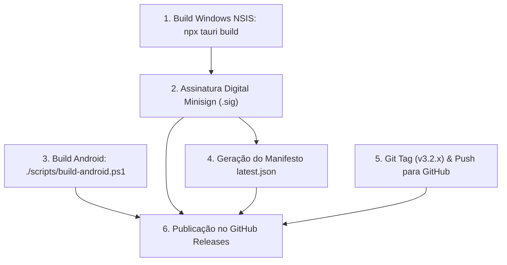

# Operação, Suíte de Testes, Guia de Release e Diagnóstico de Falhas

Este documento é o manual de operações e engenharia de confiabilidade (*SRE / DevOps*) do **IdleStream**. Ele documenta a suíte de automação em `scripts/`, os protocolos criptográficos de publicação de releases, a estrutura de auto-atualização do Tauri Updater e os procedimentos de diagnóstico de erros em produção.

---

## 1. Suíte de Scripts de Teste e Benchmark (`scripts/`)

O repositório mantém uma suíte de utilitários em TypeScript, JavaScript e PowerShell para testes unitários, medição de estresse e empacotamento:

| Script | Execução Recomendada | Propósito e Escopo Técnico |
| :--- | :--- | :--- |
| [`benchmark-performance.ts`](file:///C:/Projetos/Chatter/scripts/benchmark-performance.ts) | `npm run test:perf` (jiti) | Mede throughput geométrico de layout (100k iterações em < 0.001ms/frame), compara perfis de RAM (-74.4%) e avalia desvio padrão de jitter do ticker anti-sleep (±0.00ms). |
| [`test-version.ts`](file:///C:/Projetos/Chatter/scripts/test-version.ts) | `npm run test:version` (jiti) | Validador rigoroso de sincronismo SemVer: certifica que `package.json`, `tauri.conf.json`, `Cargo.toml`, `appStore.ts` e `latest.json` estejam na mesma versão. |
| [`test-twitch-android-points.ts`](file:///C:/Projetos/Chatter/scripts/test-twitch-android-points.ts) | `npm run test:twitch` (jiti) | Valida a mutation GraphQL de pontos com o Client ID do Android (`kd1unb4b...`) e verifica o retorno de saldo de canal. |
| [`test-stream-redeem.ts`](file:///C:/Projetos/Chatter/scripts/test-stream-redeem.ts) | `npm run test:redeem` (jiti) | Testa a injeção do cookie `auth-token` e o carregamento do popout web de resgate da Twitch. |
| [`test-games.ts`](file:///C:/Projetos/Chatter/scripts/test-games.ts) | `npm run test:games` (jiti) | Valida a integridade do script `anti_sleep.js` e a inicialização dos 4 slots de jogos. |
| [`test-votes.ts`](file:///C:/Projetos/Chatter/scripts/test-votes.ts) | `npm run test:votes` (jiti) | Valida as 4 contas padrão (`GGB2006..4`), URLs do TopIdle, whitelist restrita e regra exata de cooldown de `24h 01m` (`86.460s`). |
| [`test-hunt-lifecycle.ts`](file:///C:/Projetos/Chatter/scripts/test-hunt-lifecycle.ts) | `jiti ./scripts/test-hunt-lifecycle.ts` | Valida o ciclo de injeção da extensão `/hunt` e a integridade das tabelas elementais e regiões Outland. |
| [`test-ultra-and-heartbeat.ts`](file:///C:/Projetos/Chatter/scripts/test-ultra-and-heartbeat.ts) | `jiti ./scripts/test-ultra-and-heartbeat.ts` | Testa a ativação programática do Modo Ultra do PokeIdle e a estabilidade dos pings de WebSocket do jogo. |
| [`test-v3-mobile-games.ts`](file:///C:/Projetos/Chatter/scripts/test-v3-mobile-games.ts) | `jiti ./scripts/test-v3-mobile-games.ts` | Simula os limites e o viewport adaptativo do Android para WebViews de jogos. |
| [`bundle-hunt-extension.cjs`](file:///C:/Projetos/Chatter/scripts/bundle-hunt-extension.cjs) | `node ./scripts/bundle-hunt-extension.cjs` | Bundler Node que minifica e empacota os módulos da extensão `/hunt` em um arquivo standalone para injeção nativa em Rust (`include_str!`). |
| [`build-android.ps1`](file:///C:/Projetos/Chatter/scripts/build-android.ps1) | `npm run build:android` | Esteira completa de compilação Android: Vite build $\to$ setup NDK LLVM $\to$ cross-compilação Rust `cdylib` $\to$ montagem APK via Gradle. |
| [`sign-release.ps1`](file:///C:/Projetos/Chatter/scripts/sign-release.ps1) | `powershell -File ./scripts/sign-release.ps1` | Assina digitalmente o instalador NSIS compilado utilizando a chave privada Minisign e gera o arquivo `.sig`. |
| [`validate-docs.cjs`](file:///C:/Projetos/Chatter/scripts/validate-docs.cjs) | `node ./scripts/validate-docs.cjs` | Validador sintático e estrutural da pasta `Docs/`: inspeciona frontmatter YAML, blocos Mermaid e consistência de Wiki Links. |

---

## 2. Processo de Assinatura Criptográfica e Guia de Release

O IdleStream implementa verificação criptográfica estrita ed25519 em suas atualizações automáticas via `@tauri-apps/plugin-updater`.



### 2.1 Credenciais Criptográficas (Tauri Minisign)
- **Localização da Chave Privada**: `$env:USERPROFILE\.tauri\idlestream.key`
- **Passphrase da Chave**: `idlestream_signing_key_2026`
- **Chave Pública (Minisign ed25519)**:
  ```text
  dW50cnVzdGVkIGNvbW1lbnQ6IG1pbmlzaWduIHB1YmxpYyBrZXk6IDU3Rjk5Nzk4QjMzMjNCMjEKUldRaE96S3ptSmY1VjI2Unh2cnRJK3RNTW4zeHRsbHFSaXZwU1FKUDhJL2Fnd2tvNlFyNGpmajQK
  ```
- **Configuração no App**: Registrada em `src-tauri/tauri.conf.json` sob a chave `"plugins.updater.pubkey"`.

### 2.2 Estrutura do Manifesto `latest.json`
O arquivo `latest.json` publicado na raiz da release no GitHub informa ao aplicativo os metadados da nova versão:

```json
{
  "version": "3.2.7",
  "notes": "IdleStream v3.2.7 — Notas descritivas da release...",
  "pub_date": "2026-11-07T22:31:00Z",
  "platforms": {
    "windows-x86_64": {
      "signature": "dW50cnVzdGVkIGNvbW1lbnQ6IHNpZ25hdHVyZSBmcm9tIHRhdXJpIHNlY3JldCBrZXkK...",
      "url": "https://github.com/GabrielGamaBaptista/IdleStream/releases/download/v3.2.7/IdleStream_3.2.7_x64-setup.exe"
    }
  }
}
```

### 2.3 Checklist Obrigatório de Publicação de Release
Toda release no GitHub **DEVE** conter exatamente estes 5 artefatos anexados:
1. `IdleStream_<VERSION>_x64-setup.exe` (Instalador oficial NSIS para Windows 64-bit)
2. `IdleStream_<VERSION>_x64-setup.exe.sig` (Assinatura digital Minisign gerada pela chave privada)
3. `IdleStream_<VERSION>_arm64.apk` (Pacote nativo Android compilado com NDK/Gradle)
4. `idlestream.exe` (Executável standalone portátil sem instalador)
5. `latest.json` (Manifesto assinado consumido pelo `@tauri-apps/plugin-updater`)

---

## 3. Guia de Diagnóstico e Resolução de Problemas (*Troubleshooting*)

### 3.1 Falha de Autenticação OAuth Twitch (Porta 3000 em Uso)
- **Sintoma**: Ao clicar em "Conectar Twitch via OAuth", a aplicação exibe mensagem de erro de timeout ou porta ocupada.
- **Causa Raiz**: O servidor HTTP temporário `tiny_http` tenta vincular na porta `127.0.0.1:3000`. Se outro processo (servidor Node, React dev server ou Docker) estiver escutando nessa porta, o bind falha.
- **Resolução**:
  1. Feche processos na porta 3000: `netstat -ano | findstr :3000` e termine o PID correspondente.
  2. Alternativamente, utilize o fluxo **"Conectar via Navegador Interno"** (`open_twitch_login`), que abre uma janela WebView isolada e captura a sessão sem precisar de servidor HTTP local.

### 3.2 Erros Kick HTTP 403 Forbidden / Cloudflare Turnstile
- **Sintoma**: O canal Kick permanece com status de erro e não conecta ao chat nem pontua.
- **Causa Raiz**: A sessão salva expirou ou o token `XSRF-TOKEN` / `session_token` foi invalidado pelos gateways Cloudflare.
- **Resolução**:
  1. Abra a aba **Contas**.
  2. Clique em **"Reconectar Kick"** para abrir a WebView oficial da Kick.
  3. Efetue login novamente (resolva qualquer captcha interativo na tela, se solicitado).
  4. O IdleStream atualizará automaticamente os cookies e restabelecerá o watcher nativo.

### 3.3 Mitigação de Queda de Sinal DWM / Tela Preta (Windows DirectComposition)
- **Histórico**: Em versões legadas (< 3.2.7), ao minimizar a janela na bandeja do sistema, o uso das chamadas `put_IsVisible(FALSE)` ou `webview.hide()` no WebView2 destruía árvores visuais DirectComposition do DWM do Windows, provocando breves blackouts no monitor em certas placas de vídeo Nvidia/AMD.
- **Solução Definitiva no v3.2.7**: As Child Webviews de jogos não são mais destruídas nem ocultadas via `put_IsVisible`. O sistema reposiciona as janelas para um retângulo mínimo offscreen ($1 \times 1$ pixel em coordenadas virtuais) e desacelera o ticker de rAF para **1 FPS**, eliminando qualquer queda de sinal de vídeo e mantendo ~0% de uso de GPU sem desconectar as sessões de jogo.

### 3.4 Localização de Logs de Erro e Pânico
- **Windows**:
  - Erros de runtime e saídas de comando são registrados em `stderr` no console de desenvolvimento.
  - O DevTools do WebView principal pode ser aberto com `F12` ou botão direito inspecionar em builds com devtools habilitado.
- **Android**:
  - Em falhas críticas (pânico do Rust), o handler `std::panic::set_hook` grava automaticamente o stack trace em:
    ```text
    /data/user/0/com.idlestream.app/files/panic.log
    ```
  - Logs em tempo real de JNI e Foreground Service podem ser inspecionados via ADB:
    ```shell
    adb logcat -s IdleStream:* KickHttp:* Rust:*
    ```

---

## 4. Conclusão da Documentação Técnica

Com a finalização deste documento, toda a arquitetura de engenharia do **IdleStream** encontra-se 100% especificada e mapeada:
👉 Retorne ao índice mestre: **[[README]] — Master Map of Content (MOC)**.
