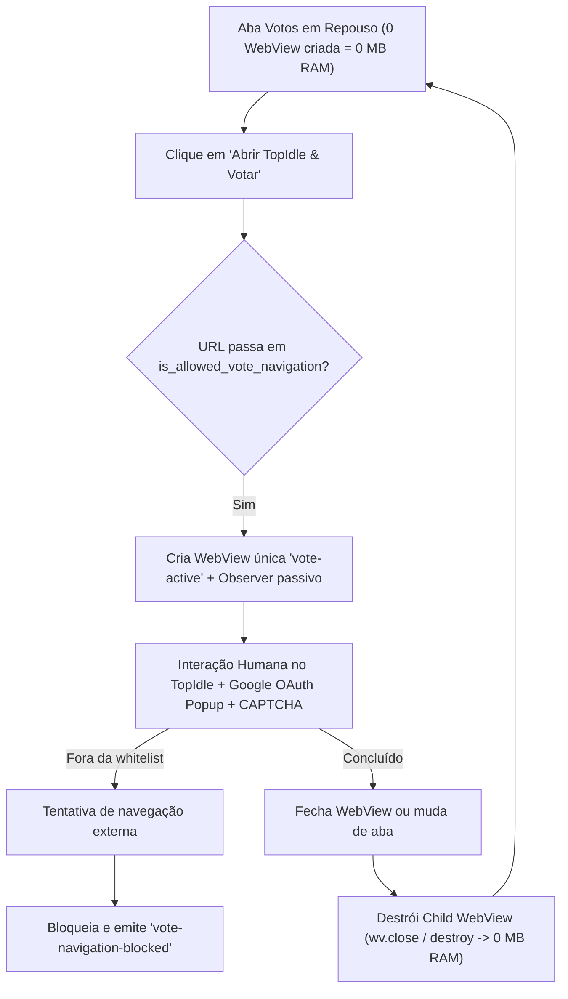
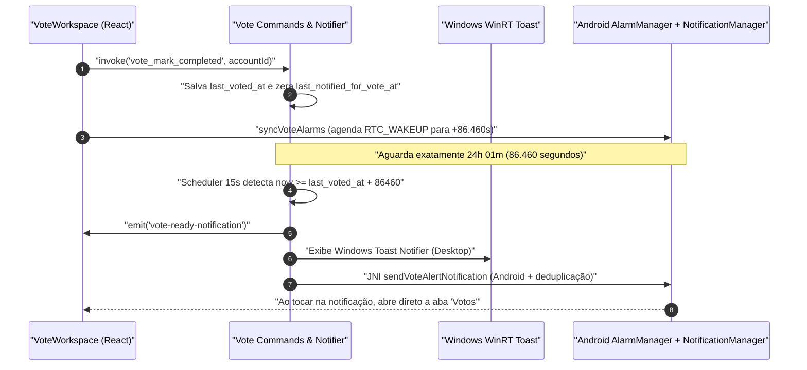

# Sistema de Votos Diários TopIdle (`v4.0.0`)

Este documento descreve a arquitetura, segurança e operação da seção **Votos**, introduzida na versão **4.0.0** para gerenciar votos diários no TopIdle (`https://topidle.com/jogo/pokeidle-io-5f9969?playerIdentifier=<ID>`) com total interatividade humana (suportando CAPTCHA) e notificação automática após **24 horas e 1 minuto** (`86.460` segundos).

---

## 1. Contas Padrão e Vínculo com Perfis Google (`config/models.rs`)

Por padrão, na inicialização e migração v3 → v4 via [`ConfigStore::load()`](file:///c:/Projetos/Chatter/src-tauri/src/config/store.rs), o IdleStream cria 4 contas pré-vinculadas aos 4 perfis do módulo `Idle Games`:

| ID Interno | Nome / `playerIdentifier` | Slot Vinculado (`share_game_profile: true`) | Pasta / Perfil de Sessão Compartilhado |
| :--- | :--- | :--- | :--- |
| `vote-1` | `GGB2006` | `slot-1` | Desktop: `game_profiles/slot-1` • Android: `slot_slot-1` |
| `vote-2` | `GGB2006_2` | `slot-2` | Desktop: `game_profiles/slot-2` • Android: `slot_slot-2` |
| `vote-3` | `GGB2006_3` | `slot-3` | Desktop: `game_profiles/slot-3` • Android: `slot_slot-3` |
| `vote-4` | `GGB2006_4` | `slot-4` | Desktop: `game_profiles/slot-4` • Android: `slot_slot-4` |

> [!TIP]
> Compartilhar o diretório/perfil com `slot-1`..`slot-4` permite usar exatamente a **mesma conta Google** e o **mesmo jogador** já autenticados no PokeIdle, sem necessidade de refazer login sempre que abrir o TopIdle. O botão **"Limpar Sessão TopIdle"** remove apenas cookies e storage de `topidle.com`, mantendo o login Google e a sessão do PokeIdle intactos.

---

## 2. Política de Navegação Estrita e Ciclo Sob Demanda (0 MB em Repouso)

A WebView da seção **Votos** segue o princípio de alocação estritamente sob demanda:

### 2.1 Whitelist Rigorosa (`votes/policy.rs` & `VoteUrlPolicy.kt`)
Somente URLs `https://` pertencentes aos seguintes escopos são autorizadas no navegador da seção **Votos**:
1. **Site oficial TopIdle**: `topidle.com` e `*.topidle.com`.
2. **Autenticação Google OAuth**: `accounts.google.com`, `accounts.youtube.com`, `myaccount.google.com`, `gds.google.com`, `apis.google.com`, `consent.google.com`, `consent.youtube.com` (com injeção não-invasiva de `prompt=select_account`).
3. **Infraestrutura de CAPTCHA interativo**: `challenges.cloudflare.com`, `*.hcaptcha.com`, `*.recaptcha.net`, `*.gstatic.com` e `google.com/recaptcha*`.

O script `vote_observer.js` atua **exclusivamente em modo somente leitura**, sem nunca preencher formulários ou clicar em widgets anti-bot — apenas exibe um atalho visual na barra superior caso o site apresente confirmação de voto concluído.

---

## 3. Notificador de 24h 01m (`86.460s`) e Confiabilidade Android/Desktop

### Deduplicação entre Scheduler Rust e `AlarmManager`
Para impedir alertas duplicados quando o app está ativo no Android e também possui um alarme `AlarmManager.setAndAllowWhileIdle` programado para o mesmo instante, tanto [`VoteAlarmReceiver`](file:///c:/Projetos/Chatter/src-tauri/gen/android/app/src/main/java/com/idlestream/app/VoteAlarmReceiver.kt) quanto a chamada JNI do Rust passam por [`VoteNotificationHelper.showVoteAlert()`](file:///c:/Projetos/Chatter/src-tauri/gen/android/app/src/main/java/com/idlestream/app/VoteNotificationHelper.kt), que valida o carimbo `last_voted_at` em `SharedPreferences` (`idlestream_vote_alerts`).

---

## 4. Comandos IPC e Cobertura de Testes

Comandos registrados no módulo `votes::commands`:
- `vote_update_account`, `vote_open_webview`, `vote_close_webview`, `vote_update_bounds`, `vote_hide_webview`, `vote_reload_webview`, `vote_clear_topidle_session`, `vote_get_active`, `vote_mark_completed`, `vote_reset_timer`, `vote_test_notification`.

Baterias de testes automatizados:
- **Rust (`votes::tests`)**: `cargo test --lib`
- **TypeScript (`scripts/test-votes.ts`)**: `npm run test:votes`
- **Android JUnit (`VoteUrlPolicyTest`)**: `.\gradlew.bat testArm64DebugUnitTest`
