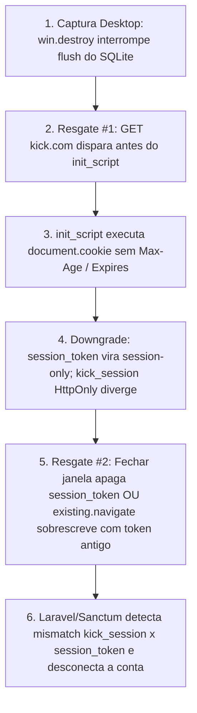
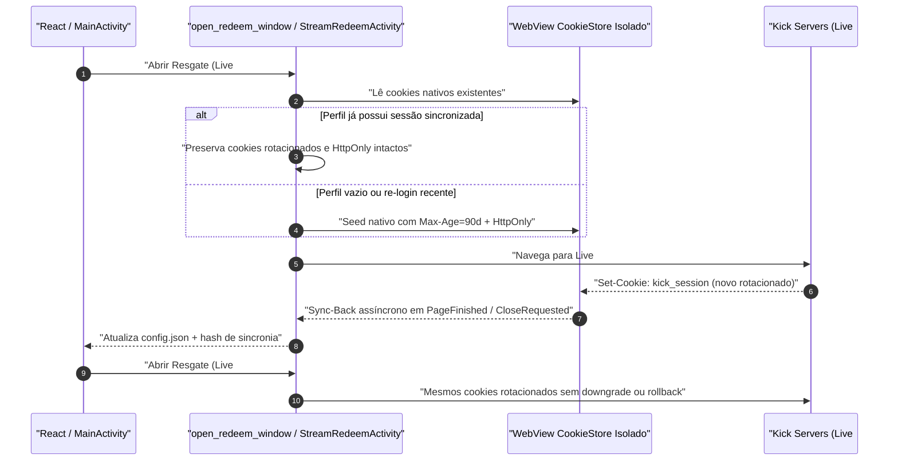

# Persistência de Sessões em Resgates e Verificador de Contas (`v4.0.1`)

Este documento especifica a correção definitiva do defeito crítico de desconexão em cadeia nos resgates da **Kick no Computador (Windows WebView2)** — enquanto no **Celular (Android)** o fluxo continua funcional — e define a arquitetura orientada a testes (TDD) do **Verificador Contínuo de Saúde de Contas**, garantindo operação estável **24/7 das 8 contas** (Twitch e Kick) em Windows e Android.

---

## 1. Diagnóstico Comparativo de Causa Raiz (Por que falha no Computador e funciona no Celular)

A análise comparativa direta entre o runtime Desktop (`kick/webview.rs`, `twitch/webview.rs`, `commands.rs` sobre Windows WebView2) e o runtime Android (`StreamRedeemActivity.kt` sobre `CookieManager` / `ProfileStore`) explica exatamente o comportamento observado:

| Etapa do Ciclo | Celular (Android — Funciona) | Computador (Windows WebView2 — Falha na 2ª Live) |
| :--- | :--- | :--- |
| **1. Captura de Login** | Extrai cookies via `CookieManager.getCookie` em Activity dedicada. | [`commands.rs`](file:///c:/Projetos/Chatter/src-tauri/src/commands.rs) executava **`win.destroy()`** imediato após ler cookies, encerrando o processo WebView2 antes do flush SQLite em `kick_profiles/{account_id}`. |
| **2. Injeção antes do Request** | `StreamRedeemActivity` chama `CookieManager.setCookie(...)` + `flush()` **ANTES** de `webView.loadUrl(targetUrl)`. | `kick/webview.rs` **NUNCA chamava `win.set_cookie(...)`**; passava `WebviewUrl::External` direto no `WebviewWindowBuilder`, disparando `GET https://kick.com/<live>` **ANTES** do `initialization_script`. |
| **3. Escrita via JS (`document.cookie`)** | Na abertura da 2ª live, `setupCookiesAndProfile()` reaplica cookies nativamente no mesmo processo Chromium do app. | `.initialization_script` injetava `document.cookie` **SEM `Max-Age`/`Expires`** em todo documento/iframe: 1) **`session_token` e `XSRF-TOKEN` viravam *session-only*** e eram **apagados ao fechar a janela** da 1ª live (encerramento do processo WebView2 isolado de `kick_profiles/{id}`); 2) **`kick_session` é `HttpOnly`**, impedindo atualização via JS (ou criando cookie sombra não-HttpOnly); 3) Na navegação entre lives (`existing.navigate`), os tokens **antigos** sobrescreviam tokens já rotacionados na 1ª live enquanto `kick_session` (`HttpOnly`) permanecia novo → **Laravel/Sanctum revogava a sessão inteira no servidor**. |
| **4. Retorno ao `config.json`** | Cookies mantidos em memória no processo único do app Android entre Activities. | Rotação ocorrida na 1ª live no Desktop nunca voltava para `AppState` / `config.json`, nem havia auto-reparo para perfis já corrompidos pela v4.0.0. |

| Camada | Defeito Identificado | Efeito Prático |
| :--- | :--- | :--- |
| **Desktop `kick/webview.rs`** | `open_redeem_window` registrava `.initialization_script` injetando `document.cookie = "session_token=..."` e `"kick_session=..."` sem `Max-Age`/`Expires`. | 1) Toda navegação ou reuso de janela (`existing.navigate`) reescrevia tokens **antigos** por cima de tokens já rotacionados; 2) Cookies persistentes viravam *session cookies* e eram apagados ao fechar a 1ª janela; 3) `kick_session` (`HttpOnly`) não pode ser atualizado via JS, criando divergência fatal. |
| **Desktop `twitch/webview.rs`** | `open_redeem_window` e `trigger_background_chest_claim` injetavam `document.cookie` sem `Max-Age` e duplicavam `.twitch.tv` + `www.twitch.tv`. | O auto-claim em segundo plano (25s) convertia `auth-token` em cookie temporário e removia a sessão do perfil ao fechar. |
| **Desktop `commands.rs`** | `save_kick_session` e `save_twitch_session` encerravam a janela com `win.destroy()`. | Encerramento abrupto antes do flush do SQLite de cookies do WebView2 no disco (`kick_profiles/` / `twitch_profiles/`). |
| **Android `StreamRedeemActivity.kt`** | `onPageStarted` executava `injectCookiesViaJs` em toda página; `buildKickCookies` / `buildTwitchCookieString` não tinham `Max-Age` nem `HttpOnly`; não havia sync de volta. | Tokens expiravam ao destruir a Activity e cookies rotacionados na 1ª live eram esmagados por tokens antigos do `AppConfig` ao abrir a 2ª live. |
| **Observabilidade / Startup** | Ausência de verificador de saúde de autenticação ao iniciar o app; `kick/watcher.rs` ignorava `401` em `fetch_channel_points`. | Contas expiradas passavam despercebidas e a Kick `/api/v1/user` retorna `HTTP 200 {}` quando deslogado (armadilha silenciosa). |

---

## 2. Arquitetura da Solução

### 2.1 Regra "Profile-First" & Native Cookies (`kick/webview.rs` e `twitch/webview.rs`)

1. **Eliminação total de `document.cookie` em `initialization_script` / `onPageStarted`**:
   - No **Desktop**, o `AUTO_CLAIM_TWITCH_SCRIPT` permanece injetado apenas para auto-clicar o baú (+50 pts) da Twitch, sem tocar em cookies.
   - No **Android**, `injectCookiesViaJs` é removido por completo.
2. **Pre-Seeding Nativo Antes da Navegação**:
   - No Desktop, a janela de resgate inicia em `about:blank`, consulta `cookies_for_url` via `spawn_blocking` (evitando deadlock na thread UI do WebView2) e **só aplica `win.set_cookie(...)`** se:
     - O perfil estiver **sem** o cookie obrigatório (`kick_session` ou `session_token` na Kick; `auth-token` na Twitch), **OU**
     - Uma nova autenticação explícita alterou o hash em `AppConfig` em relação ao marcador `.profile_sync_hash` (ou `SharedPreferences` no Android).
   - Cookies já presentes e rotacionados dentro do perfil **NUNCA são sobrescritos** por valores antigos.
3. **Atributos Persistentes e Autênticos**:
   - **Kick**:
     - `kick_session`: `Domain=.kick.com; Path=/; Secure; HttpOnly; SameSite=Lax; Max-Age=7776000` (90 dias).
     - `session_token`: `Domain=.kick.com; Path=/; Secure; SameSite=Lax; Max-Age=7776000` (preserva `%7C` na camada de cookie e decodifica `|` para cabeçalhos `Authorization: Bearer`).
     - `XSRF-TOKEN` (se presente): `Domain=.kick.com; Path=/; Secure; SameSite=Lax; Max-Age=7776000`.
   - **Twitch**:
     - `auth-token`: `Domain=.twitch.tv; Path=/; Secure; SameSite=Lax; Max-Age=7776000`.
4. **Sincronização Reversa (Sync-Back de Rotação)**:
   - Ao concluir carregamento de página na Kick (`on_page_load` `Finished`), na abertura/navegação e no evento `WindowEvent::CloseRequested` (e no `onPageFinished`/`onPause`/`onDestroy` do `StreamRedeemActivity.kt`), o app lê o cookie store atualizado do perfil e, caso `kick_session`, `session_token` ou `XSRF-TOKEN` tenham rotacionado, atualiza `AppConfig`, `config.json` e o hash `.profile_sync_hash`.
5. **Graceful Flush no Login (`commands.rs`)**:
   - Substituição de `win.destroy()` por `win.close()` + aguardo curto (`250ms`) para commit garantido do banco SQLite WebView2 no disco antes de finalizar o comando e disparar `verify_single_account`.

---

## 3. Verificador de Saúde de Contas (`accounts/` + Startup Loop + UI)

### 3.1 Contrato de Modelos (`accounts/models.rs`)

- **`AccountHealthState`**:
  - `healthy`: Autenticação validada com sucesso na API oficial e requisitos de resgate satisfeitos (`is_functional = true`).
  - `invalid`: Token/cookie rejeitado (`401`/`403`/payload vazio `{}` na Kick / `currentUser: null` na Twitch) ou ausência de `kick_session` para resgates WebView (`requires_reauth = true`).
  - `missing_credentials`: Conta cadastrada ainda sem token ou sessão capturada (`requires_reauth = true`).
  - `rate_limited`: HTTP `429` durante checagem (não marca conta como desconectada; tenta novamente no próximo ciclo).
  - `checking`: Verificação em andamento.
  - `network_error`: Falha transitória de rede/timeout (não acusa falso logout).
- **`AccountHealthStatus`**:
  - `account_id`, `platform`, `label`, `username`, `state`, `authenticated_username`, `username_matches`, `has_redeem_session`, `http_status`, `message`, `checked_at`, `requires_reauth`.
- **`AccountsHealthSummary`**:
  - `total`, `healthy`, `failing`, `checking`, `warning`, `all_healthy`, `checked_at`, `accounts: Vec<AccountHealthStatus>`.

### 3.2 Verificação Precisa por Plataforma (`accounts/verifier.rs`)

1. **Kick (`verify_kick_account`)**:
   - **Armadilha Conhecida Confirmada**: `GET https://kick.com/api/v1/user` retorna **`HTTP 200 OK` com corpo `{}`** quando desautenticado!
   - Portanto, o parser `parse_kick_user_response(status, body)` classifica:
     - `200..299` com JSON contendo `id` válido e/ou `username` não-vazio → `Authenticated(username)`.
     - `200..299` com `{}` ou sem `id`/`username` → `Unauthorized`.
     - `401` / `403` / JSON com `"Unauthenticated"` → `Unauthorized`.
     - `429` → `RateLimited`.
   - Envia **apenas** `Authorization: Bearer <session_token_decodificado>` via [`kick_http_request`](file:///c:/Projetos/Chatter/src-tauri/src/kick/http.rs) (bypass TLS Cloudflare via `curl.exe` no Windows / `OkHttp` no Android, **sem** enviar `Cookie: kick_session` para não provocar rotação fora da WebView). Caso `/api/v1/user` retorne `{}`, realiza fallback único em `/api/v2/channels/kick/points` para confirmar status `401` vs `200`.
   - Exige também que `account.kick_session` não esteja vazio para que a conta seja considerada 100% pronta para resgates em WebView.

2. **Twitch (`verify_twitch_account`)**:
   - Passo 1: `POST https://gql.twitch.tv/gql` com `Client-Id: kimne78kx3ncx6brgo4mv6wki5h1ko`, `Authorization: OAuth <clean_token>` e query `{ currentUser { id login displayName } }`.
   - Passo 2 (Fallback OAuth Externo): Se Passo 1 retornar `401` ou `currentUser == null`, valida via `GET https://id.twitch.tv/oauth2/validate` com `Authorization: OAuth <clean_token>`.
   - Token vazio/ausente → `MissingCredentials`; HTTP 401/null em ambos → `Invalid` (`requires_reauth = true`).

### 3.3 Ciclo de Execução, Escalonamento e Reatividade

- **Startup Automático (`lib.rs`)**: Assim que o aplicativo abre, `AppState::start_account_health_loop()` executa verificação inicial completa de todas as contas (escalonada com atraso suave de **650 ms** entre chamadas Kick para evitar `429` quando há 8+ contas).
- **Monitoramento Periódico 24/7**: Reexecuta automaticamente a cada **10 minutos (600s)** em segundo plano.
- **Reatividade em Tempo Real**:
  - Watchers (`kick/watcher.rs` quando `fetch_channel_points` ou `fetch_viewer_ws_token` recebem `401/403`, `twitch/watcher.rs` e `twitch/irc.rs` ao receber `:Login authentication failed`) reportam imediatamente falha de autenticação para `AppState::handle_watcher_auth_failure(...)` (com debounce de 30s), atualizando a UI via evento IPC `"accounts-health-updated"`.
  - Comandos IPC expostos: `verify_all_accounts`, `verify_account`, `get_accounts_health`.

### 3.4 Interface React (`src/`)

- **`Header.tsx`**: Exibe pílula de saúde global em tempo real (ex: `8/8 Contas OK` em esmeralda, ou alerta âmbar/vermelho clicável `7/8 Contas` que leva diretamente à aba **Contas**).
- **`App.tsx`**: Banner global de alerta no topo caso qualquer conta esteja expirada, inválida ou sem credenciais, informando exatamente quais contas falharam e oferecendo ações **"Ir para Contas"** e **"Reverificar Todas"**.
- **`AccountManager.tsx`**: Botão **"Verificar Todas (X/Y)"**, badge individual por conta com `@authenticated_username`, estado de verificação e botão de rechecagem individual.
- **`StreamCard.tsx`**: Indicador visual (verde/âmbar/vermelho) diretamente em cada botão de resgate de conta e confirmação protetiva caso a conta esteja marcada como desconectada antes de abrir a WebView.

---

## 4. Matriz de Especificação Orientada a Testes (TDD Matrix)

Todos os requisitos acima possuem suítes determinísticas divididas entre **Rust (`cargo test`)**, **TypeScript (`npm run test:*`)** e **Android JUnit (`gradlew test`)**:

| ID | Suite / Módulo | Caso de Teste | Expectativa Validada (Assert) |
| :--- | :--- | :--- | :--- |
| **TDD-01** | `accounts::tests` | `test_kick_user_empty_object_http_200_is_unauthorized` | `kick.com/api/v1/user` com HTTP `200` e corpo `{}` **DEVE** retornar `Unauthorized`, jamais `Healthy`. |
| **TDD-02** | `accounts::tests` | `test_kick_user_valid_json_extracts_username` | Payload `{"id": 123, "username": "player1"}` retorna `Authenticated("player1")`. |
| **TDD-03** | `accounts::tests` | `test_kick_missing_kick_session_flags_redeem_incomplete` | Mesmo com `session_token` válido, `kick_session` ausente marca `has_redeem_session = false` e `Invalid` com `requires_reauth = true`. |
| **TDD-04** | `accounts::tests` | `test_twitch_gql_and_oauth_validate_parsers` | GQL `currentUser` válido, `currentUser: null`, HTTP `401`, HTTP `429` e fallback `oauth2/validate` classificados exatamente. |
| **TDD-05** | `accounts::tests` | `test_aggregate_eight_accounts_health_summary` | Resumo com 8 contas (4 Twitch + 4 Kick) calcula `total=8`, `healthy`, `failing`, `all_healthy` corretamente para 8/8 OK e 7/8 com 1 expirada. |
| **TDD-06** | `accounts::tests` | `test_profile_first_never_overwrites_rotated_kick_cookies` | Se perfil já possui `kick_session` e `session_token` e hash coincide com sync anterior, `plan_kick_cookie_seeding` retorna lista vazia (não sobrescreve); se há cookies ausentes ou hash mudou por novo login externo, gera cookies com `HttpOnly=true` em `kick_session` e `Max-Age=7776000`. |
| **TDD-07** | `accounts::tests` | `test_kick_cookie_encoding_preserves_pct_and_decodes_bearer` | Valor `12345|abc` vira `12345%7Cabc` no cookie e `12345|abc` no Bearer sem dupla codificação. |
| **TDD-08** | `accounts::tests` | `test_kick_cookie_rotation_sync_detects_updated_session` | Mudança em `kick_session` ou `session_token` no WebView gera `AccountSessionUpdate` e novo hash; ausência de mudança não grava disco à toa. |
| **TDD-09** | `twitch::tests` | `test_redeem_script_does_not_overwrite_cookies` | O script de inicialização de resgate Twitch contém apenas `AUTO_CLAIM_TWITCH_SCRIPT`, sem `document.cookie`. |
| **TDD-10** | `StreamRedeemActivityTest.kt` | `testKickCookiesIncludeMaxAgeAndHttpOnly` / `testShouldSeedCookiesProfileFirst` / `testDetectKickCookieRotation` | `buildKickCookies` e `buildTwitchCookieString` incluem `Max-Age=7776000` e `HttpOnly` em `kick_session`; lógica profile-first bloqueia sobrescrita destrutiva; extração detecta rotação para sync-back. |
| **TDD-11** | `scripts/test-accounts-session.ts` | `npm run test:accounts` | Valida agregação de saúde das 8 contas no frontend, helpers de alerta de UI, bloqueio preventivo no clique de resgate e contrato de resumo `AccountsHealthSummary`. |
