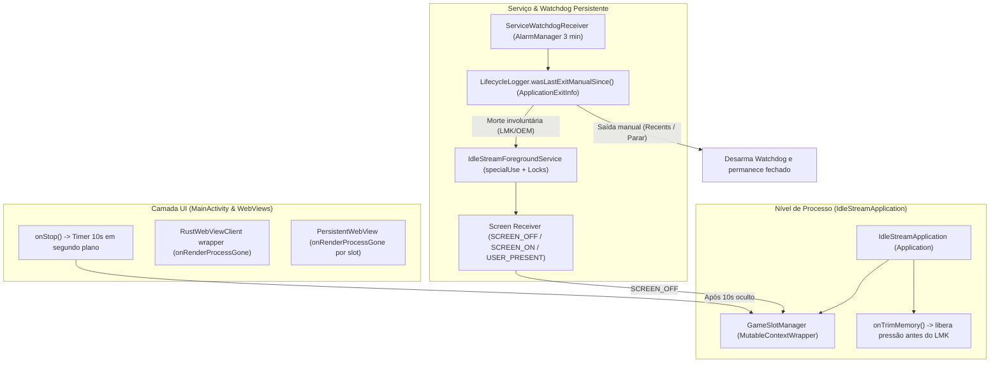
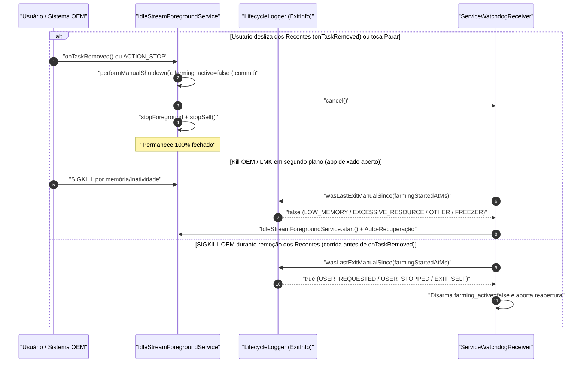

# Resiliência em Segundo Plano, Modo 1 FPS e Recuperação de Sessão (`v4.1.1` / `v4.1.2`)

Este documento especifica as proteções implementadas a partir da versão **4.1.1** e refinadas na **4.1.2** para garantir que o **IdleStream** permaneça ativo durante horas de tela bloqueada ou em segundo plano no Android — retomando automaticamente caso o sistema operacional ou um otimizador OEM encerre o processo — sem impedir que o usuário feche o aplicativo manualmente quando desejar.

---

## 1. Diagnóstico das Causas Raiz (Por que o App Resetava Durante a Madrugada)

Mesmo com o smartphone conectado ao carregador e sem economia de bateria ativa, um aplicativo mantido aberto na barra de Apps Recentes pode aparecer "resetado" na aba inicial ao ser reaberto após horas. Seis mecanismos distintos causavam esse comportamento:

| # | Causa Raiz Identificada | Efeito Prático |
| :--- | :--- | :--- |
| **1** | `GameSlotManager` acoplado ao ciclo de vida da `MainActivity` | Quando o Android destruía apenas a Activity em segundo plano para poupar RAM (mantendo o card nos Apps Recentes), `onDestroy()` encerrava todos os WebViews de jogos. |
| **2** | Queda isolada do processo Chromium Renderer sem `onRenderProcessGone` | No Android 8+, o sistema pode matar apenas o processo do WebView em segundo plano mantendo a Activity viva; ao retornar, a UI aparecia congelada/limpa sem recarregar. |
| **3** | Contrato incompleto do `IdleStreamForegroundService` em `ACTION_UPDATE` e `START_STICKY` | `updateStatus()` usava `startService` em vez de `ContextCompat.startForegroundService`, e reinícios `START_STICKY` (`intent == null`) não chamavam `startForeground()` imediatamente. |
| **4** | Restauração restrita ao flag `auto_start` | Lives e jogos abertos manualmente na sessão, além da aba ativa (`active_tab`), layout e Modo Ultra, não eram persistidos de forma atômica para auto-retomada após um kill do sistema. |
| **5** | Renderização contínua de GPU/FPS com tela bloqueada ou app oculto | Jogos continuavam renderizando em FPS alto mantendo texturas `LAYER_TYPE_HARDWARE`, elevando o consumo de GPU/RAM e tornando o processo alvo prioritário do LMK/OEM. |
| **6** | Fechamento manual confundido com morte involuntária (corrigido na `v4.1.2`) | Na `v4.1.1` (e legado `onTaskRemoved`), deslizar o app dos Apps Recentes acionava `tryRelaunchMainActivity()` e alarme imediato, tornando o aplicativo impossível de fechar manualmente. |

---

## 2. Arquitetura Multicamadas da Solução

---

## 3. Modo Ultra-Econômico Automático (1 FPS + Liberação de GPU)

Para reduzir drasticamente o risco de o kernel Linux (LMK) ou gerenciadores agressivos (HyperOS/MIUI, OneUI, ColorOS) encerrarem o processo durante a noite, o `GameSlotManager` alterna os slots para baixo consumo **sem pausar WebSockets nem `HackTimer` WebWorkers**:

1. **Gatilho Imediato — Tela Desligada (`ACTION_SCREEN_OFF`)**:
   - Registrado dinamicamente no [`IdleStreamForegroundService`](file:///C:/Projetos/Chatter/src-tauri/gen/android/app/src/main/java/com/idlestream/app/IdleStreamForegroundService.kt), aciona `setLowPowerBackgroundMode(true, "screen_off")` no instante em que a tela apaga.
2. **Gatilho Temporizado — 10 Segundos em Segundo Plano (`MainActivity.onStop()`)**:
   - Ao sair do foco do usuário (ex.: abrir outro aplicativo ou minimizar), [`MainActivity`](file:///C:/Projetos/Chatter/src-tauri/gen/android/app/src/main/java/com/idlestream/app/MainActivity.kt) agenda um `Handler` de **10.000 ms** (`backgroundLowPowerRunnable`).
   - Se o usuário retornar dentro dos 10 segundos (`onStart()` / `onResume()`), o callback é cancelado imediatamente.
   - Passados 10 segundos em segundo plano, `setLowPowerBackgroundMode(true, "background_10s")` entra em ação.
3. **Efeito nos WebViews de Jogo (`GameSlotManager.setLowPowerBackgroundMode`)**:
   - Chama `window.__setIdleStreamSlotHidden(true)` no motor `anti_sleep.js`, derrubando o loop visual (`requestAnimationFrame`) para **1 FPS** enquanto mantém WebWorkers (`HackTimer`), WebSockets e `/hunt` 100% vivos.
   - Troca o tipo de camada de hardware para `View.LAYER_TYPE_NONE`, liberando os framebuffers (FBO textures) na GPU.
   - Reduz a frequência do heartbeat nativo no watchdog de slots de `2s` (primeiro plano) para `10s` (segundo plano).
4. **Restauração Instantânea**:
   - Ao desbloquear a tela (`ACTION_USER_PRESENT` / `ACTION_SCREEN_ON` com app em foreground) ou reabrir a `MainActivity`, o `LAYER_TYPE_HARDWARE` e o FPS configurado pelo usuário (`10`, `30` ou `60 FPS`) são restaurados imediatamente.

---

## 4. Desacoplamento de WebViews & Recuperação de Crash (`onRenderProcessGone`)

### 4.1 `GameSlotManager` em Nível de `Application`
- Instanciado sob demanda em [`IdleStreamApplication`](file:///C:/Projetos/Chatter/src-tauri/gen/android/app/src/main/java/com/idlestream/app/IdleStreamApplication.kt), usando `MutableContextWrapper`.
- Em `MainActivity.onCreate()` / `onStart()`, `attachToActivity(this)` apenas reanexa o `FrameLayout` transparente ao novo root sem recarregar nenhuma WebView já ativa.
- Em `MainActivity.onDestroy()`, `detachFromActivity(this)` desanexa o container devolvendo a base context para `Application` — **os jogos continuam vivos** a menos que `isStoppingByUser` seja verdadeiro.
- Os slots em execução também são espelhados em `SharedPreferences` (`desired_game_slots_json`) para restauração imediata em caso de kill total do processo.

### 4.2 Resiliência a Quedas do Chromium (`onRenderProcessGone`)
- **WebView Principal (`MainActivity`)**: `wrapMainWebViewClientForCrashResilience()` envolve o `RustWebViewClient` gerado sem modificá-lo; se `onRenderProcessGone` disparar, agenda `recreate()` preservando o backend Rust e os slots de jogos intactos.
- **WebViews de Jogos (`GameSlotManager`)**: se um renderer de slot cair individualmente, o slot afetado destrói apenas a WebView morta e recria somente aquele slot com a URL salva, sem derrubar o app nem os demais slots.

---

## 5. Persistência Atômica e Restauração Unificada (`runtime_state.json`)

O núcleo Rust ([`config/models.rs`](file:///C:/Projetos/Chatter/src-tauri/src/config/models.rs), [`config/store.rs`](file:///C:/Projetos/Chatter/src-tauri/src/config/store.rs), [`state.rs`](file:///C:/Projetos/Chatter/src-tauri/src/state.rs)) introduz `RuntimeSessionState` ao lado de `config.json`:

- **Escrita Atômica (`write_atomic`)**: Tanto `config.json` quanto `runtime_state.json` são gravados em arquivo temporário `.tmp` seguido de `fs::rename`, evitando corrupção em kills abruptos de bateria/kernel.
- **Estado Persistido em `RuntimeSessionState`**:
  - `desired_active_streams: Vec<String>` (atualizado em `start_stream` / `stop_stream`).
  - `desired_active_game_slots: Vec<String>` (atualizado por `GameWorkspace.tsx`).
  - `active_tab` (`streams`, `games`, `votes`, `accounts`, `settings`), `game_layout`, `focused_game_slot_id`, `game_fps_tier` e `pokeidle_ultra`.
- **União no Boot (`compute_streams_to_restore`)**: Na inicialização em `lib.rs`, o app inicia todas as streams marcadas com `auto_start = true` **unidas sem duplicatas** a `desired_active_streams`, com verificação inicial do loop de vigília antecipada para **15 segundos** (e ciclos subsequentes de 300s).
- **Retomada Transparente no Frontend (`appStore.ts`)**: Restaura a aba ativa, FPS tier, layout e Modo Ultra, retomando apenas slots de jogos que já não estejam vivos nativamente no `GameSlotManager` e ocultando overlays automaticamente caso a aba restaurada não seja `games`.

---

## 6. Fechamento Manual vs. Morte Involuntária (`v4.1.2`)

A versão **4.1.2** corrigiu o ciclo de encerramento para que o app **nunca reabra após um fechamento manual do usuário**, mantendo a auto-recuperação estritamente para quedas involuntárias por inatividade, LMK ou garbage collector OEM:

### Regras de Decisão em [`LifecycleLogger.kt`](file:///C:/Projetos/Chatter/src-tauri/gen/android/app/src/main/java/com/idlestream/app/LifecycleLogger.kt):
- **Saídas tratadas como Manuais (`isManualExitReason == true`)**:
  - `REASON_USER_REQUESTED` (`10`, ex.: `"remove task"` nos Apps Recentes).
  - `REASON_USER_STOPPED` (`11`, "Forçar parada" em Configurações).
  - `REASON_EXIT_SELF` (`1`, encerramento limpo via botão "Parar").
  - `REASON_PERMISSION_CHANGE` (`8`) ou descrição contendo `"remove task"`.
- **Saídas tratadas como Involuntárias (`isManualExitReason == false`, elegíveis à auto-recuperação)**:
  - `REASON_LOW_MEMORY` (`3`), `REASON_EXCESSIVE_RESOURCE_USAGE` (`9`), `REASON_DEPENDENCY_DIED` (`12`), `REASON_OTHER` (`13`), `REASON_FREEZER` (`14`), `REASON_CRASH` / `REASON_CRASH_NATIVE` / `REASON_ANR`.
- **Filtro Temporal (`shouldTreatExitAsManualSince`)**: só considera uma saída manual do `ApplicationExitInfo` se o timestamp do encerramento for posterior ao início da sessão atual de farm (`exitTimestampMs >= sessionStartedAtMs - 5000`), evitando que um fechamento manual de ontem bloqueie a recuperação de hoje.

---

## 7. Orientações por Fabricante (OEM), Permissão de Sobreposição e Diagnóstico

- **`BatteryBanner.tsx` & `BatteryOptimizationHelper.kt`**:
  - Detecta se notificações (`POST_NOTIFICATIONS`) estão bloqueadas (impedindo o usuário de visualizar o serviço em primeiro plano).
  - Oferece botão direto **"Config. App"** (`openAppBatterySettings()`), botão opcional **"Permitir Auto-Recuperação"** (`SYSTEM_ALERT_WINDOW`, permitindo reabrir a `MainActivity` silenciosamente via `background_recovery=true` + `moveTaskToBack(true)` caso o OEM mate o processo) e um checklist expansível específico por fabricante (**Xiaomi/HyperOS/POCO**, **Samsung/OneUI**, **Motorola**, **Realme/Oppo/OnePlus**, **Android Genérico**).
- **Relatório de Diagnóstico (`SettingsTab.tsx` & `LifecycleLogger.kt`)**:
  - Registra em `lifecycle.log` rotativo (máx. 64 KB) eventos de criação/parada de serviço, `SCREEN_OFF`/`ON`, `BACKGROUND_10S`, `ON_RENDER_PROCESS_GONE`, `WATCHDOG_REVIVE` e `MANUAL_STOP`.
  - Na aba **Configurações → Diagnóstico**, consolida `ApplicationExitInfo` (Android 11+), status de `WakeLock`/`WifiLock`/permissões, `crash.log` (Java), `panic.log` (Rust) e eventos recentes em um único relatório copiável.
