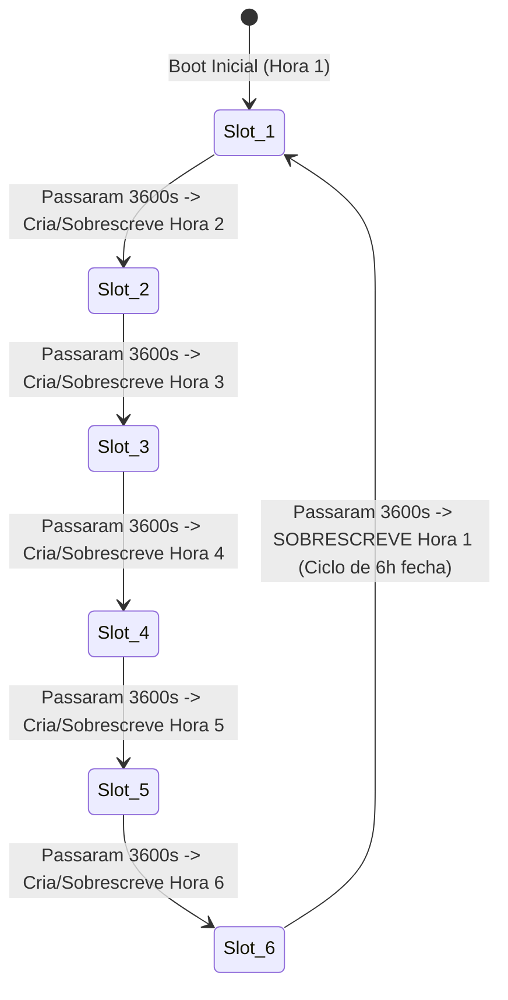

# Sistema de Auditoria e Logs Rotativos em Disco (`v4.2.0`)

Este documento especifica a arquitetura e operação do **Sistema de Auditoria e Logs de Execução** do **IdleStream**, concebido para fornecer rastreabilidade forense completa e diagnósticos detalhados sem introduzir **nenhum buffer ou consumo contínuo de memória RAM (0 MB em RAM)** e com **limite estrito de 6 horas de histórico** gravado em disco.

---

## 1. Princípios Arquiteturais & Diretrizes de Performance

A auditoria de um aplicativo de longa execução (24/7) frequentemente sofre com dois problemas clássicos:
1. **Memory Leaks por Acúmulo de Buffers**: Manter arrays de logs em memória RAM degrada a performance ao longo de dias e semanas.
2. **Crescimento Descontrolado em Disco**: Arquivos de log que crescem indefinidamente podem consumir gigabytes de armazenamento.

Para eliminar ambos os riscos de forma determinística, o IdleStream adota as seguintes diretrizes:

| Requisito | Diretriz Arquitetural | Implementação Técnica |
| :--- | :--- | :--- |
| **Consumo de RAM** | **Zero Buffer Contínuo (0 MB em RAM)** | Nenhum evento é retido em listas/vetores na heap do Rust ou do JavaScript. A escrita ocorre diretamente no arquivo físico via `write_all` e `flush` imediato. |
| **Janela Temporal** | **Últimas 6 Horas de Execução** | O histórico é segmentado em **6 arquivos de 1 hora** (`audit_hour_1.log` a `audit_hour_6.log`). |
| **Limite em Disco** | **Sobrescrita Circular Estrita ($\pmod 6$)** | Ao atingir 3.600 segundos (1 hora), o ponteiro de gravação avança para o próximo slot e **sobrescreve o arquivo gravado há 6 horas**, garantindo teto rígido de armazenamento. |
| **Leitura sob Demanda** | **Streaming sem Bloqueio de Thread** | A leitura dos logs para a interface visual ocorre apenas sob requisição explícita do usuário via IPC, utilizando `BufReader` e liberando a memória imediatamente após o envio. |

---

## 2. Estrutura Física em Disco & Mecanismo de Rotação (`logger/mod.rs`)

Os arquivos de auditoria residem no diretório de dados da aplicação (`<app_data>/audit/`):
- **Windows**: `%APPDATA%/com.idlestream.app/audit/`
- **Android**: `/data/user/0/com.idlestream.app/files/audit/`

```text
<app_data>/audit/
├── current_slot.json       ──> Metadados do slot corrente { "current_slot": 2, "hour_start_epoch": 1700003600 }
├── audit_hour_1.log        ──> Eventos gravados na Hora 1
├── audit_hour_2.log        ──> Eventos gravados na Hora 2 (Hora corrente)
├── audit_hour_3.log        ──> Eventos gravados na Hora 3
├── audit_hour_4.log        ──> Eventos gravados na Hora 4
├── audit_hour_5.log        ──> Eventos gravados na Hora 5
└── audit_hour_6.log        ──> Eventos gravados na Hora 6
```

### 2.1 Algoritmo de Avanço e Sobrescrita



A cada chamada da macro `audit_log!(category, level, message)`, o método `AuditLogger::log` verifica:
1. $T_{now} \ge T_{hour\_start} + 3600$:
   - Calcula $H_{passed} = (T_{now} - T_{hour\_start}) / 3600$.
   - Para cada hora transcorrida (até o limite de 6), trunca e recria o arquivo correspondente (`File::create`), inserindo o cabeçalho:
     `=== IDLESTREAM AUDIT LOG - HORA X (INÍCIO: YYYY-MM-DD HH:MM:SS) ===`
   - Atualiza `current_slot = ((current_slot - 1 + H_{passed}) % 6) + 1`.
   - Persiste atomicamente o estado em `current_slot.json`.
2. Formata a linha de log no padrão estruturado:
   `[YYYY-MM-DD HH:MM:SS.mmm] [LEVEL] [CATEGORY] Mensagem...`
3. Abre o arquivo do slot corrente com `OpenOptions::new().append(true)` e descarrega com `flush()`.

---

## 3. Categorias e Eventos Auditados

O sistema categoriza rigorosamente os eventos para viabilizar filtros forenses instantâneos:

| Categoria | Níveis Típicos | Eventos Auditados |
| :--- | :--- | :--- |
| `[ACCOUNTS]` | `INFO`, `WARN`, `ERROR` | Adição/remoção de contas, edição de rótulo/username (`update_account_info`), verificação de credenciais Twitch/Kick, status HTTP (200, 401, 403, 408), expiração de sessão e username confirmado. |
| `[LIVES]` | `INFO`, `WARN` | Inicialização e encerramento de streams, transição para **"Farmando"** ativo quando online, transição automática para **Modo Vigília (0 MB de RAM)** quando o canal encerra a transmissão. |
| `[GAMES]` | `INFO`, `WARN` | Inicialização e destruição de WebViews de slots (`slot-1` a `slot-4`), carregamento de URLs, aplicação de layouts (`Grid2x2`, `FocusSingle`), recarregamento de páginas e alteração de taxa de quadros (60 FPS, 10 FPS, 1 FPS Sleep). |
| `[VOTES]` | `INFO`, `WARN` | Abertura e fechamento da janela TopIdle, confirmação de votos realizados com incremento de total e marcação de carimbo, reset manual de temporizador. |
| `[SYSTEM]` | `INFO`, `ERROR` | Inicialização do aplicativo, inicialização do registrador de auditoria em disco, erros graves e eventos de ciclo de vida. |

---

## 4. Comandos IPC do Barramento Tauri (`commands.rs`)

| Comando IPC | Parâmetros | Retorno | Descrição |
| :--- | :--- | :--- | :--- |
| `get_audit_logs` | `filter_category: Option<String>`, `filter_level: Option<String>`, `search: Option<String>` | `Result<String, String>` | Lê os arquivos de log das últimas 6 horas em ordem cronológica via `BufReader`, aplicando os filtros requisitados em streaming sem alocar buffers desnecessários. |
| `clear_audit_logs` | Nenhum | `Result<(), String>` | Remove fisicamente todos os 6 arquivos de log em disco, reinicia o slot para a Hora 1 e recria o cabeçalho inicial. |
| `write_audit_log` | `category: String`, `level: String`, `message: String` | `Result<(), String>` | Permite que a camada frontend ou bridges nativas registrem eventos no subsistema de auditoria em disco. |

---

## 5. Visualizador de Logs na Interface (`AuditLogViewer.tsx`)

Localizado na aba **Configurações** (`SettingsTab.tsx`), o componente [`AuditLogViewer.tsx`](file:///c:/Projetos/Chatter/src/components/AuditLogViewer.tsx) provê uma interface de terminal profissional:

- **Selo de Garantia**: Exibe `Gravado em Disco (6h rotativo | 0 MB RAM)`.
- **Filtros por Categoria**: Pílulas de seleção rápida (`TODAS`, `ACCOUNTS`, `LIVES`, `GAMES`, `VOTES`, `SYSTEM`).
- **Filtros por Nível**: Pílulas coloridas (`TODOS`, `INFO`, `WARN`, `ERROR`).
- **Busca Textual em Tempo Real**: Campo de pesquisa com filtragem imediata.
- **Janela de Terminal Monospace**: Renderização estilo console escuro com syntax highlighting:
  - Timestamp em cinza neutro font-mono.
  - Pílulas coloridas de severidade (`[INFO]` verde, `[WARN]` âmbar, `[ERROR]` vermelho).
  - Pílulas de categoria (`[ACCOUNTS]` roxo, `[LIVES]` ciano, `[GAMES]` verde, `[VOTES]` laranja, `[SYSTEM]` azul).
- **Ações**:
  - **Atualizar**: Recarrega o conteúdo mais recente do disco.
  - **Copiar Relatório**: Copia todos os logs filtrados para a área de transferência com feedback visual ("Copiado!").
  - **Limpar Histórico**: Botão de segurança de 2 etapas (*"Confirmar Limpeza do Disco?"*) que expurga fisicamente os arquivos de log.

---

## 6. Cobertura de Testes Automatizados

O subsistema possui validação automatizada em duas frentes:

1. **Rust Core (`logger::tests`)**:
   - `test_hourly_rotation_and_overwrite_at_six_hours`: Simula a passagem de tempo, avanço de slots 1 $\rightarrow$ 6 e comprova a purga do conteúdo de 6 horas atrás na sobrescrita do slot 1.
   - `test_filtering_by_category_level_and_search`: Valida o isolamento de eventos por categoria, severidade e termos de busca.
   - `test_clear_logs_purges_all_files`: Comprova a deleção de todos os arquivos em disco e reinício limpo na Hora 1.
2. **Frontend (`scripts/test-audit-logger.ts`)**:
   - Valida definições de categorias e níveis.
   - Valida parser regex de formatação de linha.
   - Valida construção de payloads IPC e classificação visual para renderização.
