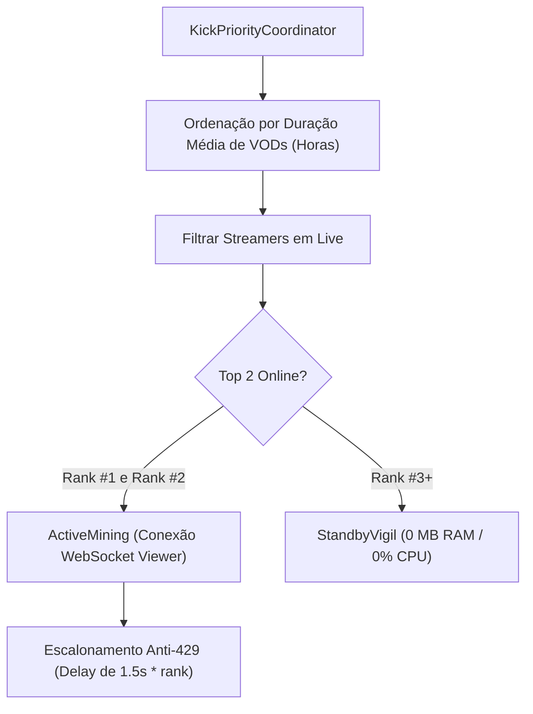
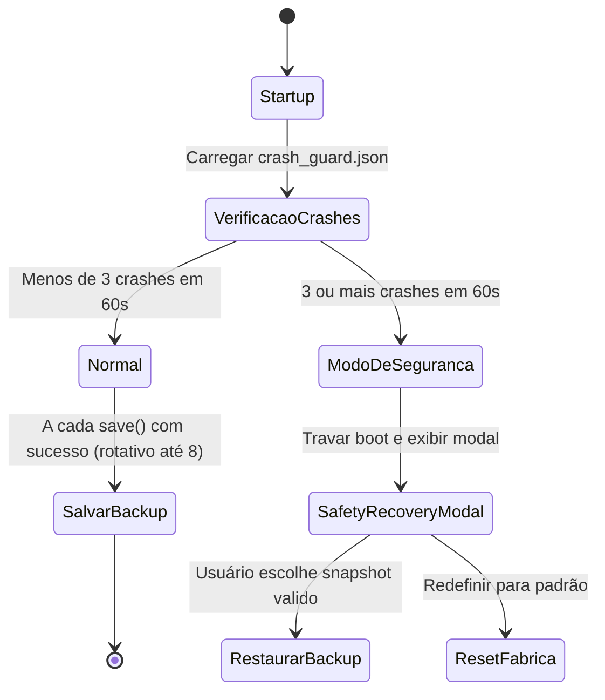
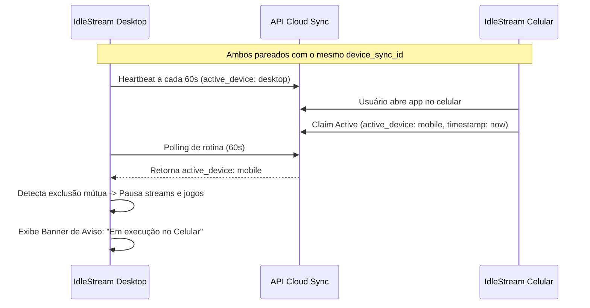
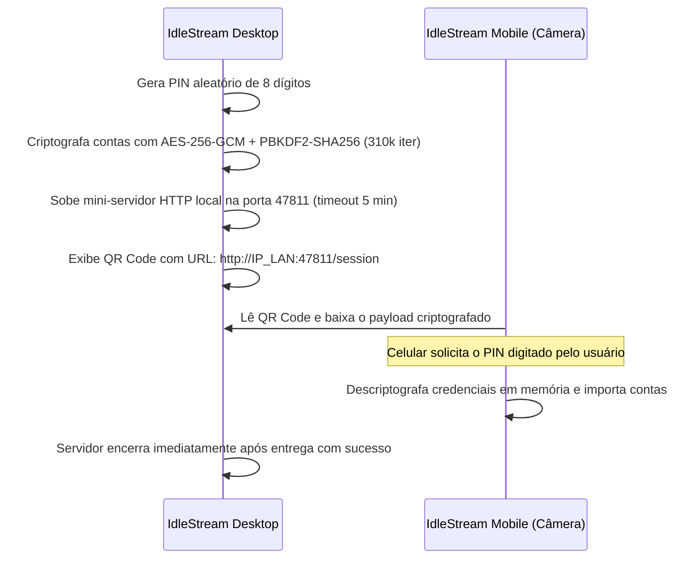

# Novos Subsistemas v4.3.0: Segurança, Alertas, Overlay OBS, Elo PC-Mobile e Exportação P2P

A versão **v4.3.0** introduz uma expansão arquitetural de grande escala no IdleStream, motivada por análise comparativa competitiva e refinamentos de experiência de uso contínuo 24/7. Este documento descreve as especificações técnicas, fluxos criptográficos e modelos de dados desses novos subsistemas.

---

## 1. Kick Engine: Expansão para 2 Lives Simultâneas por Conta

Historicamente limitado a 1 stream ativa simultânea por conta na plataforma Kick, o subsistema foi expandido para equiparar-se ao motor da Twitch, permitindo **até 2 slots de mineração concorrentes** por conta sem penalidade de rate-limit.

### Características Técnicas
- **Constante**: `MAX_CONCURRENT_KICK_SLOTS_PER_ACCOUNT = 2`.
- **Prevenção de HTTP 429**: Escalonamento gradual (*stagger sleep*) ao solicitar tokens em `/viewer/v1/token` caso o streamer possua rank > 1.
- **Failover Dinâmico**: Ao desconectar a stream do Rank #1, o streamer em Standby do Rank #3 é promovido para `ActiveMining` em tempo real via canal Tokio MPSC.

---

## 2. Rede de Segurança (`safety/mod.rs` & `SafetyRecoveryModal.tsx`)

Desenvolvido para garantir recuperação automática em caso de arquivos de configuração corrompidos ou falhas repetidas no ciclo de boot do runtime.

### Componentes Principais
1. **CrashLoopGuard**:
   - Persiste timestamps de inicialização em `crash_guard.json`.
   - Se o delta entre 3 inicializações consecutivas for inferior a 60 segundos, o app dispara o evento `crash-loop-detected` e ativa a flag de Modo de Segurança.
2. **Backups Atômicos Rotativos**:
   - Armazenados no subdiretório `backups/config_backup_TIMESTAMP.json`.
   - Política FIFO mantendo estritamente os **8 backups íntegros mais recentes**.

---

## 3. Despachador de Alertas Multicanal (`alerts/mod.rs` & `AlertSettingsCard.tsx`)

Módulo assíncrono em Rust desacoplado que centraliza e despacha notificações de eventos críticos para múltiplos destinos:

| Destino | Mecanismo | Formato / Headers |
|---|---|---|
| **Desktop Nativo** | Tauri Notification API | Notificação nativa do sistema operacional |
| **ntfy.sh** | HTTP POST `https://ntfy.sh/{topic}` | Headers `Title`, `Priority` (`urgent`/`default`), `Tags` |
| **Discord Webhook** | HTTP POST Discord Webhook URL | Payload JSON com `embeds`, cores temáticas e campos de dados |

### Eventos Monitorados
- `stream_offline`: Queda imprevista de transmissão em monitoramento.
- `auth_failure`: Expiração ou invalidação de token OAuth/Session Token.
- `redeem_failed`: Erro no resgate de recompensa ou pontos.
- `points_milestone`: Conquista de marco relevante de pontos acumulados.

### Rate-Limiting e Deduplicação
- Cache em memória com `last_sent: HashMap<(AlertChannel, AlertEventKind), Instant>`.
- Intervalo mínimo de **30 segundos** entre alertas idênticos para evitar saturação de push no celular ou webhook de Discord.

---

## 4. Elo PC ↔ Celular (Exclusão Mútua Bidirecional)

Garante que o usuário nunca tenha simultaneamente o aplicativo rodando no PC e no Celular coletando pontos e jogos na mesma rede ou conta, o que geraria descarte de sessões ou desconfiança pelas plataformas.

- **Independente de Wi-Fi**: Utiliza `api.restful-api.dev` com polling inteligente, funcionando mesmo quando o celular está em rede 3G/4G fora de casa.
- **Canal de Estado Separado**: Utiliza `device_sync_id` dedicado, sem risco de interferir no histórico e cooldown dos votos de `vote_sync_id`.

---

## 5. Overlay OBS Local (`overlay/mod.rs` & `OverlaySettingsCard.tsx`)

Servidor micro-HTTP local alimentado por `tiny_http` rodando em thread separada na porta `47850`:
- **`GET /overlay`**: Retorna uma página HTML moderna com fundo transparente (`background: rgba(0,0,0,0)`), projetada para ser adicionada como **Navegador (Browser Source)** no OBS Studio.
- **`GET /overlay/data`**: Retorna um payload JSON em tempo real com o status dos streams, pontos acumulados por hora, contas ativas e telemetria do jogo PokeIdle.

---

## 6. Freeze de Slots Inativos (0% GPU) (`games/manager.rs` & `anti_sleep.js`)

Solução técnica para máquinas com GPU integrada ou uso de múltiplos slots de jogos simultâneos:
1. Ao acionar o botão de congelamento de um slot inativo, o script de injeção captura um snapshot estático do `<canvas>` do jogo via `toDataURL('image/jpeg', 0.7)`.
2. O dado codificado em base64 é transmitido para o Rust via IPC (`__IDLESTREAM_SLOT_SNAPSHOT__|`).
3. O webview nativo subjacente do slot é **ocultado do compositor gráfico da GPU**, enquanto o frontend renderiza a imagem estática com o selo de `🧊 0% GPU (Congelado)`.
4. Ao descongelar, o webview é reposicionado e reexibido instantaneamente sem perder a sessão.

---

## 7. Telemetria Hook WebSocket do PokeIdle (`games/anti_sleep.js`)

A injeção de script monitora o tráfego do jogo PokeIdle através de um Proxy no `window.WebSocket`:
- Intercepta pacotes de inicialização e sincronização contendo level, XP atual, XP/hora e multiplicadores de bônus obtidos ao vincular a conta da Twitch e Kick.
- Os dados são transmitidos de forma assíncrona ao Rust e armazenados em cache no `GameSessionManager`.
- O frontend exibe no topo do card do jogo badges dinâmicos de status de desempenho em tempo real.

---

## 8. Exportação P2P de Sessões Mobile (`session_export/mod.rs`)

Permite transferir todas as contas configuradas no Desktop para o Celular sem digitar credenciais, cookies ou senhas manualmente, e sem enviar nenhum dado para a nuvem pública.

### Garantias de Segurança
- **Restrição de IP Privado**: O servidor rejeita requisições vindas de endereços IP fora das faixas privadas RFC1918 (`10.0.0.0/8`, `172.16.0.0/12`, `192.168.0.0/16`).
- **Criptografia Simétrica Militar**: Payload cifrado com `AES-256-GCM` com nonce de 12 bytes e salt de 16 bytes. A derivação da chave a partir do PIN de 8 dígitos exige 310.000 iterações de `PBKDF2-SHA256`.
- **Efeméride Estrita**: O servidor encerra automaticamente após 5 minutos de inatividade ou após o limite máximo de 3 tentativas de entrega.
