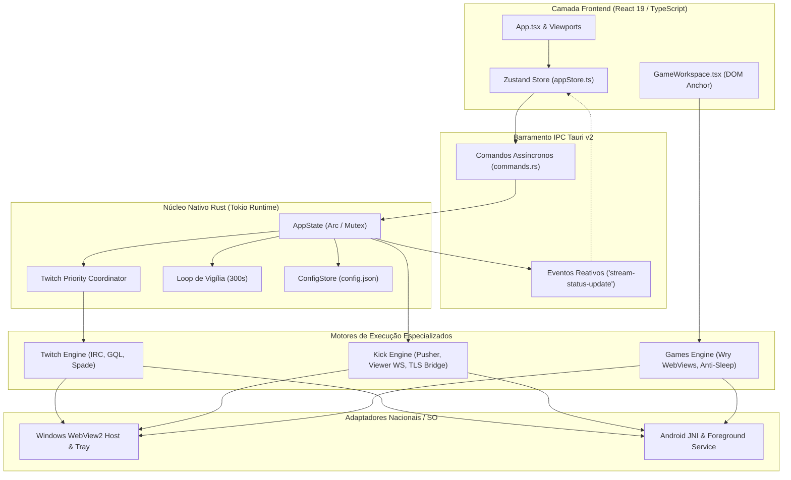

# IdleStream (Chatter) — Documentação Técnica de Engenharia

> [!NOTE]
> **IdleStream** (designação de engenharia: `Chatter`, identificador de bundle: `com.idlestream.app`) é uma plataforma desktop e mobile de alto desempenho, orientada a presença contínua, coleta de recompensas (Drops / Pontos de Canal em Twitch e Kick) e gerenciamento concorrente de sessões de jogos ociosos (*Idle Games*, com ênfase em PokeIdle).

Este repositório documental representa o **Map of Content (MOC)** e a base de conhecimento estruturada do projeto. Foi concebido tanto para navegação humana (compatível com visualizadores Markdown e o ecossistema **Obsidian** com suporte a Wiki Links) quanto para agentes autônomos de IA e ferramentas de busca semântica vetorial (RAG).

---

## 1. Apresentação do Projeto & Stack Tecnológica

| Componente | Especificação de Engenharia | Detalhes de Implementação |
| :--- | :--- | :--- |
| **Versão Corrente** | `4.1.1` | Produção / Estável (Windows NSIS & Android ARM64 APK) |
| **Framework Host** | **Tauri v2** (`@tauri-apps/cli ^2.0`, `@tauri-apps/api ^2.0`) | Modelo multi-janela, Child Webviews nativas (`wry`), IPC binário e JSON |
| **Runtime Rust Core** | **Rust 2021 Edition** | Assíncrono com `tokio 1.0` (Full), `tokio-tungstenite 0.24`, `futures-util 0.3` |
| **Camada HTTP / Web** | **Reqwest 0.12** (`rustls-tls`), `tiny_http 0.12` | Subprocesso `curl.exe` (Windows) e OkHttp Bridge (Android) para bypass TLS |
| **Frontend UI** | **React 19.1.0** + **TypeScript 6.0** | Componentes funcionais puros, Tailwind CSS v4, Lucide React 1.16 |
| **Estado Reativo** | **Zustand 5.0** | Store centralizada sem dependência de Context Provider, sync IPC reativo |
| **Build & Bundler** | **Vite 8.0** (`@vitejs/plugin-react 6.0`) | HMR ultrarrápido, asset pipelines segregados para Desktop e Android |
| **Segurança & Updater** | **Tauri Updater v2.14** + **Minisign** | Assinatura ed25519 de binários, verificação automática via `latest.json` |
| **Mobile Target** | **Android NDK 26+** (API 24+) | Compilação `aarch64-linux-android` (`cdylib`), Foreground Service Kotlin |

---

## 2. Índice Interativo Obsidian (MOC)

A documentação divide-se em 11 documentos técnicos especializados e este índice mestre:

| Documento | Título Formal | Escopo Técnico Resumido | Código-Fonte Referenciado | Status |
| :--- | :--- | :--- | :--- | :--- |
| **[[00-visao-geral]]** | Visão Geral, Negócio & Casos de Uso | Problema de farming de 10+ abas em Chrome, solução Headless Watcher (~1MB RAM), multi-contas, PokeIdle Hub e Votos Diários. | `src-tauri/src/state.rs`<br/>`scripts/benchmark-performance.ts` | **Concluído** |
| **[[01-arquitetura]]** | Arquitetura Geral & Barramento IPC | Topologia C4, fronteira IPC Tauri v2, ciclo de boot (`main.rs`, `lib.rs`), flags V8/WebView2 e canais assíncronos. | `src-tauri/src/lib.rs`<br/>`src-tauri/src/commands.rs` | **Concluído** |
| **[[02-twitch-engine]]** | Subsistema Twitch & Telemetria | IRC WebSocket, GQL Queries, Spade telemetria (`minute-watched`), claim de baús e Coordenador de Prioridade (máx 2 slots). | `src-tauri/src/twitch/` | **Concluído** |
| **[[03-kick-engine]]** | Subsistema Kick & TLS Bypass | Pusher WS multiplexado (16 canais/conn), Viewer WebSocket token, bridge TLS via `curl.exe` e OkHttp JNI. | `src-tauri/src/kick/` | **Concluído** |
| **[[04-games-engine]]** | Game Workspace & Motor Anti-Sleep | Child Webviews Wry, layouts dinâmicos (Grid/Focus/Sidebar), motor anti-sleep JS, rAF override e extensão `/hunt`. | `src-tauri/src/games/`<br/>`src/components/games/` | **Concluído** |
| **[[05-backend-core]]** | Backend Core, Estado & Dicionário IPC | `AppState` thread-safe, persistência `config.json`, Modo Vigília (300s loop), migrações e catálogo exaustivo de comandos IPC. | `src-tauri/src/state.rs`<br/>`src-tauri/src/config/` | **Concluído** |
| **[[06-frontend]]** | Camada Frontend React 19 & Zustand | Store Zustand, catálogo de telas/componentes, ciclo reativo de eventos de live/voto e serviços de adaptação mobile/desktop. | `src/`<br/>`src/stores/appStore.ts` | **Concluído** |
| **[[07-multiplataforma-android]]** | Multiplataforma, JNI & Android Build | Foreground Service, Wakelock, VoteWebViewManager, AlarmManager, bridges Kotlin e pipeline `build-android.ps1`. | `src-tauri/gen/android/`<br/>`scripts/build-android.ps1` | **Concluído** |
| **[[08-operacao-e-scripts]]** | Operação, Suíte de Testes & Release | Esteira de testes automatizados (`scripts/*.ts`), assinatura Minisign, atualização via GitHub Releases e diagnóstico de falhas. | `scripts/`<br/>`RELEASE_GUIDE.md` | **Concluído** |
| **[[09-sistema-de-votos]]** | Sistema de Votos Diários TopIdle | WebView interativa sob demanda (0 MB em repouso), whitelist TopIdle/OAuth/CAPTCHA, reuso Google e alertas de 24h 01m. | `src-tauri/src/votes/`<br/>`src/components/votes/` | **Concluído** |
| **[[10-sessoes-resgates-e-verificador]]** | Sessões Persistentes & Verificador de Contas | Estratégia Profile-First (cookies nativos `Max-Age=90d` + `HttpOnly`), sync-back de rotação e verificador contínuo das 8 contas Twitch/Kick. | `src-tauri/src/accounts/`<br/>`src/utils/accountHealth.ts` | **Concluído** |

---

## 3. Matriz de Busca Rápida para IAs (Code-to-Doc Mapping)

Esta tabela mapeia diretamente qualquer diretório ou arquivo do repositório para o documento de especificação técnica que o descreve em detalhes:

```text
C:\Projetos\Chatter\
├── src-tauri\
│   ├── src\
│   │   ├── main.rs, lib.rs                 ──> [[01-arquitetura]]
│   │   ├── commands.rs                     ──> [[01-arquitetura]], [[05-backend-core]]
│   │   ├── state.rs                        ──> [[01-arquitetura]], [[05-backend-core]], [[10-sessoes-resgates-e-verificador]]
│   │   ├── live_check.rs                   ──> [[05-backend-core]]
│   │   ├── accounts\                       ──> [[10-sessoes-resgates-e-verificador]]
│   │   │   ├── mod.rs, models.rs, session_sync.rs, verifier.rs, tests.rs
│   │   ├── config\                         ──> [[05-backend-core]]
│   │   │   ├── mod.rs, models.rs, store.rs
│   │   ├── twitch\                         ──> [[02-twitch-engine]]
│   │   │   ├── irc.rs, gql.rs, spade.rs, coordinator.rs, watcher.rs, webview.rs, auth.rs, models.rs
│   │   ├── kick\                           ──> [[03-kick-engine]]
│   │   │   ├── pusher.rs, watcher.rs, http.rs, auth.rs, webview.rs
│   │   ├── games\                          ──> [[04-games-engine]]
│   │   │   ├── manager.rs, commands.rs, anti_sleep.js, hunt_extension.js
│   │   └── votes\                          ──> [[09-sistema-de-votos]]
│   │       ├── manager.rs, policy.rs, notifier.rs, commands.rs, vote_observer.js
│   └── gen\android\                        ──> [[07-multiplataforma-android]], [[09-sistema-de-votos]]
│       └── app\src\main\java\com\idlestream\app\
│           ├── MainActivity.kt, IdleStreamForegroundService.kt, KickHttpBridge.kt, GameSlotManager.kt
│           └── VoteUrlPolicy.kt, VoteWebViewManager.kt, VoteNotificationHelper.kt, VoteAlarmReceiver.kt
├── src\
│   ├── main.tsx, App.tsx, App.css          ──> [[06-frontend]]
│   ├── stores\appStore.ts                  ──> [[06-frontend]]
│   ├── components\                         ──> [[06-frontend]]
│   │   ├── Header.tsx, Sidebar.tsx, BottomNav.tsx, StreamCard.tsx, AccountManager.tsx
│   │   ├── games\GameWorkspace.tsx         ──> [[04-games-engine]], [[06-frontend]]
│   │   └── votes\VoteWorkspace.tsx         ──> [[09-sistema-de-votos]], [[06-frontend]]
│   ├── services\                           ──> [[06-frontend]], [[07-multiplataforma-android]], [[09-sistema-de-votos]]
│   │   ├── gamePlatformService.ts, votePlatformService.ts, updaterService.ts
│   └── types\index.ts, utils\              ──> [[06-frontend]]
└── scripts\                                ──> [[08-operacao-e-scripts]]
    ├── build-android.ps1, sign-release.ps1, benchmark-performance.ts, test-*.ts
```

---

## 4. Guia Rápido de Ação: "Onde Agir por Cenário de Desenvolvimento"

Esta matriz orienta diretamente novos desenvolvedores ou agentes de IA sobre **quais arquivos, funções e structs modificar** para implementar qualquer nova funcionalidade sem adivinhações:

| Cenário de Modificação / Feature | Arquivos do Backend Rust / Kotlin | Arquivos do Frontend React / TS | Documento Técnico de Referência |
| :--- | :--- | :--- | :--- |
| **Adicionar Nova Plataforma de Stream** (ex: YouTube Live, Trovo) | 1. `config/models.rs` (`enum Platform`)<br/>2. `live_check.rs` (função de live check)<br/>3. Nova pasta `src-tauri/src/<plataforma>/`<br/>4. `state.rs` (`start_stream`, `stop_stream`) | 1. `src/types/index.ts` (`Platform`)<br/>2. `src/components/AddStreamModal.tsx`<br/>3. `src/components/StreamCard.tsx` (badge/render) | **[[02-twitch-engine]]**<br/>**[[03-kick-engine]]**<br/>**[[05-backend-core]]** |
| **Ajustar Modo Vigília (Standby) & Auto-Live** | 1. `state.rs` (`start_vigilance_loop`, timer 300s)<br/>2. `live_check.rs` (`check_twitch_live`, `check_kick_live`)<br/>3. `config/models.rs` (`AppSettings.auto_live_only`) | 1. `src/components/SettingsTab.tsx`<br/>2. `src/stores/appStore.ts` | **[[01-arquitetura]]**<br/>**[[05-backend-core]]** |
| **Ajustar Telemetria de Drops ou Baús Twitch** | 1. `twitch/spade.rs` (`build_spade_payload`)<br/>2. `twitch/gql.rs` (`claim_community_points`)<br/>3. `twitch/coordinator.rs` (`MAX_CONCURRENT_ACTIVE_SLOTS_PER_ACCOUNT`)<br/>4. `twitch/webview.rs` (`AUTO_CLAIM_TWITCH_SCRIPT`) | 1. `src/components/StreamCard.tsx`<br/>2. `src/stores/appStore.ts` (`openStreamRedeem`) | **[[02-twitch-engine]]** |
| **Ajustar Kick (Bypass TLS, Pusher ou Pontos)** | 1. `kick/http.rs` (`kick_http_request`)<br/>2. `kick/pusher.rs` (`KickAccountSession`)<br/>3. `kick/watcher.rs` (loops de 10s e 120s)<br/>4. `kick/auth.rs` (`authenticate_pusher_channel`) | 1. `src/components/AddAccountModal.tsx`<br/>2. `src/stores/appStore.ts` (`saveKickSession`) | **[[03-kick-engine]]** |
| **Adicionar Jogos ou Alterar Motor Anti-Sleep** | 1. `games/manager.rs` (`start_game_slot`, `apply_layout`)<br/>2. `games/anti_sleep.js` (rAF dispatcher, áudio `IsAudible`, GC)<br/>3. `games/hunt_extension.js` (tabelas PokeIdle) | 1. `src/components/games/GameWorkspace.tsx`<br/>2. `src/services/gamePlatformService.ts` | **[[04-games-engine]]** |
| **Ajustar Votos Diários TopIdle & Notificações** | 1. `votes/policy.rs` & `votes/manager.rs`<br/>2. `votes/notifier.rs` (24h 01m scheduler)<br/>3. `VoteWebViewManager.kt` & `VoteAlarmReceiver.kt` | 1. `src/components/votes/VoteWorkspace.tsx`<br/>2. `src/services/votePlatformService.ts`<br/>3. `scripts/test-votes.ts` | **[[09-sistema-de-votos]]** |
| **Ajustar Persistência em Resgates & Saúde das 8 Contas** | 1. `accounts/session_sync.rs` & `accounts/verifier.rs`<br/>2. `kick/webview.rs`, `twitch/webview.rs` (`Profile-First`)<br/>3. `StreamRedeemActivity.kt` & `state.rs` | 1. `src/utils/accountHealth.ts`<br/>2. `src/components/Header.tsx`, `AccountManager.tsx`, `StreamCard.tsx`<br/>3. `scripts/test-accounts-session.ts` | **[[10-sessoes-resgates-e-verificador]]** |
| **Criar Novo Comando IPC (Rust $\leftrightarrow$ React)** | 1. `commands.rs` ou `games/commands.rs` (`#[tauri::command]`)<br/>2. `lib.rs` (adicionar em `tauri::generate_handler![...]`) | 1. `src/stores/appStore.ts` (`invoke('nome_comando', ...)`) | **[[01-arquitetura]]**<br/>**[[05-backend-core]]** |
| **Modificar Telas, Modais ou Estado da UI** | N/A (Consome comandos IPC existentes) | 1. `src/stores/appStore.ts` (estado / actions)<br/>2. `src/App.tsx` (roteamento e modais)<br/>3. `src/components/` (componentes atômicos) | **[[06-frontend]]** |
| **Alterar Notificação ou Fundo no Android** | 1. `IdleStreamForegroundService.kt` (notificação e locks)<br/>2. `KickHttpBridge.kt` & `MainActivity.kt` (JNI / JS Bridge)<br/>3. `kick/http.rs` (`update_android_notification`) | 1. `src/services/gamePlatformService.ts`<br/>2. `src/components/BatteryBanner.tsx` | **[[07-multiplataforma-android]]** |
| **Compilar, Assinar e Publicar Release** | 1. `scripts/build-android.ps1` (APK)<br/>2. `scripts/sign-release.ps1` (Assinatura Minisign)<br/>3. `latest.json` (Manifesto do auto-updater) | 1. `src/services/updaterService.ts`<br/>2. `RELEASE_GUIDE.md` | **[[08-operacao-e-scripts]]** |

---

## 4. Glossário Fundamental de Engenharia & Termos de Domínio

- **Headless Native Watcher**: Mecanismo proprietário do IdleStream que substitui a carga de um player de vídeo completo de navegador (HTML5 Video + WebGL + Decodificador H.264/AV1) por conexões de rede nativas (WebSockets IRC/Pusher + pings esparsos de CDN HLS + heartbeats de telemetria). Reduz o consumo de ~250 MB por live para ~1 MB (Twitch) ou ~60 MB (Kick).
- **Standby Vigil (Modo Vigília)**: Estado de latência ultraeconômica em que um streamer configurado é monitorado periodicamente a cada 300 segundos sem conexões ativas de WebSocket ou player. Ao entrar ao vivo, o sistema promove o canal automaticamente para execução ativa.
- **Active Mining**: Estado operacional no qual uma conta está ativamente conectada ao chat, validando presença e recebendo pacotes de watch-time para geração de Channel Points / Drops. Na Twitch, é estritamente limitado pelo coordenador a 2 slots simultâneos por conta para evitar bloqueios de telemetria.
- **Coordenador de Prioridade de Contas (`AccountPriorityCoordinator`)**: Módulo concorrente em Rust que analisa a média histórica de horas de live dos canais (`avg_duration_hours` via VODs) e gerencia uma fila dinâmica: se 3 ou mais canais monitorados por uma conta estiverem online, os 2 com maior probabilidade de tempo em live permanecem minerando e os demais ficam em fila de espera (`StandbyVigil`). Se um streamer primário cai, a fila é promovida instantaneamente.
- **Anti-Sleep Engine**: Conjunto de injeções em JavaScript (`anti_sleep.js`) aplicado nas instâncias de jogos que neutraliza os mecanismos de throttling de navegadores baseados em Chromium: falsifica `document.hidden = false`, desvia eventos `blur`, substitui o `requestAnimationFrame` nativo por um ticker determinístico acionado por `setInterval` e executa áudio silencioso para conceder imunidade a descarte de processos.
- **Spade Telemetry**: Sistema oficial de telemetria da Twitch (`https://spade.twitch.tv/track`) responsável pelo cômputo de minutos assistidos (`minute-watched`) exigido para progressão de Twitch Drops e Pontos de Canal.
- **Kasada / Anti-bot Bypass**: Estratégia de interoperabilidade na qual o IdleStream emula o Client ID do aplicativo oficial Android da Twitch (`kd1unb4b...`) acompanhado do User-Agent `okhttp/4.12.0`, isentando chamadas GraphQL da exigência de tokens `Client-Integrity` complexos que afetam navegadores web.
- **Child Webview**: Recurso avançado do Tauri v2 / Wry no qual janelas Webview secundárias são instanciadas como filhas da janela principal, mantendo processos de renderização e contextos de armazenamento isolados, mas perfeitamente dimensionadas sobre o layout React via cálculo geométrico de limites.
- **AndroidBridge**: Interface JavaScript exposta nativamente via `@JavascriptInterface` no WebView do Android que permite à interface React comunicar-se diretamente com o runtime Kotlin, invocando serviços de segundo plano, gerenciadores de slot e diálogos do sistema.

---

## 5. Grafo Arquitetural do Ecossistema IdleStream



---

## 6. Próximos Passos & Roteiro de Leitura Recomendado

Para aprofundar-se nos aspectos conceituais e entender detalhadamente o problema de consumo de recursos que motivou o projeto:
👉 Siga para: **[[00-visao-geral]] — Visão Geral, Conceito de Negócio e Casos de Uso**.
