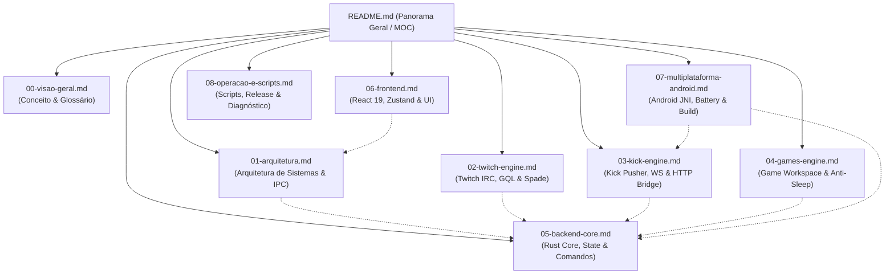

# Planejamento Estratégico de Documentação Técnica: IdleStream (Chatter)

Este documento estabelece o plano diretor para a construção da base de conhecimento e documentação de engenharia completa do projeto **IdleStream** (também referenciado como **Chatter**), localizada no diretório `C:\Projetos\Chatter\Docs`.

A documentação foi projetada para cumprir dois objetivos fundamentais com excelência:
1. **Legibilidade e navegabilidade humana fluida** (via visualizadores Markdown e Obsidian, com sumários, tipografia clara, diagramas conceituais e links bidirecionais).
2. **Alta densidade informacional e precisão para Modelos de IA Agêntica** (frontmatter YAML estruturado, assinaturas de tipo exatas, tabelas de payload IPC/WebSocket, fluxos de execução passo a passo, contratos de erro, diagramas Mermaid e caminhos absolutos/relativos de código).

---

## 1. Visão Geral da Arquitetura de Documentação

A documentação será composta por **1 arquivo mestre de índice/panorama geral** e **8 documentos de especialização técnica profunda**, interligados por **Wiki Links Obsidian** (`[[Nome-Do-Arquivo]]` ou `[[Nome-Do-Arquivo#Seção|Texto]]`).



---

## 2. Padrão Estrutural Obrigatório para Todos os Documentos

Para maximizar a eficiência de agentes de IA e a consistência humana, **todo arquivo gerado deve seguir o seguinte cabeçalho Frontmatter YAML padronizado**:

```yaml
---
id: "DOC-ID"
title: "Título Técnico Descritivo"
category: "architecture | backend | frontend | mobile | ops"
tags: [idlestream, tauri-v2, rust, react, twitch, kick, pokeidle]
related_code:
  - "src-tauri/src/..."
  - "src/..."
wiki_links:
  - "[[README]]"
  - "[[Outro-Doc]]"
status: "completed"
version: "3.2.3"
last_updated: "2026-11-07"
summary: "Resumo executivo de 2-3 frases sobre o escopo deste documento para indexação vetorial e contextualização rápida de LLMs."
---
```

---

## 3. Estrutura Detalhada por Arquivo e Etapas de Execução

O processo será conduzido em **9 etapas sequenciais de execução e validação mútua**.

---

### ETAPA 0: O MOC Mestre (Map of Content)
**Arquivo:** `C:\Projetos\Chatter\Docs\README.md`

#### Objetivo & Função:
Atuar como o ponto de entrada primário ("Single Source of Navigation") para humanos e IAs. Fornecer uma visão em árvore, tabela de dependências cruzadas e matriz de busca por funcionalidade ou arquivo de código.

#### Tópicos e Conteúdos Exigidos:
1. **Apresentação do Projeto**: Nome, versão (3.2.3), stack (Tauri v2, Rust 2021, React 19, TypeScript, Tailwind 4, Zustand).
2. **Índice Interativo Obsidian (MOC)**: Tabela contendo:
   - Link Wiki Obsidian (`[[00-visao-geral]]`, etc.)
   - Título formal
   - Escopo resumido
   - Módulos de código mapeados
3. **Matriz de Busca Rápida para IAs (Code-to-Doc Mapping)**:
   - Mapeamento exato de cada pasta e arquivo de `src/` e `src-tauri/src/` para seu respectivo documento de referência técnica.
4. **Glossário Fundamental de Termos**: (Watcher nativo, Standby Vigil, Active Mining, Anti-Sleep Engine, Spade Telemetry, Kasada Bypass, Child Webview, AndroidBridge).
5. **Grafo de Relacionamentos**: Diagrama Mermaid de dependências entre os módulos.

---

### ETAPA 1: Conceito, Propósito e Funcionamento do Negócio
**Arquivo:** `C:\Projetos\Chatter\Docs\00-visao-geral.md`

#### Objetivo & Função:
Documentar *o que* o software faz, *por que* foi desenhado desta forma e *quais problemas resolve*.

#### Tópicos e Conteúdos Exigidos:
1. **Problema do Farming Tradicional**: O consumo excessivo de memória/CPU ao manter 10+ abas de Chrome abertas para farming de Twitch Drops e Pontos de Canal (~150MB a 300MB por aba com decode de vídeo e execução de JavaScript pesado).
2. **A Solução IdleStream**:
   - Abordagem "Headless Native Watcher": Consumo de ~1 MB de RAM por stream Twitch (via GQL + IRC + HLS CDN Ping) contra centenas de MB de um navegador.
   - Kick Watcher: Consumo de ~60 MB via viewer WebSocket dedicado e Pusher.
3. **Segregação de Múltiplas Contas**: Como o app permite vincular várias contas simultâneas a uma mesma stream sem colisões de sessão ou conflitos de tokens.
4. **Hub Multi-Slot de Idle Games**: Propósito do suporte ao PokeIdle em até 4 slots simultâneos mantendo-os em execução em segundo plano sem descarte de abas pelo Chromium.
5. **Casos de Uso**:
   - Modo 24/7 em desktop (Modo Vigília em segundo plano na bandeja do sistema).
   - Uso mobile Android com serviço em primeiro plano (Foreground Notification) imune à suspensão de bateria.

---

### ETAPA 2: Arquitetura Geral do Sistema e IPC
**Arquivo:** `C:\Projetos\Chatter\Docs\01-arquitetura.md`

#### Objetivo & Função:
Detalhar a engenharia do software, separação de fronteiras, modelos de concorrência e o protocolo de comunicação interna.

#### Tópicos e Conteúdos Exigidos:
1. **Topologia de Camadas (Diagrama C4 / Arquitetura em Bloco)**:
   - Camada Frontend (React 19 / Vite / Tailwind 4 / Zustand)
   - Fronteira IPC Tauri v2 (Commands com tipagem serde e Events reativos)
   - Núcleo Nativo Rust (Tokio Runtime assíncrono, Mutex de estado, Channels MPSC/Watch)
   - Plataformas Nativas (Windows WebView2 Flags especiais vs Android JNI & Native Activity)
2. **Ciclo de Inicialização do Aplicativo**:
   - Fluxo de inicialização em `main.rs` e `lib.rs`: flags do WebView2 anti-throttling (`--disable-background-timer-throttling`, `--expose-gc`), interceptação de fechamento de janela para minimizar na bandeja, inicialização da store de configuração, spawn do loop de vigília.
3. **Gerenciamento de Estado Concorrente**:
   - Detalhamento do `AppState` (`Arc<AppState>`): `config`, `twitch_sessions`, `twitch_watchers`, `kick_watchers`, `statuses`, `twitch_coordinator`.
   - Uso de chaves compostas de sessão: `"streamId:accountId"`.
4. **Protocolo IPC & Eventos**:
   - Catálogo do evento `stream-status-update` (formato do payload, frequência de disparo, push reativo para a UI sem polling).
5. **Ponte de Comunicação Android**:
   - Interface `window.AndroidBridge` exposta ao frontend.
   - Chamadas JNI de Rust para Java (`KickHttpBridge.java`).

---

### ETAPA 3: Twitch Engine (IRC, GQL, Spade & Multi-Account Coordinator)
**Arquivo:** `C:\Projetos\Chatter\Docs\02-twitch-engine.md`

#### Objetivo & Função:
Documentar com máxima profundidade o subsistema Twitch, incluindo engenharia reversa de APIs, protocolos de chat e telemetria.

#### Tópicos e Conteúdos Exigidos:
1. **IRC WebSocket (`twitch/irc.rs`)**:
   - Conexão com `wss://irc-ws.chat.twitch.tv:443`.
   - Fluxo de autenticação (`PASS oauth:...`, `NICK ...`, `CAP REQ :twitch.tv/membership`, `JOIN #canal`).
   - Loop de keepalive PING/PONG e estratégia de reconexão automática com backoff.
2. **Camada GraphQL (`twitch/gql.rs`)**:
   - Tabela de Client IDs utilizados: Web (`kimne78k...`), Android (`kd1unb4b...`), SmartTV (`ue6666qo...`).
   - Query pública de status de live vs Query autenticada `ChannelPointsContext`.
   - Cálculo de média de duração de VODs (`fetch_streamer_uptime_avg`).
   - Consulta e resgate de baú de pontos de canal (`claim_community_points`).
   - **Técnica de Bypass Kasada / Anti-bot**: Uso do Client ID Android com User-Agent `okhttp/4.12.0` para contornar verificações de integridade de navegador.
3. **Telemetria Spade (`twitch/spade.rs`)**:
   - Formato do payload base64 do evento `minute-watched`.
   - Parâmetros obrigatórios (`channel_slug`, `channel_id`, `broadcast_id`, `user_id`).
   - Endpoint de envio (`https://spade.twitch.tv/track`).
4. **Coordenador de Prioridade de Contas (`twitch/coordinator.rs`)**:
   - **Regra de Negócio**: Limite estrito de 2 slots ativos simultâneos por conta Twitch (`MAX_CONCURRENT_ACTIVE_SLOTS_PER_ACCOUNT = 2`).
   - Algoritmo de ranking por horas médias de VOD (`avg_duration_hours`).
   - Máquina de estados dos slots: `ActiveMining`, `StandbyVigil`, `Offline`.
   - Notificações reativas via `mpsc::UnboundedSender` e re-priorização dinâmica imediata quando um canal cai.
5. **Loop do Watcher (`twitch/watcher.rs`)**:
   - Fluxo iterativo: Ping no CDN HLS da Twitch (via Usher URL) a cada 20 segundos.
   - Envio de Spade a cada 60s (3 pings).
   - Verificação e claim de baú sob demanda.
6. **Automação Desktop WebView (`twitch/webview.rs`)**:
   - Perfis isolados por conta em disco.
   - Extração nativa de cookies (`auth-token`, `unique_id`).
   - Script injetado de auto-claim via `MutationObserver` (8 seletores CSS de fallback).
   - Headless background chest claim (criação de WebView invisível descartável de 25s).

---

### ETAPA 4: Kick Engine (Pusher, Viewer WS, HTTP Bridge & WebViews)
**Arquivo:** `C:\Projetos\Chatter\Docs\03-kick-engine.md`

#### Objetivo & Função:
Documentar a integração reversa com a Kick, o sistema de multiplexação de chat e o cliente HTTP resiliente a Cloudflare.

#### Tópicos e Conteúdos Exigidos:
1. **Cliente HTTP Multiplataforma (`kick/http.rs`)**:
   - **Problema**: Bloqueio de TLS Fingerprint (Cloudflare JA3/JA4) por clientes HTTP padrão (como reqwest).
   - **Solução Windows**: Subprocesso `curl.exe` executado com flag `CREATE_NO_WINDOW` e parsing customizado de headers/status code.
   - **Solução Android**: Ponte JNI chamando o client OkHttp nativo da aplicação Android (`KickHttpBridge.request`).
2. **Pusher WebSocket (`kick/pusher.rs`)**:
   - Endpoint Pusher (`wss://ws-us2.pusher.com/app/32cbd69e4b950bf97679`).
   - Resolução de `chatroom_id` via API Kick `/api/v2/channels/{slug}`.
   - **Multiplexação**: 1 única conexão WebSocket por conta Kick gerenciando até 16 streams via comandos dinâmicos `Subscribe` e `Unsubscribe` em canais `chatrooms.{id}.v2`.
3. **Viewer WebSocket (`kick/watcher.rs`)**:
   - Obtenção do token de visualizador via `websockets.kick.com/viewer/v1/token`.
   - Conexão em `wss://websockets.kick.com/viewer/v1/connect?token=...`.
   - Handshake de canal e ciclo de três intervalos concorrentes:
     - 10s: Disparo do evento `tracking.user.watch.livestream`.
     - 30s: Keepalive ping e handshake.
     - 120s: Polling de saldo de pontos do canal (`/api/v2/channels/{slug}/points`).
4. **WebView & Extração de Sessão (`kick/webview.rs`, `kick/auth.rs`)**:
   - Diretórios de perfil isolados em `kick_profiles/{account_id}`.
   - Captura e decodificação de cookies: `kick_session`, `XSRF-TOKEN`, `session_token`.
   - Autenticação de canais Pusher privados via `/broadcasting/auth`.

---

### ETAPA 5: Game Workspace & Motor Anti-Sleep
**Arquivo:** `C:\Projetos\Chatter\Docs\04-games-engine.md`

#### Objetivo & Função:
Documentar a engenharia por trás do hub multi-instância de jogos Idle (PokeIdle), o layout nativo e os mecanismos avançados de anti-suspensão do Chromium.

#### Tópicos e Conteúdos Exigidos:
1. **Gerenciador de Layouts (`games/manager.rs`, `games/commands.rs`)**:
   - Uso de Child Webviews integradas na janela do Tauri v2 (não são IFrames, possuem processos e perfis de navegação isolados).
   - Modos de layout geométricos:
     - `Grid2x2`: 4 quadrantes perfeitamente dimensionados.
     - `FocusSingle`: 1 slot em evidência, os demais ocultos (mas **vivos** e processando).
     - `FocusSidebar`: Layout 72% principal / 28% secundários empilhados.
   - Sistema de sincronização de limites DOM <-> Nativo (`update_slots_bounds` disparado pelo React).
2. **Motor Anti-Sleep (`games/anti_sleep.js`)**:
   - **Spoofing de Visibilidade**: Sobrescrita de `document.hidden = false` e `document.visibilityState = 'visible'`.
   - **Bloqueio de Perda de Foco**: Interceptação de eventos `blur` e `focusout`.
   - **Custom requestAnimationFrame Dispatcher**: Substituição do rAF do browser por um despachante acionado via `setInterval(8ms)`, suportando modos de 60, 30 e 10 FPS.
   - **Bypass de Áudio Silencioso**: Criação de tag `<audio>` com WAV silencioso em loop E oscilador Web Audio API, forçando o Chromium a marcar o processo com `IsAudible = true` (impedindo que o Windows descarte o processo).
   - **Gerenciamento Ativo de Memória**: Chamada forçada de Garbage Collection a cada 2 minutos via `window.gc()` (habilitado pela flag V8 `--expose-gc`).
   - **Watchdog de WebSocket**: Monitoramento da conexão de jogo PokeIdle (`estado.ws`) com pings e reconexão autônoma.
3. **Modo Ultra PokeIdle & Modo Eco**:
   - Redução drástica de CSS (desativação de sombras, animações e pixelização de canvases).
   - Interação direta com o DOM do PokeIdle para ativar o modo ultra nativo.
4. **Extensão /hunt (`games/hunt_extension.js`)**:
   - Estrutura da extensão embutida (787 KB) com tabelas de moves, fraquezas elementais e regiões Outland.
   - Injeção condicional exclusiva em URLs de domínio `pokeidle.io`.
5. **Interface React (`src/components/games/GameWorkspace.tsx`)**:
   - Toolbar de controle de FPS, zoom escalonado (50%-200%), atalhos de teclado (ESC), modo imersivo fullscreen.

---

### ETAPA 6: Backend Rust Core, Estado Global & Dicionário IPC
**Arquivo:** `C:\Projetos\Chatter\Docs\05-backend-core.md`

#### Objetivo & Função:
Documentar as engrenagens centrais do backend Rust, persistência de dados, loop de vigília e expor o dicionário completo de comandos IPC.

#### Tópicos e Conteúdos Exigidos:
1. **Configuração e Persistência (`config/models.rs`, `config/store.rs`)**:
   - Modelos de dados completos: `Account`, `StreamConfig`, `AppSettings`, `GameSlotConfig`, `AppConfig`, `StreamRuntimeStatus`.
   - Mecanismo de migração automática: conversão de streams legadas de conta única (`account_id`) para multi-contas (`account_ids`), correção de URLs antigas de domínio (`pokeidle.net` -> `pokeidle.io`).
   - Tolerância a falhas na desserialização do `config.json` (fallback independente por seção).
2. **Ciclo de Vida de Streams e Modo Vigília (`state.rs`)**:
   - Fluxo de `start_stream`: Checagem ao vivo prévia (`live_check.rs`).
   - **Modo Standby**: Se offline e `auto_live_only` estiver ativo, consome 0 MB de RAM, coleta saldo inicial e aguarda.
   - **Loop de Vigília em Segundo Plano**: Varredura a cada 300 segundos (5 minutos) com promoção automática de canais que ficaram online e corte para Standby dos que ficaram offline.
3. **Verificação de Status Online (`live_check.rs`)**:
   - Twitch: Query GQL `user -> stream` com fallback para `decapi.me/twitch/uptime`.
   - Kick: Checagem direta de `livestream != null` via HTTP API.
4. **Dicionário Completo de Comandos Tauri (IPC Commands)**:
   - Tabela exaustiva cobrindo todos os ~30 comandos de `commands.rs` e `games/commands.rs`:
     - Nome do comando Rust / Invocação JS
     - Argumentos e tipos exatos
     - Tipo de retorno
     - Possíveis erros (`Result<T, String>`)
     - Efeitos colaterais no estado

---

### ETAPA 7: Frontend React 19, Zustand Store & Interface UI
**Arquivo:** `C:\Projetos\Chatter\Docs\06-frontend.md`

#### Objetivo & Função:
Documentar toda a camada de interface, fluxo de dados reativo, store central e componentes visuais.

#### Tópicos e Conteúdos Exigidos:
1. **Gerenciamento de Estado Global (`src/stores/appStore.ts`)**:
   - Estrutura completa do estado do Zustand (config, statuses, abas ativas, atualizações pendentes, janelas Kick visíveis, modo imersivo).
   - Fluxo do método `init()`: Leitura de versão, carregamento inicial de config/status, verificação silenciosa de updates em background, setup da ponte Android, registro do listener `stream-status-update`.
2. **Catálogo de Componentes UI**:
   - `App.tsx`: Roteamento baseado em abas, layout em tela cheia, gerenciamento de modais.
   - `Header.tsx`: Exibição de estatísticas agregadas (streams ativas, standby, RAM estimada), botões globais "Ativar Todas" / "Parar Todas", badge de atualização.
   - `Sidebar.tsx` & `BottomNav.tsx`: Navegação adaptativa Desktop vs Mobile.
   - `StreamCard.tsx`: Cartão de stream multi-conta com badge de plataforma, contador de uptime ao vivo, seletor de contas com pontos individuais, atalho para resgate (`openStreamRedeem`).
   - `AccountManager.tsx`, `AddAccountModal.tsx`, `AddStreamModal.tsx`, `EditStreamModal.tsx`, `SettingsTab.tsx`, `BatteryBanner.tsx`, `StatusBar.tsx`.
3. **Camada de Serviços do Frontend**:
   - `gamePlatformService.ts`: Abstração transparente que direciona chamadas para `window.AndroidBridge` (mobile) ou comandos Tauri (desktop).
   - `updaterService.ts`: Lógica híbrida de atualização automática (plugin oficial updater no desktop vs parsing de releases do GitHub e download de APK via bridge no Android).
4. **Tipagem e Utilitários (`types/index.ts`, `format.ts`, `version.ts`)**:
   - Definições TypeScript, comparador SemVer, formatadores de data e pontos em pt-BR.

---

### ETAPA 8: Multiplataforma, Android Bridge & Build System
**Arquivo:** `C:\Projetos\Chatter\Docs\07-multiplataforma-android.md`

#### Objetivo & Função:
Documentar minuciosamente as especificidades mobile, interoperabilidade JNI, serviços de background e pipeline de build cruzado.

#### Tópicos e Conteúdos Exigidos:
1. **Divergências Arquiteturais Desktop vs Android**:
   - Tabela comparativa de comportamento: Autenticação, WebViews de jogos, execução de HTTP, atualizações.
2. **Camada JNI & Java Bridges**:
   - Classe `KickHttpBridge.java` e registro nativo em `kick/http.rs`.
   - Ponte `AndroidBridge` em Javascript injetada no WebView do Android.
   - Callbacks nativos para login: `window.__onAndroidTwitchAuth` e `window.__onAndroidKickAuth`.
3. **Resiliência em Segundo Plano no Android**:
   - Notificação em primeiro plano (Foreground Service) com status dinâmico de streams ativas/standby.
   - Verificação e requisição de isenção de otimizações agressivas de bateria da OEM (`isBatteryOptimizationIgnored`, `requestIgnoreBatteryOptimization`).
4. **Pipeline de Build Android (`scripts/build-android.ps1`)**:
   - Etapas do script: Build do frontend com Vite -> Setup do Android NDK -> Compilação cruzada da biblioteca Rust `cdylib` para `aarch64-linux-android` -> Cópia de assets e scripts de jogos -> Montagem via Gradle -> Geração do APK final.

---

### ETAPA 9: Operação, Scripts de Automação & Guia de Release
**Arquivo:** `C:\Projetos\Chatter\Docs\08-operacao-e-scripts.md`

#### Objetivo & Função:
Servir de manual de operações, esteira de testes, procedimentos de deploy e resolução de problemas.

#### Tópicos e Conteúdos Exigidos:
1. **Suíte de Scripts de Teste e Benchmark (`scripts/`)**:
   - Tabela e documentação de cada script:
     - `benchmark-performance.ts`
     - `test-version.ts`
     - `test-twitch-android-points.ts`
     - `test-stream-redeem.ts`
     - `test-games.ts`
     - `test-hunt-lifecycle.ts`
     - `test-ultra-and-heartbeat.ts`
     - `test-v3-mobile-games.ts`
     - `bundle-hunt-extension.cjs`
2. **Processo de Assinatura e Release (`RELEASE_GUIDE.md`, `scripts/sign-release.ps1`)**:
   - Configuração de chaves Minisign do Tauri.
   - Estrutura do arquivo de metadados `latest.json` para auto-update.
   - Checklist rigoroso de release: build desktop -> assinatura do installer NSIS -> build Android APK -> commit & tag git -> GitHub Release.
3. **Guia de Diagnóstico e Resolução de Problemas (Troubleshooting)**:
   - Captura de relatórios de diagnóstico em tempo de execução.
   - Localização de arquivos de log de pânico (`panic.log`).
   - Resolução de conflitos de porta OAuth e bloqueios de sessão Kick/Cloudflare.

---

## 4. Plano de Verificação e Validação da Documentação

A validação será realizada de forma automatizada e manual ao final da geração de todos os arquivos:

### 1. Verificação Automatizada (Scripts PowerShell / Node):
- **Integridade de Links Wiki**: Script que lê todos os `.md` em `Docs/` e valida se todo link `[[Destino]]` aponta para um arquivo existente na pasta.
- **Validação de Sintaxe Mermaid**: Validação de blocos ````mermaid para garantir ausência de erros de formatação ou caracteres especiais inválidos em rótulos.
- **Validação de Frontmatter YAML**: Garantir que todos os 9 arquivos possuem os campos obrigatórios (`id`, `title`, `tags`, `related_code`, `summary`).

### 2. Validação Manual & Criteriosa:
- Verificar a fluidez da leitura humana a partir do `Docs/README.md`.
- Testar a navegação bidirecional no Obsidian / Markdown preview.
- Confirmar que nenhuma função, comando IPC ou modelo do código-fonte ficou sem documentação.

---
