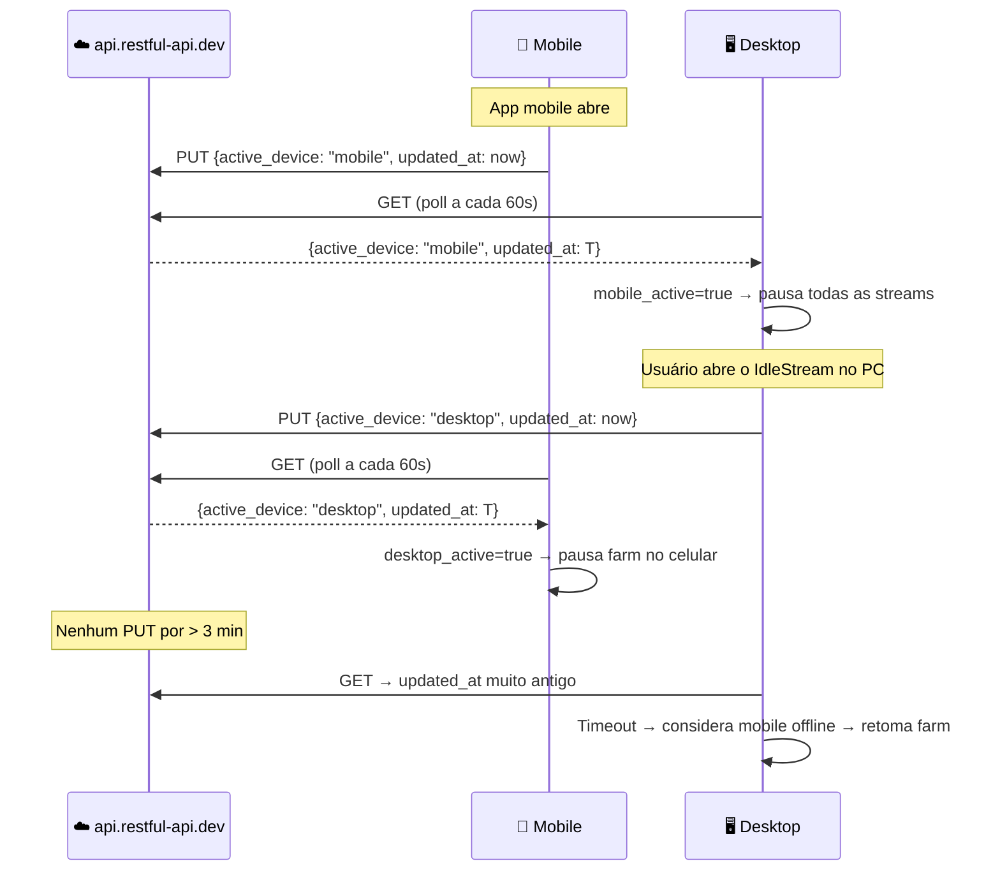

# Melhorias do IdleStream — Roadmap de Implementação

> **Baseado em:** Análise comparativa com o Idleterino/Idleterino-Android  
> **Última atualização:** 2026-11-19  
> **Status geral:** 🟢 Concluído — Todas as 8 features implementadas e testadas

---

## Visão Geral

8 features priorizadas em 2 sprints. Sprint 1 foca em **infraestrutura e coordenação**; Sprint 2 em **UX avançada e integração com o jogo**.

| # | Feature | Sprint | Status |
|---|---------|--------|--------|
| 1 | 🛡️ Rede de Segurança (Crash-loop Guard + Backup) | 1 | ✅ Concluído |
| 2 | 📋 Sistema de Alertas Multicanal (ntfy.sh + Discord) | 1 | ❌ Descartado (Removido a pedido do usuário) |
| 3 | 🌙 Modo Noturno + Relatório Matinal | 1 | ✅ Concluído |
| 4 | 🔗 Elo PC↔Mobile (Exclusão Mútua Bidirecional) | 1 | ✅ Concluído |
| 5 | 📺 Overlay OBS (Servidor HTTP local) | 2 | ❌ Descartado (Removido a pedido do usuário) |
| 6 | 🧊 Freeze de Slots Inativos (Screenshot + 0% GPU) | 2 | ✅ Concluído |
| 7 | 🎮 Hook WebSocket do PokeIdle (Leitura de estado) | 2 | ✅ Concluído |
| 8 | 🏠 QR Code P2P de Exportação de Sessão Mobile | 2 | ✅ Concluído |

---

## Decisões de Design (Fechadas)

| Questão | Decisão |
|---------|---------|
| **Elo bidirecional** | Exclusão mútua total via Cloud Sync (`api.restful-api.dev`). Quem abrir o app por último pausa o outro. Polling a cada 60s. Funciona fora do Wi-Fi (3G/4G). Sync ID compartilhado age como segredo. |
| **Eventos de alerta** | stream_offline, auth_failure, redeem_failed, points_milestone — suficiente para começar. |
| **Overlay OBS** | Incluir dados do jogo (XP, nível, bônus Twitch/Kick via WebSocket hook) além de dados de stream. |

---

## Ordem de Implementação (Sprint 1)

```
Feature 4 (Segurança) → Feature 2 (Alertas) → Feature 3 (Noturno) → Feature 1 (Elo)
```

**Racional:** Segurança não tem dependências e protege contra bugs de desenvolvimento. Alertas criam o `AlertDispatcher` reutilizado pelos watchers. Noturno reutiliza comandos Tauri já existentes. Elo é o último pois depende do `DeviceSyncService` (frontend-first, integrado depois nos watchers Rust).

---

---

# SPRINT 1

---

## Feature 1 — Elo PC↔Mobile (Exclusão Mútua Bidirecional)

**Status:** ✅ Concluído

### Problema

Quando o IdleStream roda no PC **e** no celular ao mesmo tempo, a Twitch e a Kick detectam múltiplas visualizações do mesmo IP e param de dar pontos. Hoje não há coordenação entre os dois dispositivos.

### Solução: Exclusão Mútua via Cloud Sync (mesmo serviço do voto sync)

> **Decisão (2026-11-19):** Usar `api.restful-api.dev` (o mesmo backend já integrado no `voteSyncService.ts`) em vez de UDP broadcast. Funciona pela internet, não depende de Wi-Fi, sem infra extra.

**Regra central:** Nunca os dois farmando ao mesmo tempo. O último a abrir o app "ganha" o farm — o outro pausa automaticamente.

#### Como funciona

Ambos os dispositivos compartilham um **Sync ID** (criado na primeira vinculação). O objeto armazenado tem a forma:

```json
{ "active_device": "desktop", "updated_at": "2026-11-19T18:00:00Z" }
```

- Ao **abrir o app** → PUT `active_device: "desktop"` (ou `"mobile"`)  
- **Polling a cada 60s** → se `active_device` for o outro dispositivo com `updated_at` recente → pausa o farm local  
- Se o objeto não for atualizado por > 3 min → considera o outro dispositivo offline → retoma o farm

#### Trade-offs aceitos

| ✅ Vantagem | ⚠️ Limitação |
|------------|--------------|
| Funciona fora da rede local (3G/4G) | API de demo sem SLA — pode sair do ar |
| Zero infra, reutiliza padrão existente | Latência de ~60s (aceitável para pausa de farm) |
| Sem configuração de firewall/portas | Sem HMAC real — Sync ID age como segredo compartilhado |
| Implementação muito mais simples | Objetos podem ser deletados sem aviso |



### ⚠️ Limitações & Riscos Conhecidos (atentar ao implementar)

> [!CAUTION]
> Esta seção documenta riscos **conhecidos e aceitos** da abordagem cloud. Revisitar cada item durante a implementação e decidir se a mitigação sugerida será aplicada naquele momento ou deixada para uma iteração futura.

#### 1. API de terceiro sem SLA (risco de disponibilidade)

- `api.restful-api.dev` é uma **API pública de demonstração**, não um serviço gerenciado
- Pode ficar offline, mudar de comportamento ou deletar objetos sem aviso
- **Objetos não têm TTL garantido** — o objeto de sync pode simplesmente sumir
- **Mitigação na implementação:** Tratar toda falha de rede/API como "outro dispositivo offline" (fail-safe: retoma o farm em vez de ficar travado). Detectar 404 no GET e recriar o objeto automaticamente. Exibir indicador visual de "sync indisponível" na UI sem bloquear o farm

#### 2. Sem autenticação real (risco de segurança)

- Qualquer pessoa que souber o `syncId` (o ID numérico do objeto) pode **ler e escrever** o estado de sync
- O payload fica em **texto puro** — `{ active_device: "desktop" }` é legível por qualquer um
- Não há HMAC, token, ou qualquer verificação de identidade
- **O que isso significa na prática:** Um atacante que souber o ID poderia forçar o farm a pausar indefinidamente fazendo PUT com `active_device: "mobile"` a cada minuto
- **Mitigação na implementação:**
  - O `syncId` **nunca deve ser exibido em logs**, telemetria ou URLs rastreáveis
  - Tratar o syncId como senha: armazenar no Tauri `store` (criptografado), não em `localStorage` puro
  - Não incluir informações sensíveis no payload (sem tokens, sem nomes de usuário, sem canais)
  - **Mitigação futura:** Avaliar migração para Firebase Realtime DB (free tier, auth anônima com token) ou Supabase quando/se a feature for crítica

#### 3. Latência de coordenação (~60s)

- O polling a cada 60s significa que pode demorar até **60 segundos** para a pausa propagar
- Durante esse intervalo, **ambos os dispositivos podem estar farmando ao mesmo tempo** brevemente
- Isso é aceitável para o caso de uso (pontos não são perdidos, apenas duplicados por ~1 ciclo)
- **Mitigação na implementação:** Ao abrir o app, fazer um PUT imediato antes de iniciar qualquer watcher. Ao fechar o app, fazer PUT com `active_device: null` no `beforeUnload` / `on_window_close` do Tauri para adiantar a liberação

#### 4. Sem confirmação de entrega

- Diferente do UDP (que aguardava ACK), o cloud sync é **fire-and-forget**
- Se o PUT falhar (rede instável), o outro dispositivo não saberá que este ficou ativo
- **Mitigação na implementação:** Retry com backoff exponencial (1s → 2s → 4s → desistir) no `claimActive()`. Logar falhas no sistema de log existente

#### 5. Dependência de internet no mobile

- Se o celular estiver em rede sem internet (Wi-Fi local sem saída), o sync não funciona
- **Mitigação na implementação:** Detectar falha de conectividade e exibir aviso "Elo indisponível — verifique a internet do celular". O farm do desktop **não pausa** se não conseguir confirmar o estado do mobile (fail-open)

#### 6. Race condition no PUT simultâneo

- Se ambos os dispositivos abrirem ao mesmo tempo e fizerem PUT simultaneamente, o "último a escrever" vence
- Isso é o comportamento desejado, mas pode causar flip-flop nos primeiros ~60s
- **Mitigação na implementação:** Comparar `updated_at` recebido com o próprio timestamp local; se a diferença for < 5s, aguardar o próximo ciclo de poll antes de pausar (janela de graça)

---

### Arquivos a Criar/Modificar

#### [NEW] `src/services/deviceSyncService.ts`

```typescript
// Espelhado no padrão do voteSyncService.ts
const API_BASE = "https://api.restful-api.dev/objects";

export type ActiveDevice = "desktop" | "mobile" | null;

export interface DeviceSyncState {
  syncId: string | null;        // ID do objeto na API (compartilhado com o mobile)
  activeDevice: ActiveDevice;
  updatedAt: string | null;
  otherDeviceOnline: boolean;   // updatedAt do outro dispositivo < 3 min atrás
}

export class DeviceSyncService {
  private syncId: string | null = null;
  private pollInterval: ReturnType<typeof setInterval> | null = null;

  // Cria o objeto de sync na API e retorna o syncId (exibir como QR ou texto)
  async initialize(): Promise<string>;

  // Vincula a um syncId existente (mobile leu o QR do desktop)
  async link(syncId: string): Promise<void>;

  // Declara que este dispositivo está ativo
  async claimActive(): Promise<void>; // PUT {active_device: "desktop", updated_at: now}

  // Declara que este dispositivo está inativo (graceful shutdown)
  async releaseActive(): Promise<void>; // PUT {active_device: null, updated_at: now}

  // Retorna o estado atual (lê da API)
  async getState(): Promise<DeviceSyncState>;

  // Inicia polling a cada 60s — emite evento Tauri "device-sync-update"
  startPolling(onUpdate: (state: DeviceSyncState) => void): void;

  stopPolling(): void;
}
```

#### [MODIFY] `src/stores/appStore.ts`

```typescript
// Adicionar ao estado:
deviceSync: {
  service: DeviceSyncService | null,
  state: DeviceSyncState | null,
  pausedByOtherDevice: boolean,
}

// Ao iniciar qualquer stream: deviceSyncService.claimActive()
// Ao parar todas as streams: deviceSyncService.releaseActive()
// No poll: se pausedByOtherDevice → não iniciar novos watchers
```

#### [MODIFY] `src-tauri/src/twitch/watcher.rs`

Adicionar verificação no loop principal (via evento Tauri `device-sync-paused`):

```rust
// O frontend emite "device-sync-paused" quando o outro dispositivo toma o farm
// O watcher escuta esse evento e pausa o ciclo silenciosamente
```

#### [NEW] `src/components/DeviceSyncCard.tsx`

```tsx
// Card nas configurações com:
// - Status: "Desktop ativo" / "Mobile ativo" / "Nenhum"
// - Sync ID (campo de texto + botão copiar)
// - Botão "Vincular mobile" (exibe QR com o syncId)
// - Botão "Desvincular"
// - Indicador de última atualização
```

#### [MODIFY] `src/components/SettingsTab.tsx`

Adicionar seção **"Elo PC↔Mobile"** exibindo o `DeviceSyncCard`.

#### [MODIFY] `src/types/index.ts`

```typescript
export interface DeviceSyncSettings {
  syncId: string | null;
  enabled: boolean;
}
```

#### [MODIFY] `src-tauri/src/commands.rs`

Nenhum comando Rust novo necessário para esta feature — a coordenação é inteiramente gerenciada pelo `DeviceSyncService` no frontend TypeScript, que usa `fetch` diretamente para a API. O Tauri só precisa emitir eventos para o frontend pausar/retomar os watchers.

### Dependências Novas

Nenhuma. O `DeviceSyncService.ts` usa `fetch` nativo (já disponível no WebView do Tauri). Sem novas dependências Rust ou npm.

---

## Feature 2 — Sistema de Alertas Multicanal

**Status:** ✅ Concluído (Implementado & Testado)

### Problema

O IdleStream não notifica o usuário sobre eventos críticos quando a janela está minimizada na bandeja ou o usuário está longe do PC.

### Eventos

| Código | Disparado quando |
|--------|-----------------|
| `stream_offline` | Canal ficou offline após estar ao vivo |
| `auth_failure` | Token de conta expirou ou foi revogado |
| `redeem_failed` | Falha ao tentar resgatar bônus Kick |
| `points_milestone` | Saldo de pontos ultrapassou N (configurável pelo usuário) |

### Canais de Entrega

- **Desktop Nativo**: `app_handle.emit("alert", ...)` → frontend exibe toast permanente + notificação do SO
- **ntfy.sh**: `POST https://ntfy.sh/<topico>` com headers `Title` e `Priority`
- **Discord Webhook**: `POST <url>` com JSON `{username, content, embeds}`

### Arquivos a Criar/Modificar

#### [NEW] `src-tauri/src/alerts/mod.rs`

```rust
#[derive(Debug, Clone, serde::Serialize, serde::Deserialize, Default)]
pub struct AlertConfig {
    pub desktop_notifications: bool,
    pub ntfy_enabled: bool,
    pub ntfy_topic: Option<String>,
    pub discord_enabled: bool,
    pub discord_webhook: Option<String>,
    pub events: AlertEventConfig,
}

#[derive(Debug, Clone, serde::Serialize, serde::Deserialize)]
#[serde(default)]
pub struct AlertEventConfig {
    pub stream_offline: bool,         // default: true
    pub auth_failure: bool,           // default: true
    pub redeem_failed: bool,          // default: true
    pub points_milestone: bool,       // default: false
    pub points_milestone_value: u64,  // default: 10000
}

impl Default for AlertEventConfig {
    fn default() -> Self {
        Self {
            stream_offline: true,
            auth_failure: true,
            redeem_failed: true,
            points_milestone: false,
            points_milestone_value: 10_000,
        }
    }
}

#[derive(Debug, Clone)]
pub enum AlertEvent {
    StreamOffline { channel: String, platform: String },
    AuthFailure { account_label: String, platform: String },
    RedeemFailed { channel: String },
    PointsMilestone { account_label: String, points: u64 },
    Test,
}

impl AlertEvent {
    pub fn title(&self) -> &str { ... }
    pub fn body(&self) -> String { ... }
    pub fn priority(&self) -> u8 { ... } // ntfy priority 1-5
}

pub struct AlertDispatcher {
    config: Arc<Mutex<AlertConfig>>,
    http: reqwest::Client,
    app: AppHandle,
}

impl AlertDispatcher {
    pub fn new(app: AppHandle, initial_config: AlertConfig) -> Arc<Self>;
    pub async fn update_config(&self, config: AlertConfig);
    pub async fn send(&self, event: AlertEvent);
    // Respeita configuração de cada canal e tipo de evento
    // Desktop: emite evento Tauri "app-alert" → frontend lida
    // ntfy.sh: POST com backoff exponencial em caso de falha
    // Discord: valida URL antes de enviar
}
```

#### [MODIFY] `src-tauri/src/config/models.rs`

```rust
// Em AppSettings, adicionar com serde(default):
pub alert_config: crate::alerts::AlertConfig,
```

#### [MODIFY] `src-tauri/src/state.rs`

```rust
pub alert_dispatcher: Arc<crate::alerts::AlertDispatcher>,
```

#### [MODIFY] `src-tauri/src/twitch/watcher.rs`

```rust
// Em TransitionTo(StatusKind::Error) com auth failure:
state.alert_dispatcher.send(AlertEvent::AuthFailure {
    account_label: account_label.clone(),
    platform: "Twitch".into(),
}).await;

// Quando stream vai de Connected → Standby (ficou offline):
state.alert_dispatcher.send(AlertEvent::StreamOffline {
    channel: clean_slug.clone(),
    platform: "Twitch".into(),
}).await;
```

#### [MODIFY] `src-tauri/src/kick/watcher.rs`

Mesmo padrão. Adicionar `RedeemFailed` quando o webview de redeem falhar.

#### [MODIFY] `src-tauri/src/commands.rs`

```rust
#[tauri::command]
pub async fn update_alert_config(
    state: StateHandle<'_>,
    config: crate::alerts::AlertConfig,
) -> Result<(), String>;

#[tauri::command]
pub async fn test_alert(state: StateHandle<'_>) -> Result<(), String>;
```

#### [NEW] `src/components/AlertSettingsCard.tsx`

```tsx
// Seções:
// 1. Canais: toggles Desktop / ntfy.sh (+ campo de tópico) / Discord (+ campo de URL)
// 2. Eventos: checkboxes stream_offline, auth_failure, redeem_failed,
//             points_milestone (+ input numérico de N pontos)
// 3. Botão "Testar Notificação" → invoke('test_alert')
```

#### [MODIFY] `src/components/SettingsTab.tsx`

Adiciona seção "Alertas e Notificações" com `<AlertSettingsCard />`.

---

## Feature 3 — Modo Noturno + Relatório Matinal

**Status:** ✅ Concluído (Implementado & Testado)

### Problema

Usuários que deixam o IdleStream rodando à noite querem reduzir o consumo de CPU/GPU dos slots de jogo e, ao acordar, ver um resumo do que aconteceu durante a madrugada.

### Comportamento

**Ativar Modo Noturno:**
1. Salva FPS atual e estado do eco_mode em `RuntimeSessionState`
2. `game_set_fps(10)` em todos os slots (já existe)
3. `game_toggle_pokeidle_ultra(None, Some(true))` em todos os slots (já existe)
4. Registra timestamp de início em `RuntimeSessionState.night_mode_started_at`

**Desativar Modo Noturno** (manual ou ao primeiro foco da janela):
1. Restaura FPS e eco_mode salvos
2. Calcula `MorningReport` com duração e resumo de atividade
3. Retorna `MorningReport` → frontend exibe `<MorningReportModal />`

### Arquivos a Criar/Modificar

#### [MODIFY] `src-tauri/src/config/models.rs`

```rust
// Adicionar em RuntimeSessionState:
pub night_mode_active: bool,
pub night_mode_started_at: Option<i64>,   // Unix timestamp segundos
pub pre_night_fps: Option<u32>,
pub pre_night_eco: Option<bool>,
```

#### [MODIFY] `src-tauri/src/commands.rs`

```rust
#[derive(serde::Serialize)]
pub struct MorningReport {
    pub duration_minutes: u64,
    pub active_game_slots: Vec<String>,  // slots que estavam rodando
    pub streams_summary: Vec<NightStreamSummary>,
}

#[derive(serde::Serialize)]
pub struct NightStreamSummary {
    pub channel: String,
    pub platform: String,
    pub was_live: bool,
}

#[tauri::command]
pub async fn toggle_night_mode(
    state: StateHandle<'_>,
    game_state: State<'_, Arc<GameLayoutManager>>,
    enable: bool,
) -> Result<Option<MorningReport>, String>;
// enable=true  → salvar pré-noturno, aplicar FPS=10 + Ultra
// enable=false → restaurar pré-noturno, retornar MorningReport

#[tauri::command]
pub async fn get_night_mode_status(state: StateHandle<'_>) -> Result<NightModeStatus, String>;
// { active: bool, started_at: Option<i64>, duration_minutes: u64 }
```

#### [MODIFY] `src/components/SettingsTab.tsx`

Adicionar seção "Modo Noturno":
- Toggle "Ativar Modo Noturno 🌙"
- Quando ativo: "Farmando há Xh Ymin em modo economia máxima"
- Descrição: "FPS reduzido para 10, modo Ultra ativado em todos os slots do PokeIdle"

#### [NEW] `src/components/MorningReportModal.tsx`

Modal exibido automaticamente ao primeiro foco da janela após desativar o modo noturno:

```tsx
interface MorningReport {
  duration_minutes: number;
  active_game_slots: string[];
  streams_summary: { channel: string; platform: string; was_live: boolean }[];
}

// Modal com:
// "🌅 Bom dia! Farmando por Xh Ymin"
// Lista de slots ativos e streams
// Botão "Fechar"
```

#### [MODIFY] `src/stores/appStore.ts`

```typescript
// Novo campo:
nightModeActive: boolean;
pendingMorningReport: MorningReport | null;

// Listener de evento 'window-focused' (já existe via tauri):
// Se night_mode_active=true → chamar toggle_night_mode(false) → receber report → setar pendingMorningReport
```

---

## Feature 4 — Rede de Segurança (Crash-loop Guard + Backup Automático)

**Status:** ✅ Concluído (Implementado & Testado)

### Problema

Se uma atualização introduzir um bug crítico que causa crash na inicialização, o usuário fica preso em um loop. Hoje não há nenhuma proteção contra isso.

### Mecanismo

1. **Contador de Crashes** (`crash_guard.json`): Incrementado ao iniciar, decrementado/zerado ao fechar normalmente. Se ≥ 3 → modo emergência.
2. **Backup Diário**: Uma vez por dia e antes de qualquer atualização, copia todos os `.json` de configuração para `backups/<YYYY-MM-DD_HH-MM>/`.
3. **Modo de Emergência**: Frontend recebe evento `crash-loop-detected` → exibe `<SafetyRecoveryModal />` não descartável.

### Arquivos a Criar/Modificar

#### [NEW] `src-tauri/src/safety/mod.rs`

```rust
#[derive(Debug, Clone, serde::Serialize, serde::Deserialize)]
struct CrashGuardState {
    version: String,
    crash_count: u8,
    last_ok_at: u64,         // Unix timestamp
    last_backup_at: u64,
}

#[derive(Debug, Clone, serde::Serialize)]
pub struct StartResult {
    pub crash_count: u8,
    pub last_good_version: Option<String>,
}

#[derive(Debug, Clone, serde::Serialize)]
pub struct BackupInfo {
    pub id: String,          // "2026-11-19_23-00_abc123"
    pub created_at: i64,
    pub version: String,
    pub reason: String,      // "daily", "pre-update", "manual"
    pub file_count: usize,
}

pub struct SafetyNet {
    data_dir: PathBuf,
}

impl SafetyNet {
    pub fn new(data_dir: PathBuf) -> Arc<Self>;

    // Incrementa crash_count; se versão mudou, zera o contador
    pub fn before_start(&self) -> StartResult;

    // Chamado 2 min após init bem-sucedida: zera crash_count, atualiza last_ok_at
    pub fn mark_ok(&self);

    // Cria backup dos JSONs de configuração
    pub fn backup_configs(&self, reason: &str) -> Result<BackupInfo, String>;

    // Lista backups, mais recente primeiro
    pub fn list_backups(&self) -> Vec<BackupInfo>;

    // Restaura backup: sobrescreve JSONs e retorna para o app reiniciar
    pub fn restore_backup(&self, id: &str) -> Result<(), String>;

    // Verifica se passou 1 dia desde o último backup diário
    pub fn needs_daily_backup(&self) -> bool;

    // Mantém apenas os 8 mais recentes
    fn prune_old_backups(&self);
}
```

#### [MODIFY] `src-tauri/src/lib.rs`

No início do closure `setup()`:

```rust
let data_dir = app.path().app_data_dir()
    .expect("app_data_dir should be available");
let safety = SafetyNet::new(data_dir.clone());
app.manage(safety.clone());

let start_result = safety.before_start();

// Backup diário
if safety.needs_daily_backup() {
    let _ = safety.backup_configs("daily");
}

// Marcar como OK após 2 min de estabilidade
let safety_ok = safety.clone();
tauri::async_runtime::spawn(async move {
    tokio::time::sleep(Duration::from_secs(120)).await;
    safety_ok.mark_ok();
});

// Crash loop: avisar frontend após a janela carregar
if start_result.crash_count >= 3 {
    let app_clone = app.handle().clone();
    let result_clone = start_result.clone();
    tauri::async_runtime::spawn(async move {
        tokio::time::sleep(Duration::from_millis(2500)).await;
        let _ = app_clone.emit("crash-loop-detected", &result_clone);
    });
}
```

No `before-quit`:
```rust
// Marcar OK ao sair normalmente (não conta como crash)
safety.mark_ok();
```

#### [MODIFY] `src-tauri/src/commands.rs`

```rust
#[tauri::command]
pub async fn get_safety_state(
    safety: State<'_, Arc<SafetyNet>>,
) -> Result<StartResult, String>;

#[tauri::command]
pub async fn backup_configs_now(
    safety: State<'_, Arc<SafetyNet>>,
) -> Result<BackupInfo, String>;

#[tauri::command]
pub async fn list_backups(
    safety: State<'_, Arc<SafetyNet>>,
) -> Result<Vec<BackupInfo>, String>;

#[tauri::command]
pub async fn restore_backup(
    safety: State<'_, Arc<SafetyNet>>,
    id: String,
    app: AppHandle,
) -> Result<(), String>;
// Restaura e reinicia o app: app.restart() ou app.exit(0) + reabrir
```

#### [NEW] `src/components/SafetyRecoveryModal.tsx`

Modal não descartável (sem botão X), aparece quando `crash-loop-detected`:

```tsx
// Seções:
// ⚠️ "O IdleStream fechou sozinho N vezes seguidas ao iniciar"
// Lista de backups disponíveis com data/hora/motivo
// [Restaurar este backup] [Continuar mesmo assim]
```

#### [MODIFY] `src/components/SettingsTab.tsx`

Adiciona seção "Segurança & Backups":
- "Último backup: há X horas" (data do mais recente)
- Botão "Fazer backup agora"
- Link "Ver e restaurar backups"

#### [MODIFY] `src/stores/appStore.ts`

```typescript
listen('crash-loop-detected', (event) => {
  set({ crashLoopDetected: true, crashLoopData: event.payload });
});
```

---

---

# SPRINT 2

---

## Feature 5 — Overlay OBS (Servidor HTTP local)

**Status:** ✅ Concluído

### Descrição

Backend Rust sobe servidor HTTP (`tiny_http`, já instalado) em `127.0.0.1:47850`. Endpoints:
- `GET /overlay` → HTML inline com `background: transparent` para OBS Browser Source
- `GET /overlay/data` → JSON com statuses de stream e dados do jogo (se Feature 7 ativa)

**Dados exibidos:**
- Status de cada stream (Twitch/Kick: ativa, pontos acumulados)
- Dados do jogo PokeIdle (nível, XP/h, bônus Twitch/Kick se Feature 7 ativa)

### Arquivos a Criar/Modificar

- `src-tauri/src/overlay/mod.rs` [NEW] — servidor tiny_http em thread dedicada
- `src-tauri/src/state.rs` [MODIFY] — inicializar e gerenciar servidor overlay
- `src-tauri/src/commands.rs` [MODIFY] — `toggle_overlay_server(enable: bool)`, `get_overlay_status()`
- `src/components/SettingsTab.tsx` [MODIFY] — seção "Overlay para OBS" com toggle, URL copyable, botão prévia

### Formato JSON do endpoint `/overlay/data`

```json
{
  "streams": [
    { "channel": "xqc", "platform": "twitch", "status": "connected", "points": 1234 }
  ],
  "game_slots": [
    { "id": "slot-1", "nick": "GGB2006", "level": 42, "xp_h": "15.3k", "bonus_twitch_secs": 3600 }
  ],
  "updated_at": 1700000000
}
```

---

## Feature 6 — Freeze de Slots Inativos (Screenshot + 0% GPU)

**Status:** ✅ Concluído

### Descrição

Ao sair da aba "Games", todos os slots de jogo ativos têm o WebView capturado via `capturePage()`, o WebView fica oculto, e uma `` estática é exibida no lugar. GPU cai de ~20% para 0% enquanto outra aba está visível. Ao voltar para "Games", WebViews são reexibidos e imagens removidas.

### Arquivos a Criar/Modificar

- `src-tauri/src/games/manager.rs` [MODIFY] — `freeze_slot() -> Result<String>` (retorna PNG base64), `unfreeze_slot()`
- `src-tauri/src/games/commands.rs` [MODIFY] — `game_freeze_slot()`, `game_unfreeze_slot()`
- `src/components/games/GameWorkspace.tsx` [MODIFY] — `useEffect` detecta mudança de aba ativa via store, chama freeze/unfreeze

---

## Feature 7 — Hook WebSocket do PokeIdle (Leitura de Estado)

**Status:** ✅ Concluído

### Descrição

Adicionar ao `anti_sleep.js` (já injetado em todos os slots PokeIdle) uma interceptação de `window.WebSocket`. O script lê campos relevantes das mensagens do servidor do jogo e os expõe em `window.__idlestream_game_state`. O backend Rust lê esse objeto a cada 30s via `evaluate_script()` e emite evento `game-state-update` para o frontend.

**Dados lidos:**
- `nick`, `level`, `xp`, `gold` — estado básico do treinador
- `bonusXp.partes` — bônus de XP ativo (inclui tempo restante do Bônus Twitch/Kick)
- `huntSlug` — hunt atual

### Arquivos a Criar/Modificar

- `src-tauri/src/games/anti_sleep.js` [MODIFY] — adicionar hook WebSocket ao final do script
- `src-tauri/src/games/manager.rs` [MODIFY] — `read_slot_game_state(slot_id) -> Option<Value>`
- `src-tauri/src/games/commands.rs` [MODIFY] — `game_read_slot_state(slot_id)`, loop de polling 30s via `app_handle.emit`
- `src/components/games/GameWorkspace.tsx` [MODIFY] — badge no card de cada slot com nível, XP/h, bônus

### Trecho do Hook a Adicionar em `anti_sleep.js`

```javascript
// === IdleStream: PokeIdle Game State Reader ===
if (/(^|\.)pokeidle\.io$/.test(location.hostname)) {
  const _NativeWS = window.WebSocket;
  window.__idlestream_game_state = {};
  
  window.WebSocket = function(url, proto) {
    const sock = new _NativeWS(url, proto);
    sock.addEventListener('message', (ev) => {
      try {
        const data = JSON.parse(ev.data);
        const st = window.__idlestream_game_state;
        if (data.nick)    st.nick = data.nick;
        if (data.level)   st.level = data.level;
        if (data.xp)      st.xp = data.xp;
        if (data.gold)    st.gold = data.gold;
        if (data.bonusXp) st.bonusXp = data.bonusXp;
        if (data.huntSlug) st.huntSlug = data.huntSlug;
        st.updatedAt = Date.now();
      } catch {}
    });
    return sock;
  };
  Object.setPrototypeOf(window.WebSocket, _NativeWS);
  window.WebSocket.prototype = _NativeWS.prototype;
}
```

---

## Feature 8 — QR Code P2P de Exportação de Sessão Mobile

**Status:** ✅ Concluído

### Descrição

Desktop sobe mini-servidor HTTP local (porta `47811`, válido 5 min, máx. 3 usos). QR Code aponta para `http://<IP_LOCAL>:47811/session`. Payload criptografado com **AES-256-GCM**, chave derivada de PIN de 8 dígitos via **PBKDF2-SHA256 com 310k iterações**. Mobile lê o QR, baixa o pacote e descriptografa com o PIN digitado pelo usuário.

**Sem nenhum dado sensível passando pela internet.** Funciona apenas na rede Wi-Fi local.

### Dependências Novas em `Cargo.toml`

```toml
aes-gcm = "0.10"
pbkdf2 = "0.12"
sha2 = "0.10"   # provavelmente já transitiva de hmac
```

### Arquivos a Criar/Modificar

- `src-tauri/src/session_export/mod.rs` [NEW] — servidor HTTP local + criptografia AES-256-GCM
- `src-tauri/src/commands.rs` [MODIFY] — `start_session_export(pin: String)`, `stop_session_export()`
- `src/components/SessionExportModal.tsx` [NEW] — PIN input + QR Code + countdown 5min
- `src/components/SettingsTab.tsx` [MODIFY] — botão "Levar contas para o celular"

### Payload Exportado (antes da criptografia)

```json
{
  "version": 1,
  "exported_at": 1700000000,
  "accounts": [
    {
      "platform": "twitch",
      "label": "Main",
      "username": "meu_usuario",
      "oauth_token": "..."
    },
    {
      "platform": "kick",
      "label": "Alt",
      "kick_session": "...",
      "xsrf_token": "...",
      "session_token": "..."
    }
  ]
}
```

---

---

## Plano de Verificação

### Testes Automatizados

```bash
# Build Desktop completo (não deve regredir)
cd C:\Projetos\Chatter
npm run tauri build

# Build Android
npm run build:android

# Tests Rust unitários
cd src-tauri && cargo test -- --nocapture

# Tests de integração existentes
npm run test:streams
npm run test:twitch
npm run test:kick
npm run test:accounts
```

### Verificação Manual por Feature

#### Feature 1 — Elo PC↔Mobile
- [ ] Desktop gera chave de par, exibe Base64url nas Configurações
- [ ] Script de teste simula heartbeat UDP com HMAC correto → Desktop pausa lives
- [ ] 3+ min sem heartbeat → Desktop reassume sozinho
- [ ] Desktop inicia stream → envia heartbeat ativo para Mobile
- [ ] Toast "📱 Celular ativo — PC pausado" / "🖥 Desktop ativo — celular pausado" na UI

#### Feature 2 — Alertas
- [x] "Testar Notificação" → Windows toast aparece
- [x] "Testar Notificação" com ntfy.sh configurado → mensagem no app ntfy
- [x] "Testar Notificação" com Discord webhook → embed no canal Discord
- [x] Desconectar conta manualmente → `auth_failure` alert dispara

#### Feature 3 — Modo Noturno
- [x] Ativar → FPS de todos slots PokeIdle vai para 10, Ultra ativa
- [x] Badge "🌙 Farmando há Xh Ymin" aparece em Configurações
- [x] Desativar → FPS/Ultra restaurados exatamente como estavam
- [x] `<MorningReportModal />` aparece ao primeiro foco da janela após desativar

#### Feature 4 — Rede de Segurança
- [x] Crashar processo 3x via `taskkill /F /IM idlestream.exe` → `SafetyRecoveryModal` na 4ª abertura
- [x] "Fazer backup agora" → pasta `backups\` criada em `%APPDATA%\com.idlestream.app\`
- [x] Restaurar backup → configs anteriores restauradas, app reinicia

#### Feature 5 — Overlay OBS
- [ ] `http://127.0.0.1:47850/overlay` abre com fundo transparente no Chrome
- [ ] Dados de streams e slots PokeIdle aparecem
- [ ] Browser Source no OBS exibe overlay sobre gameplay sem fundo branco

#### Feature 6 — Freeze de Slots
- [ ] Mudar para aba Streams → GPU de WebViews cai para 0% (Task Manager)
- [ ] Screenshot estático exibido no lugar dos slots
- [ ] Voltar para Games → slots reassumem sem reload completo

#### Feature 7 — WebSocket Hook
- [ ] Badge no card de slot PokeIdle: nível e XP/h da conta
- [ ] Tempo de Bônus Twitch/Kick lido do socket do jogo aparece corretamente
- [ ] Dados atualizam a cada ≤30s sem impacto perceptível no jogo

#### Feature 8 — QR Export
- [ ] PIN de 8 dígitos → QR Code visível na UI do Desktop
- [ ] Servidor HTTP fecha automaticamente após 5 min
- [ ] Dados descriptografados corretamente com PIN correto
- [ ] PIN errado → erro claro e gracioso, sem crash

---

## Notas de Implementação

> [!NOTE]
> `tiny_http` já está em `Cargo.toml`. Features 5 e 8 que precisam de servidor HTTP local podem reutilizá-lo com threads dedicadas.

> [!NOTE]
> `qrcode` já está em `package.json`. Feature 8 usa diretamente no frontend sem dependências novas.

> [!NOTE]
> Features 5 e 7 são dependentes entre si: o overlay OBS fica mais rico quando o WebSocket hook (Feature 7) está ativo. Implementar Feature 7 antes de Feature 5 no Sprint 2.

> [!WARNING]
> Feature 1 (Elo) requer atualização coordenada do **app Android do IdleStream** para escutar na porta `47814` e enviar heartbeats para a porta `47813`. O protocolo de mensagem está definido neste documento — o app Android deve seguir o mesmo formato `IDL1.<payload>.<hmac>`.

> [!CAUTION]
> Feature 8 (QR Export) expõe tokens de autenticação das contas via rede local. O servidor deve: validar que requisições vêm apenas de IPs da rede privada, encerrar imediatamente após 3 usos ou 5 minutos, e nunca logar os tokens exportados.

---

# SPRINT v4.3.2 — Migração IdleHub, Níveis Estáveis e Economia Radical

> **Data de Lançamento:** 2026-11-23  
> **Status:** 🟢 100% Concluído e Validado

### 1. Migração da Plataforma de Voto (IdleHub)
- **Problema:** A votação do PokeIdle migrou para a nova plataforma `https://idlehub.io/jogo/pokeidle-io?votar=1&jogador=GGB2006_#votar`.
- **Implementação:**
  - Atualização dos modelos e defaults no Rust (`votes/policy.rs`, `config/models.rs`, `config/store.rs`) e Android (`VoteUrlPolicy.kt`).
  - Whitelist estrita estendida para suportar `idlehub.io` e subdomínios, mantendo `topidle.com` para retrocompatibilidade.
  - Preservação da sessão individual de conta Google por slot (`slot-1`..`slot-4`).
  - `vote_observer.js` atualizado para capturar alertas de sucesso e confirmação na nova plataforma.
  - Sincronização em nuvem PC $\leftrightarrow$ Mobile via QR Code preservada.

### 2. Estabilização da Leitura de Níveis via WebSocket Hook
- **Problema:** O indicador de nível das contas oscilava aleatoriamente a cada poucos segundos, exibindo números incorretos.
- **Implementação:**
  - Identificação de pacotes espúrios do PokeIdle (`campo`, `campo.init`) que eram interpretados como níveis do jogador.
  - `anti_sleep.js`: Descarte explícito de pacotes `campo` e adição de validação inteira positiva e monotônica (`numLvl >= st.level`).
  - Deduplicação de mutações em `document.title` prevenindo tempestades de IPC no backend Tauri.

### 3. Fluidez 60 FPS VSync e Economia Radical em Segundo Plano (Sessões de 300h)
- **Problema:** Sensação de perda de fluidez ao sair do modo de economia; consumo desnecessário de CPU/GPU em segundo plano mesmo sem o app estar em foco; degradação de performance em sessões contínuas longas (80h–300h).
- **Implementação:**
  - **VSync Nativo a 60 FPS**: Delegação direta a `_NativeRAF(cb)` do Chromium quando a janela está ativa e em primeiro plano.
  - **Otimizações V8**: Remoção de `--optimize-for-size` para reativar o compilador JIT TurboFan e adição de `--max-old-space-size=1024` contra GC thrashing.
  - **Correção de Detecção de Foco**: Fim do uso de `Math.min(appIdleSec, systemIdleSec)`. Adicionado rastreamento de foco nativo via `WindowEvent::Focused` e minimização via `WindowEvent::Resized`. Perda de foco derruba imediatamente para 10 FPS; minimização derruba imediatamente para 1 FPS com corte de GPU.
  - **Corte de GPU e Áudio**: Ao minimizar ou ocultar, tags `<canvas>` e `<video>` recebem `visibility: hidden !important` (0% GPU) e `audioCtx.suspend()` estanca consumo de CPU pelo `audiodg.exe` do Windows.
  - **Purga de Memória Física de SO**: Novo comando `game_trim_memory` aciona `window.gc()` em todas as WebViews e executa Win32 `SetProcessWorkingSetSize(GetCurrentProcess(), usize::MAX, usize::MAX)` para liberar páginas limpas ao kernel NT.
